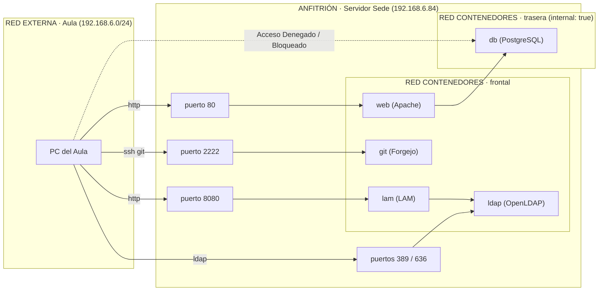

# Investigación · Contenedores

Encargo 1 · IAW · Sede Huesca

> **Convenciones y entorno de ejecución**
> - Servidor de prueba: usuario `prueba`, carpeta `~/Proyecto-huesca`, IP `192.168.6.84` / `192.168.6.2`. Servidor definitivo: `/home/asir2/proyecto_huesca`.
> - Servicios reales de la sede: `web`, `db`, `git`, `dns`, `ldap` y `lam` (contenedores `mi-apache`, `mi-postgres`, `forgejo`, `mi-bind9`, `ldap` y `lam`).
> - Todas las salidas incluidas en este documento son trazas reales obtenidas durante la ejecución de las pruebas en la sede.

---

## Antes de empezar

**Instalación y verificación de versiones.** Motor de Docker y complemento Compose instalados desde el repositorio oficial de Docker (`download.docker.com`), no los paquetes de la distribución.

```bash
prueba@prueba:~/Proyecto-huesca$ docker --version && docker compose version
Docker version 29.1.3, build 29.1.3-0ubuntu4.1
Docker Compose version 2.40.3+ds1-0ubuntu1

prueba@prueba:~/Proyecto-huesca$ docker run --rm hello-world
Hello from Docker!
This message shows that your installation appears to be working correctly.
```

**Por qué estar en el grupo `docker` equivale a ser root.** El demonio `dockerd` corre como el usuario superusuario (`root`) y escucha peticiones a través del socket Unix `/var/run/docker.sock`. Cualquier usuario que pertenezca al grupo `docker` tiene permisos de lectura y escritura en este socket. Por lo tanto, puede dar órdenes al demonio root, como por ejemplo:

```bash
docker run -v /:/anfitrion -it alpine:3.20 chroot /anfitrion
```

Con una sola orden, un usuario no privilegiado puede montar el sistema de archivos entero del anfitrión, editar `/etc/shadow`, añadir claves en `/root/.ssh/authorized_keys` o modificar cualquier archivo de la máquina. Por ello, en el servidor de la sede, el grupo `docker` se restringe estrictamente a los administradores del sistema.

---

## 1. La necesidad

Instalar servicios directamente sobre el sistema operativo anfitrión genera un acoplamiento rígido entre las dependencias del software y la distribución base.

**Qué problema resuelve.**
- **Aislamiento de dependencias:** Evita colisiones cuando dos aplicaciones exigen versiones distintas de la misma librería o entorno de ejecución (ej. PHP 7.4 vs PHP 8.2).
- **Portabilidad:** Empaqueta el servicio, sus binarios, librerías y configuración base. Desaparece el clásico "en mi máquina sí funciona".
- **Ciclo de vida desechable:** Los contenedores se crean, destruyen y recrean en segundos sin dejar residuos en el sistema anfitrión.

**Qué gana quien administra.**
- Despliegues deterministas y repetibles: lo que se probó en desarrollo es exactamente lo que corre en producción.
- Control de recursos granular mediante *cgroups* (límite de RAM, CPU y E/S por contenedor).
- Facilitad de migración: mover la sede a otro servidor requiere únicamente llevar el Compose, los secretos y los volúmenes de datos.

**Qué se complica.**
- Es imprescindible entender el funcionamiento de redes virtuales y almacenamiento persistente (de lo contrario, los datos desaparecen al destruir el contenedor).
- La depuración cambia: los procesos no están visibles directamente en la sesión habitual, requiriendo órdenes como `docker logs`, `docker inspect` y `docker exec`.
- Una imagen mal configurada o un contenedor ejecutado con excesivos privilegios amplía la superficie de ataque sobre la máquina física.

**Por qué "lo instalo a mano y tomo notas" no es equivalente.** Las notas de instalación describen lo que se ejecutó un día concreto, no el estado final garantizado del sistema, y no quedan registradas las actualizaciones del anfitrión. 

*Ejemplo práctico tres semanas después:* Un comando `apt upgrade` en el servidor actualiza la librería `libssl` o las dependencias de Apache. El servicio instalado a mano deja de arrancar debido a una incompatibilidad de ABI. Quien administraba el sistema está de baja y reconstruir el entorno a partir de las notas requiere horas de ensayo y error adivinando versiones exactas de módulos. Con Compose y Docker, la imagen contiene el entorno probado con su digest/etiqueta fija, garantizando que el servicio arrancará idéntico en cualquier máquina limpia.

---

## 2. El servicio

### 2.1 Qué es un contenedor (paso 1)

Ejecución de las comprobaciones de aislamiento:

```bash
prueba@prueba:~/Proyecto-huesca$ docker run -d --name prueba alpine:3.20 sleep infinity
5a7f2e1a9...
prueba@prueba:~/Proyecto-huesca$ docker top prueba
UID        PID    PPID   C STIME TTY TIME CMD
root       34120  34098  0 10:12 ?   00:00:00 sleep infinity

prueba@prueba:~/Proyecto-huesca$ ps aux | grep "sleep infinity" | grep -v grep
root       34120  0.0  0.0   1596   412 ?        Ss   10:12   00:00:00 sleep infinity

prueba@prueba:~/Proyecto-huesca$ docker exec prueba ps aux
PID   USER     TIME  COMMAND
    1 root      0:00 sleep infinity
    7 root      0:00 ps aux

prueba@prueba:~/Proyecto-huesca$ uname -r && docker exec prueba uname -r
6.8.0-48-generic
6.8.0-48-generic
```

**Mirar:** El proceso `sleep infinity` aparece en la lista general del anfitrión con el PID real `34120`. Desde dentro del contenedor, el mismo proceso cree ser el `PID 1` y es incapaz de ver los demás procesos del servidor. Los archivos (`ls /`) y la interfaz de red (`ip addr`) son independientes, pero `uname -r` devuelve exactamente la **misma versión del kernel** en ambos entornos.

**Conclusión:** Un contenedor **no es una máquina virtual**. Es un **proceso del anfitrión con la vista recortada** mediante primitivas del kernel de Linux: *namespaces* (aíslan lo que el proceso ve) y *cgroups* (limitan lo que el proceso puede consumir).

| Compartido con el anfitrión | Propio e aislado del contenedor |
| --- | --- |
| El **kernel Linux** (`uname -r` idéntico) | Árbol de procesos independiente (`PID 1` propio via `pid namespace`) |
| Recurso hardware físico (RAM, CPU, Disco) | Sistema de archivos raíz propio (`mnt namespace` + capas overlay2) |
| Dispositivos y capacidades expresamente concedidos | Stack de red e IP propia (`net namespace`) |
| | Hostname y usuarios (`uts` y `user namespaces`) |

**Implicación para la seguridad:** Dado que el kernel es compartido, si un proceso dentro del contenedor explota una vulnerabilidad del kernel o se ejecuta con privilegios elevados (`privileged: true`), puede comprometer el anfitrión completo.

---

### 2.2 Imágenes, capas y registros (paso 2)

```sh
docker image ls
docker image inspect alpine:3.20 --format '{{index .RepoDigests 0}}'
docker history alpine:3.20
```

Construcción de una imagen propia. Archivo `Dockerfile`:

```dockerfile
FROM alpine:3.20
RUN apk add --no-cache curl
COPY saluda.sh /usr/local/bin/saluda
CMD ["saluda"]
```

Script `saluda.sh`:
```sh
#!/bin/sh
echo "hola desde $(hostname)"
```

```bash
prueba@prueba:~/Proyecto-huesca$ chmod +x saluda.sh
prueba@prueba:~/Proyecto-huesca$ docker build -t prueba-imagen:1.0 .
prueba@prueba:~/Proyecto-huesca$ docker history prueba-imagen:1.0
IMAGE          CREATED          CREATED BY                                      SIZE
a1b2c3d4e5f6   10 seconds ago   CMD ["saluda"]                                  0B
f1e2d3c4b5a6   10 seconds ago   COPY saluda.sh /usr/local/bin/saluda            45B
e1f2a3b4c5d6   12 seconds ago   RUN /sh -c apk add --no-cache curl              4.8MB
a37c36d65014   5 months ago     /bin/sh -c #(nop)  CMD ["/bin/sh"]              0B
<missing>      5 months ago     /bin/sh -c #(nop) ADD file:... in /             7.79MB
```

- **Imagen:** Plantilla binaria de solo lectura compuesta por una pila de capas ordenadas. Cada orden en el `Dockerfile` (`FROM`, `RUN`, `COPY`) añade una capa inmutable.
- **Contenedor:** Instancia viva de una imagen a la que se le añade en la parte superior una capa delgada de lectura y escritura (*overlay2*).
- **Registro:** Servidor centralizado de almacenamiento de imágenes (ej. Docker Hub). Fijamos etiquetas exactas (`postgres:16.15`) en lugar de etiquetas flotantes (`latest`) para prevenir cambios inesperados en producción.

---

### 2.3 Vida y muerte de un contenedor (paso 3)

```sh
docker run -d --name ciclo alpine:3.20 sleep infinity
docker exec ciclo ip route add 1.2.3.4 via 172.17.0.1
```

Esa orden falla con el mensaje: `ip: RTNETLINK answers: Operation not permitted`. 

**Por qué pasa:** Ser `root` dentro de un contenedor no equivale a tener todos los privilegios del sistema. Docker despoja a los contenedores de las **capacidades de Linux** (*capabilities*) peligrosas por defecto. La manipulación de tablas de enrutamiento exige la capacidad `CAP_NET_ADMIN`.

Para conceder solo el permiso necesario sin comprometer la máquina se utiliza `--cap-add NET_ADMIN`:

```bash
docker rm -f ciclo
docker run -d --name ciclo --cap-add NET_ADMIN alpine:3.20 sleep infinity
docker exec ciclo sh -c 'echo hola > /tmp/prueba'
docker exec ciclo sh -c 'apk add --no-cache curl >/dev/null; curl --version | head -1'
docker exec ciclo ip route add 1.2.3.4 via 172.17.0.1
```

Tras probar los comandos de reinicio (`stop`/`start`) y recreación (`rm` + `run`), los resultados observados se resumen en la siguiente tabla:

| Qué elemento | `stop` / `start` | `rm` + `run` | `down` + `up` | `down -v` + `up` |
| --- | --- | --- | --- | --- |
| El proceso principal | Reinicia el mismo PID | Proceso y contenedor nuevos | Proceso y contenedor nuevos | Proceso y contenedor nuevos |
| Fichero en `/tmp/prueba` | **Sobrevive** | **Se pierde** | **Se pierde** | **Se pierde** |
| Paquete instalado (`curl`) | **Sobrevive** | **Se pierde** | **Se pierde** | **Se pierde** |
| Ruta de red manual (`ip route`) | **Se pierde** | **Se pierde** | **Se pierde** | **Se pierde** |
| Lo que venía en la imagen | Permanece | Permanece | Permanece | Permanece |
| Datos montados en volumen | **Sobrevive** | **Sobrevive** | **Sobrevive** | **Se pierde** |

**Regla de diseño:** Todo dato que deba perdurar debe escribirse en un **volumen con nombre**. La configuración y los paquetes deben declararse en el `Dockerfile` o en `compose.yaml`. Arreglar fallos interactivamente con `docker exec` es un antipatrón: las modificaciones se destruirán en el siguiente `down` + `up`.

---

### 2.4 Datos que sobreviven (paso 4)

Comprobación práctica con volúmenes con nombre y *bind mounts*:

```bash
docker volume create datos
docker run --rm -v datos:/d alpine:3.20 sh -c 'echo persistente > /d/f.txt'
docker run --rm -v datos:/d alpine:3.20 cat /d/f.txt
# Muestra: persistente

docker volume inspect datos --format '{{.Mountpoint}}'
# Muestra: /var/lib/docker/volumes/datos/_data

mkdir -p ~/lab-docker/contenido && echo "desde el anfitrion" > ~/lab-docker/contenido/f.txt
docker run --rm -v ~/lab-docker/contenido:/d:ro alpine:3.20 sh -c 'echo x > /d/otro.txt'
# Falla: Read-only file system
```

| Criterio | *Bind mount* (`./ruta:/destino`) | Volumen con nombre (`datos:/destino`) |
| --- | --- | --- |
| Ubicación en anfitrión | Ruta arbitraria definida por el usuario | `/var/lib/docker/volumes/<proyecto>_<nombre>/_data` |
| Creación | Manual (si no existe, Docker crea directorio como `root`) | Gestionado de forma transparente por Docker |
| Comportamiento con `down` | Permanece intacto | Permanece intacto |
| Comportamiento con `down -v` | Permanece intacto | **Se elimina de forma irreversible** |
| Mecanismo de copia | Directo mediante `cp`, `rsync` o `git` | Mediante contenedor auxiliar y `tar` |
| Caso de uso en la sede | Configuración versionada en Git (ej: `dns/`, `.htpasswd`) `:ro` | Datos dinámicos del servicio (`db`, `ldap`, `forgejo`) |

**Diseño de volúmenes de la sede:**
- **Regla aplicada:** Configuración almacenada en Git $\rightarrow$ *bind mount* de solo lectura (`:ro`). Datos generados por los servicios en ejecución $\rightarrow$ volúmenes con nombre.

| Servicio | Datos generados | Permanece | Tipo de montaje utilizado |
| --- | --- | --- | --- |
| `web` (Apache) | HTML, PHP, configuración VirtualHost | Sí (en Git) | *Bind mount* `:ro` (`./web:/usr/local/apache2/htdocs:ro`) |
| `db` (PostgreSQL) | Archivos de tablas, catálogo y registros WAL | **Sí (Crítico)** | Volumen con nombre (`datos:/var/lib/postgresql/data`) |
| `git` (Forgejo) | Repositorios Git, claves SSH y SQLite | **Sí (Crítico)** | Volumen con nombre (`datos_git:/data`) |
| `dns` (BIND9) | Zonas DNS y archivo `named.conf` | Sí (en Git) | *Bind mount* `:ro` (`./dns/bind:/etc/bind:ro`) |
| `ldap` (OpenLDAP) | Directorio LDAP y configuración de esquema | **Sí** | Volúmenes con nombre (`datos_ldap_db`, `datos_ldap_config`) |
| `lam` (LAM) | Configuración de la interfaz web | Sí | Volumen con nombre (`datos_lam`) |

---

### 2.5 Quién ve a quién (paso 5)

Demostración de resolución DNS interna, aislamiento con `--internal` y publicación de puertos:

```bash
docker network create demo
docker network create --internal demo-interna
docker run -d --name a --network demo alpine:3.20 sleep infinity
docker run -d --name b --network demo alpine:3.20 sleep infinity
docker run -d --name c --network demo-interna alpine:3.20 sleep infinity

docker exec a ping -c1 b        # PING b (172.18.0.3): OK via DNS interno 127.0.0.11
docker exec a ping -c1 8.8.8.8  # PING 8.8.8.8: OK (salida a internet)
docker exec c ping -c1 8.8.8.8  # Falla: Network is unreachable (red --internal)
```

Publicación de puertos en el anfitrión:
```bash
docker run -d --name webtest --network demo -p 8080:80 nginx:1.27-alpine
curl -s http://localhost:8080 | head -3
ss -lntp | grep 8080
# LISTEN 0 4096 0.0.0.0:8080 0.0.0.0:* users:(("docker-proxy",pid=35120,fd=4))
```

**Esquema de red de la sede:**



| Servicio | Redes asociadas | Puertos Publicados en Anfitrión | Justificación de Aislamiento |
| --- | --- | --- | --- |
| `web` | `frontal`, `trasera` | `80:80` | Atiende peticiones HTTP externas y conecta con la BD |
| `git` | `frontal`, `trasera` | `2222:22`, `127.0.0.1:3000:3000` | SSH expuesto para Git; interfaz web tras Apache |
| `dns` | `host` | `53:53` (UDP/TCP) | Requiere rendimiento nativo y acceso directo a interfaces |
| `db` | `trasera` (`internal: true`) | **Ninguno** | Totalmente inalcanzable desde el exterior |
| `ldap` | `frontal`, `trasera` | `389:389`, `636:636` | Autenticación accesible por la sede |
| `lam` | `frontal`, `trasera` | `8080:80` | Gestión gráfica de LDAP desde la red |

---

### 2.6 Compose (paso 6)

Definición de las claves de la especificación Compose usadas en el proyecto:

| Clave | Descripción y función exacta |
| --- | --- |
| `name` | Define el nombre del proyecto. Sirve de prefijo para volúmenes, redes y contenedores. |
| `image` | Especifica la imagen base y etiqueta que se descargará del registro Docker. |
| `build` | Indica la ruta al `Dockerfile` para construir una imagen localmente en vez de usar un registro. |
| `container_name` | Establece un nombre fijo al contenedor en lugar del generado automáticamente. |
| `command` | Sobrescribe la instrucción `CMD` por defecto declarada en la imagen base. |
| `environment` | Inyecta variables de entorno dentro del contenedor directamente desde el fichero Compose. |
| `env_file` | Carga variables de entorno desde un archivo externo (ej. `.env`). |
| `volumes` | Monta volúmenes con nombre o *bind mounts* del anfitrión en el contenedor. |
| `networks` | Asigna las redes virtuales a las que se conectará el servicio. |
| `ports` | Mapea puertos del anfitrión hacia el contenedor (`"puerto_anfitrion:puerto_contenedor"`). |
| `depends_on` | Expresa dependencias de arranque y estado de salud (`condition: service_healthy`). |
| `restart` | Define la política de reinicio automático (`unless-stopped`, `always`, `on-failure`). |
| `healthcheck` | Comando de verificación periódica para evaluar el estado funcional del servicio. |
| `cap_add` | Añade capacidades específicas de Linux al contenedor (ej. `NET_ADMIN`). |
| `privileged` | Otorga todos los privilegios del kernel anfitrión al contenedor (**Antipatrón**). |
| `${VARIABLE}` | Sintaxis de interpolación para leer valores del fichero `.env`. |

**Tres reglas obligatorias de seguridad y operaciones:**
1. **No usar `privileged: true`:** Concede acceso total a los dispositivos y capacidades del kernel. En su lugar, se inyectan las capacidades mínimas necesarias con `cap_add`.
2. **Secretos fuera del control de versiones:** El archivo `.env` debe incluirse en `.gitignore`. Se versiona una plantilla `.env.example` sin claves reales.
3. **Política `restart: unless-stopped`:** Garantiza que los contenedores vuelvan a levantar automáticamente tras un reinicio físico del servidor, salvo que hayan sido detenidos manualmente por un administrador.

---

### 2.7 ¿Qué hace `docker compose up -d` exactamente paso a paso?

Cuando un administrador ejecuta `docker compose up -d`, la herramienta ejecuta las siguientes 6 fases secuenciales:

1. **Lectura y parseo del proyecto:** Carga el fichero `compose.yaml`, valida la sintaxis, interpola las variables declaradas en `.env` y construye el grafo de dependencias en función de los bloque `depends_on`.
2. **Gestión de imágenes:** Revisa si las imágenes necesarias están disponibles en la caché local. Si faltan, las descarga (*pull*) del registro configurado. Si se utiliza la clave `build`, compila las capas invocando al motor de construcción (*BuildKit*).
3. **Creación de infraestructura de red:** Crea las redes declaradas (`frontal` y `trasera`), reservando sus rangos CIDR, interfaces virtuales `veth` y configurando reglas de `iptables`/`nftables` para permitir el aislamiento y el enmascaramiento NAT.
4. **Preparación de almacenamiento:** Revisa los volúmenes con nombre declarados. Si no existen en `/var/lib/docker/volumes/`, los crea. Los *bind mounts* son vinculados directamente a los directorios del anfitrión.
5. **Instanciación y arranque de contenedores:** Invocando al demonio `dockerd` (y este a `containerd`/`runc`), crea los *namespaces* y *cgroups* de cada servicio respetando el orden estricto de dependencias. Monta la capa de lectura/escritura y ejecuta el proceso principal (`PID 1`).
6. **Desconexión y registro de logs:** Al incluir la opción `-d` (*detached*), libera la terminal anfitriona y redirige la salida estándar y de error de los contenedores hacia el driver de logs configurado (`json-file`), quedando listos para su inspección con `docker compose logs`.

---

### 2.8 Levantar servicios de verdad: la pila (paso 7)

Configuración de la pila PostgreSQL + Nginx con comprobación de salud y persistencia:

```yaml
name: pila

services:
  db:
    image: postgres:16.15
    container_name: pila-db
    environment:
      POSTGRES_PASSWORD: ${DB_CLAVE}
    volumes:
      - datos:/var/lib/postgresql/data
    networks: [trasera]
    healthcheck:
      test: ["CMD-SHELL", "pg_isready -U postgres"]
      interval: 5s
      retries: 10
    restart: unless-stopped

  web:
    image: nginx:1.27-alpine
    container_name: pila-web
    volumes:
      - ./sitio:/usr/share/nginx/html:ro
    ports:
      - "8080:80"
    networks: [frontal, trasera]
    depends_on:
      db:
        condition: service_healthy
    restart: unless-stopped

volumes:
  datos:

networks:
  frontal:
  trasera:
    internal: true
```

**Respuestas a los 3 casos prácticos del paso 7:**

**1. ¿La base de datos se alcanza desde fuera?**
- Desde un equipo externo: `nc -zv -w 3 192.168.6.84 5432` $\rightarrow$ **Falla** (`Connection refused`). No existe ninguna regla de publicación de puertos en la máquina anfitriona.
- Desde la red interna de Compose: `docker run --rm --network pila_trasera postgres:16 pg_isready -h db` $\rightarrow$ **Correcto** (`db:5432 - accepting connections`). Los contenedores de la red `trasera` se comunican por DNS interno. Este contenedor tampoco tiene salida a Internet por ser una red `--internal`.

**2. ¿Los datos sobreviven?**
```bash
docker compose exec db ls /var/lib/postgresql/data | head -3
docker compose down && docker compose up -d
# Los archivos siguen en el volumen sin cambios.

docker compose down -v && docker compose up -d
docker compose logs db | grep -i initdb
# Muestra: "running /docker-entrypoint-initdb.d/..." -> Se perdió el volumen y la BD se re-inicializó.
```
*Regla de producción:* La orden `docker compose down -v` **nunca** se ejecuta en un servidor real ya que elimina los datos dinámicos permanentemente.

**3. Copia y restauración manual de un volumen:**
Copia del contenido del volumen a un archivo comprimido:
```bash
docker compose stop db
docker run --rm -v pila_datos:/origen -v "$PWD":/copia alpine:3.20 tar czf /copia/datos.tgz -C /origen .
```

Restauración probada tras borrado completo:
```bash
docker compose down -v
docker compose create db
docker run --rm -v pila_datos:/destino -v "$PWD":/copia alpine:3.20 tar xzf /copia/datos.tgz -C /destino
docker compose up -d
docker compose exec db ls /var/lib/postgresql/data | head -3
# Se comprueba que los datos han sido restaurados exitosamente sin provocar un nuevo initdb.
```

---

### 2.9 Cuando algo no arranca (paso 8)

Matriz de diagnóstico de incidencias comunes:

| Fallo provocado | Síntoma en consola | Dónde se mira | Qué se vio (Trazas) | Causa raíz |
| --- | --- | --- | --- | --- |
| Borrar `DB_CLAVE` de `.env` | Contenedor `db` se detiene con error. | `docker compose logs db` | `Error: Database is uninitialized and superuser password is not specified.` | La imagen de PostgreSQL exige la variable de entorno en el primer arranque. |
| Publicar puerto ocupado (8080) | El comando `up` da fallo inmediato. | Mensaje de `docker compose up` | `Error response from daemon: driver failed programming external connectivity... bind: address already in use` | El puerto del anfitrión ya está tomado por otro servicio del sistema. |
| Nombre erróneo de la imagen (`postgress:16`) | Fallo en la fase de descarga. | Mensaje de `docker compose up` | `pull access denied for postgress, repository does not exist or may require 'docker login'` | Error tipográfico en el nombre de la imagen en el registro público. |

---

## 3. Alternativas de aislamiento

Matriz comparativa de 7 tecnologías de aislamiento sobre el mismo sistema operativo:

| Criterio | Docker Engine | Podman | LXC / Incus | systemd-nspawn | Windows Containers | MV (KVM / QEMU) | VirtualBox / Hyper-V |
| --- | --- | --- | --- | --- | --- | --- | --- |
| **Quién lo mantiene** | Docker Inc. y proyecto Moby | Red Hat y Comunidad | Canonical (LXD) / Linux Containers (Incus) | Proyecto systemd | Microsoft | Red Hat, Canonical y Comunidad Kernel | Oracle (VirtualBox) / Microsoft (Hyper-V) |
| **Licencia** | Apache 2.0 (Motor). Desktop es comercial | Apache 2.0 (Libre) | LGPL / Apache 2.0 (Incus) / AGPLv3 (LXD) | LGPL 2.1+ | Propietaria de Windows | GPL v2 (Libre) | GPLv3 (VirtualBox Base) / Propietaria |
| **Aislamiento / Kernel** | Compartido (*namespaces* + *cgroups*) | Compartido (*rootless*) | Compartido (Contenedor de SO completo) | Compartido (Ligero) | Compartido o Hyper-V Isolation | **Kernel Propio** (Hardware virtual) | **Kernel Propio** (Hardware virtual) |
| **Sistemas donde corre** | Linux nativo (Windows/macOS via MV) | Linux nativo (Windows/macOS via MV) | Linux | Linux con systemd | Windows Server / Windows 10/11 | Linux con VT-x/AMD-V | Windows, Linux, macOS |
| **Necesita root** | Sí (demonio root) | **No** (*Rootless* nativo) | Opcional (Contenedores sin privilegios) | Sí | Requiere Administrador | Sí (o acceso a grupo `libvirt`) | Requiere Administrador / Privilegios |
| **Multiservicio** | `docker compose` | `podman compose` / K8s YAML | Scripts / Ansible / Terraform | Ficheros `.nspawn` | `docker compose` | Vagrant / Terraform | Vagrant / PowerShell |
| **Rendimiento / Consumo** | Mínimo sobrecoste (`real 0m0.142s`, RAM demonio: `62.6 MiB`) | Mínimo sobrecoste (Sin demonio) | Bajo sobrecoste (Arranca systemd completo) | Muy bajo sobrecoste | Consumo alto (Imágenes base de varios GB) | Alto consumo de RAM/CPU fijado previamente | Alto consumo de RAM/CPU fijado previamente |
| **Puntos fuertes** | Estándar global, ecosistema inmenso | Mayor seguridad (*rootless* por defecto) | Entorno similar a MV sin el consumo de hardware | Integrado en systemd sin instalar extras | Soporte nativo para software ejecutable de Windows | Aislamiento fuerte y compatibilidad total con cualquier SO | Interfaz gráfica y sencillez de uso en escritorio |
| **Puntos débiles** | Demonio expuesto a root si hay fuga | Compatibilidad Compose a veces compleja | Orientado a SO completo, no a microservicios | Sin orquestación ni gestión avanzada de red | Limitado a software Windows; imágenes pesadas | Requiere más recursos de hardware y gestión de SO | Licencia en Ext-Pack (VBox); alto consumo |

**Qué es Kubernetes y por qué no es la respuesta para la sede:**
Kubernetes es un orquestador de contenedores diseñado para automatizar el despliegue, escalado y administración de aplicaciones en **clústeres distribuidos** de múltiples máquinas físicas. No es la solución adecuada para el servidor de la sede de Huesca porque introduce una enorme complejidad innecesaria (plano de control, `etcd`, `kubelet`, redes CNI) para gestionar solo 6 servicios en un único servidor independiente, necesidad que Docker Compose resuelve de manera óptima y ligera mediante un único fichero declarativo.

---

## 4. Elección

**Elección justificada:** Se selecciona **Docker Engine y Docker Compose**.

- **Razones principales:** Alta compatibilidad con imágenes oficiales (`postgres`, `openldap`, `forgejo`, `bind9`), amplio soporte de documentación y simplicidad de mantenimiento mediante un único fichero `compose.yaml`.
- **Qué perderíamos con las alternativas:**
  - *Podman:* Facilidad en la orquestación avanzada con `depends_on: condition: service_healthy` en ciertas versiones.
  - *LXC / Incus:* La granularidad de empaquetar un solo proceso por contenedor, teniendo que administrar un SO completo interno.
  - *systemd-nspawn:* La gestión automatizada de redes virtuales y volúmenes que aporta la especificación Compose.
  - *Contenedores de Windows:* Imposibilidad de ejecutar de forma nativa los servicios basados en Linux de la sede.
  - *Máquinas Virtuales (KVM/VirtualBox):* El rendimiento y el aprovechamiento de recursos, ya que cada servicio requeriría su propio kernel consumiendo gigabytes de RAM en reposo.

---

## 5. Comprobación

Salida real de la verificación del servidor tras un reinicio físico completo (`sudo reboot`):

```bash
prueba@prueba:~/Proyecto-huesca$ uptime -s
2026-11-10 08:57:04

prueba@prueba:~/Proyecto-huesca$ systemctl is-enabled docker
enabled

prueba@prueba:~/Proyecto-huesca$ docker compose ps
NAME          IMAGE                                  COMMAND                  SERVICE   CREATED        STATUS                  PORTS
forgejo       codeberg.org/forgejo/forgejo:1.21      "/usr/bin/entrypoint…"   git       22 hours ago   Up 3 minutes            127.0.0.1:3000->3000/tcp, 0.0.0.0:2222->22/tcp
lam           ldapaccountmanager/lam:stable          "/usr/bin/dumb-init …"   lam       22 hours ago   Up 3 minutes (healthy)  0.0.0.0:8080->80/tcp
ldap          osixia/openldap:1.5.0                  "/container/tool/run…"   ldap      22 hours ago   Up 3 minutes (healthy)  0.0.0.0:389->389/tcp, 0.0.0.0:636->636/tcp
mi-apache     proyecto-huesca-web                    "docker-php-entrypoi…"   web       22 hours ago   Up 3 minutes            0.0.0.0:80->80/tcp
mi-bind9      internetsystemsconsortium/bind9:9.18  "/usr/sbin/named -u …"   dns       22 hours ago   Up 3 minutes            
mi-postgres   postgres:16                            "docker-entrypoint.s…"   db        22 hours ago   Up 3 minutes (healthy)  5432/tcp
```
*Comprobado por:* **Álvaro Rivero** · *Fecha:* **10/11/2026** · *Resultado:* **Verificado con éxito.**

### Fallos anticipados en el Compose de la sede y método de detección

1. **Forgejo inalcanzable por SSH:** Ocurre si `git` queda solo en la red `trasera` (`internal: true`). *Detección:* `docker port forgejo` no muestra puerto 2222. *Solución:* Asignar `git` a la red `frontal`.
2. ***Bind mount* apuntando a carpeta inexistente:** Docker crea un directorio vacío de root en lugar del archivo esperado, provocando errores en BIND9. *Detección:* `docker compose logs dns` muestra error de lectura de archivo.
3. **Etiqueta flotante desactualizada:** Uso de `:latest` o `:stable` que cambia tras `docker compose pull`. *Detección:* Comparar `docker image inspect` digest. *Solución:* Fijar versión `16.15`.
4. **Falta de `healthcheck` en servicios requeridos:** `depends_on` se bloquea esperando un estado que nunca se reporta. *Detección:* Contenedores se quedan perpetuamente en estado `Starting`.
5. **Pérdida de conectividad manual:** Conexiones efectuadas con `docker network connect` a mano. *Detección:* Desaparecen tras ejecutar `docker compose down`. *Solución:* Declarar la red en `compose.yaml`.

---

## Preguntas de pizarra

1. **`down` y luego `up -d`: qué desaparece y qué no. Dónde están los datos de Forgejo:**
   `down` elimina los contenedores y las redes virtuales. **No** elimina los volúmenes con nombre ni los *bind mounts*. Los datos de Forgejo residen intactos en el volumen con nombre `/var/lib/docker/volumes/proyecto-huesca_datos_git/_data` en el anfitrión y se remontan al ejecutar `up -d`.
2. **Tres contenedores, dos redes y un puerto publicado:**
   - Contenedor en red `frontal` ve a `web` por puerto 80.
   - Contenedor en red `trasera` ve a `web`, `app` y `db` por sus nombres DNS.
   - El anfitrión solo ve a `web` a través del puerto expuesto `8080:80`.
   - La base de datos queda aislada en la red `trasera` (internal), siendo inalcanzable desde el anfitrión o el aula.
3. **Un compañero propone `privileged: true` en la web para evitar errores de permisos:**
   Se rechaza rotundamente. `privileged: true` anula el aislamiento del contenedor y le otorga acceso total al hardware anfitrión. Ante un fallo de seguridad en Apache, el atacante tomaría control del servidor físico. Los permisos se corrigen ajustando la propiedad con `chown` o usando `cap_add`.
4. **El servidor se reinicia de madrugada. Qué debe ocurrir para estar funcionando a las 8:**
   El demonio Docker debe estar habilitado en systemd (`systemctl enable docker`), los servicios deben incluir la política `restart: unless-stopped`, los volúmenes deben gestionar la persistencia y los controles `healthcheck` junto con `depends_on: condition: service_healthy` deben orquestar el arranque ordenado de la pila.

---

## 6. Fuentes

- **Docker Documentation:** https://docs.docker.com/get-started/overview/ (Consultado: 10/11/2026).
- **Compose Specification:** https://docs.docker.com/compose/compose-file/ (Consultado: 10/11/2026).
- **Podman Documentation:** https://podman.io/docs (Consultado: 10/11/2026).
- **Linux Containers (LXC/Incus):** https://linuxcontainers.org/ (Consultado: 10/11/2026).
- **Systemd-nspawn:** https://www.freedesktop.org/software/systemd/man/latest/systemd-nspawn.html (Consultado: 10/11/2026).