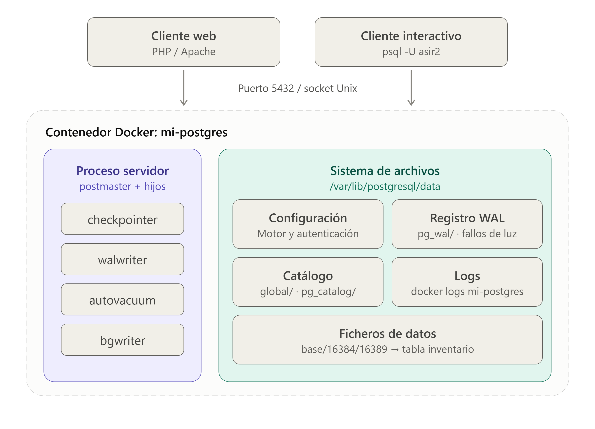
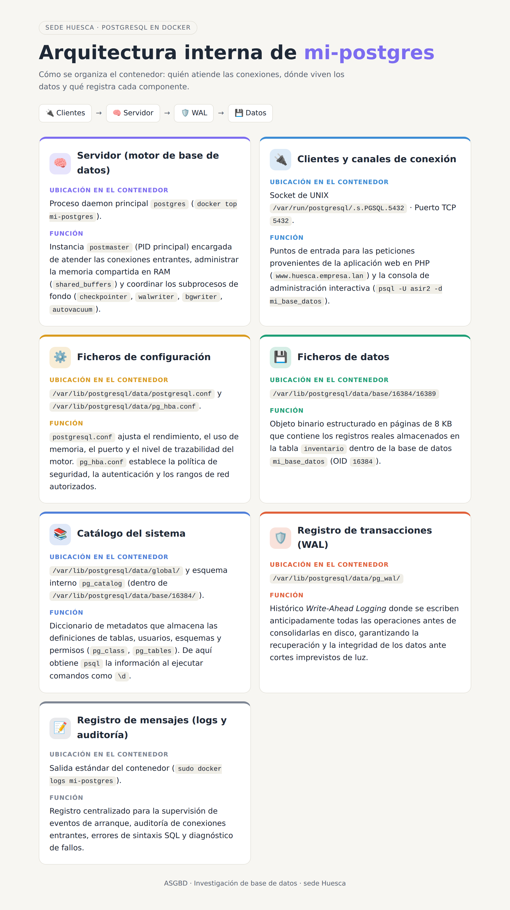

# Investigación · Base de datos

Gestor: **PostgreSQL 16.15** en Docker · Sede Huesca · ASGBD RA1

> Convenciones de este documento
> - Administrador del gestor (área de datos): `asir2`. Usuario de la web: `web_huesca`.
> - Las órdenes se ejecutan en el servidor, dentro de la carpeta del proyecto (`/home/asir2/proyecto_huesca`).
> - Donde pone ‹PEGAR›, va la salida literal de nuestro servidor.

---

## Ampliación del encargo · Necesidades de la base de datos

| # | Necesidad | Dónde se cumple |
| --- | --- | --- |
| D1 | Gestor del estándar, versión mayor fijada, fecha de fin de parches y migración | Pregunta 4 |
| D2 | Ninguna credencial en el repositorio ni en el historial; la forma más segura que admite la imagen | Pregunta 3 |
| D3 | La web entra con un usuario propio con lo mínimo; el superusuario solo lo usa el área de datos | Pregunta 3 |
| D4 | `docker compose up -d` en máquina limpia deja tablas y filas | Pregunta 2 |
| D5 | Reinicio automático, estado de salud y orden de arranque | Pregunta 6 |
| D6 | Copia fuera del servidor y restaurada en un gestor vacío | Pregunta 8 |
| D7 | Registro de conexiones y localización de un rechazo | Pregunta 7 |
| D8 | Lista de comprobaciones con salida esperada | Comprobación |

---

## Preguntas sobre nuestro gestor

### 1. Qué hay dentro del contenedor · CE a · teoría 1, 2 y 4

**Procesos del contenedor.** Orden: `docker top mi-postgres`

| Proceso | Qué hace |
| --- | --- |
| `postgres` | Proceso padre (postmaster). Escucha, acepta conexiones y lanza a los demás. |
| `checkpointer` | Periódicamente fuerza a disco todas las páginas modificadas que siguen en memoria. |
| `background writer` | Va guardando páginas modificadas en segundo plano para aliviar al checkpointer. |
| `walwriter` | Escribe cada cambio en el registro de transacciones (WAL). Si algo falla, se recupera con él. |
| `autovacuum launcher` | Lanza los workers de autovacuum cuando una tabla acumula filas muertas; recupera espacio y actualiza estadísticas. |
| `logical replication launcher` | Gestiona la replicación lógica (copiar datos a otro servidor). Sin réplicas, está ocioso. |

**Qué cambia cuando la web abre y cierra una conexión.** Al abrir, el postmaster crea un proceso hijo nuevo, uno por conexión, que se ve en `docker top` como `postgres: usuario base host idle`. Al cerrar, ese proceso desaparece.

**Dónde están de verdad los datos de la tabla.**

```
sudo docker exec -it mi-postgres psql -U asir2 -d mi_base_datos -c "SELECT pg_relation_filepath('inventario');"
```

Resultado: `base/16384/16389`, es decir, `/var/lib/postgresql/data/base/16384/16389`. Es un fichero normal del contenedor, dentro del volumen `postgres_data`.

**Qué más hay en ese directorio.**

| Elemento | Para qué sirve |
| --- | --- |
| Ficheros numéricos (`16389`, `1259`, `2601`) | Cada uno es una tabla, un índice o una tabla del catálogo. `16389` es `inventario`. |
| `*_fsm` (Free Space Map) | Espacio libre por página, para saber dónde insertar sin fragmentar. |
| `*_vm` (Visibility Map) | Qué páginas son visibles para todas las transacciones; acelera VACUUM y algunas consultas. |
| `PG_VERSION` | Versión mayor con la que se creó el clúster. |
| `pg_filenode_map` | Relaciona las tablas críticas del catálogo con sus ficheros. |
| `pg_internal.init` | Caché de metadatos del catálogo para abrir conexiones más rápido. |
| `pg_wal/` | **El WAL.** Es lo que evita perder datos si se corta la luz. Si alguien lo borra para ganar espacio, el gestor no puede recuperarse: la base queda corrupta o no arranca. |
| `postgresql.conf` y `pg_hba.conf` | Configuración y reglas de autenticación. |
| `global/pg_control` | Estado del clúster; lo lee el arranque para decidir si hay que recuperar. |

**Qué bases hay.** Orden: `sudo docker exec -it mi-postgres psql -U asir2 -d mi_base_datos -c "\l"` → `mi_base_datos`, `postgres`, `template1`, `template0`. No creadas por nosotros:

- `postgres`: base por defecto para administración y herramientas.
- `template1`: plantilla. `CREATE DATABASE` clona su contenido.
- `template0`: plantilla limpia e inmodificable, para recuperar `template1` o crear bases con otra codificación.

**De dónde sale `\d`.** `psql` lo traduce a consultas SQL contra las tablas del **catálogo del sistema** (`pg_catalog`: `pg_class`, `pg_attribute`, `pg_namespace`…). Se puede ver con `psql -E`, que muestra la consulta que lanza.

**Diagrama de las piezas.** Dónde está cada una en el contenedor:

| Pieza | Dónde |
| --- | --- |
| Servidor | `/usr/lib/postgresql/16/bin/postgres` (PID 1) |
| Clientes | `psql` dentro del contenedor (socket Unix) y la web PHP por red (puerto 5432, red de Compose) |
| Ficheros de datos | `/var/lib/postgresql/data/base/` (volumen `postgres_data`) |
| Catálogo | `pg_catalog`, dentro de cada base (ficheros de `base/`) y `global/` |
| Registro de transacciones | `/var/lib/postgresql/data/pg_wal/` |
| Configuración | `/var/lib/postgresql/data/postgresql.conf` y `pg_hba.conf` |
| Registro de mensajes | salida estándar del contenedor: `docker logs mi-postgres` |




---

### 2. Cómo nació nuestro gestor · CE f, i · teoría 8 · D4

**Primer arranque** (volumen vacío). El script `/usr/local/bin/docker-entrypoint.sh` ejecuta `initdb`:

```
fixing permissions on existing directory /var/lib/postgresql/data ... ok
creating subdirectories ... ok
selecting default max_connections ... 100
selecting default shared_buffers ... 128MB
creating configuration files ... ok
running bootstrap script ... ok
performing post-bootstrap initialization ... ok
syncing data to disk ... ok
```

Después arranca un **servidor temporal** que solo escucha por socket Unix, crea la base `POSTGRES_DB`, ejecuta lo que haya en `/docker-entrypoint-initdb.d/` y se apaga:

```
2026-09-28 09:08:12.383 UTC [48] LOG:  listening on Unix socket "/var/run/postgresql/.s.PGSQL.5432"
2026-09-28 09:08:12.392 UTC [48] LOG:  database system is ready to accept connections
CREATE DATABASE
/usr/local/bin/docker-entrypoint.sh: ignoring /docker-entrypoint-initdb.d/*
```

Y por fin arranca el servidor definitivo (PID 1), ya con red:

```
2026-09-28 09:08:12.791 UTC [1] LOG:  starting PostgreSQL 16.15...
2026-09-28 09:08:12.792 UTC [1] LOG:  listening on IPv4 address "0.0.0.0", port 5432
2026-09-28 09:08:12.807 UTC [1] LOG:  database system is ready to accept connections
```

(Esas tres líneas con `ignoring` son de cuando no había scripts. Con los scripts de D4 aparece `running /docker-entrypoint-initdb.d/01-inventario.sql` en su lugar.)

**Arranques posteriores.** El script encuentra `PG_VERSION`, **salta `initdb` y salta `/docker-entrypoint-initdb.d/`**:

```
LOG:  database system was shut down at 2026-09-28 09:08:12 UTC
LOG:  database system is ready to accept connections
```

**Cambiar la contraseña del administrador en el compose y volver a levantar: ¿sirve la nueva?** No. `POSTGRES_PASSWORD` (y `POSTGRES_PASSWORD_FILE`) solo se leen en el primer arranque. La contraseña vive como hash en `pg_authid`, dentro del volumen. Para cambiarla de verdad:

```
sudo docker exec -it mi-postgres psql -U asir2 -d mi_base_datos -c "ALTER ROLE asir2 WITH PASSWORD 'nueva';"
```

(y actualizar el fichero del secreto para que coincida).

**De dónde salieron las tablas y filas (antes de D4).** De SQL escrito a mano tras el despliegue. En una máquina limpia no aparecían.

**Cómo ejecuta SQL la imagen.** `docker-entrypoint.sh` procesa `/docker-entrypoint-initdb.d/` por orden alfabético: `.sql`, `.sql.gz`, `.sql.xz` con `psql`, y `.sh` ejecutándolos (o cargándolos con `source` si no tienen permiso de ejecución). Lo hace **solo en el primer arranque**, con el directorio de datos vacío. No lo hace si `PG_VERSION` ya existe, ni con ficheros añadidos después, salvo que se borre el volumen (`docker compose down -v`).

**Qué pasa si el SQL de inicialización tiene un error.** Se ejecuta con `ON_ERROR_STOP=1`: el primer fallo corta el script, el contenedor sale con error y no llega a abrir la red. En el arranque siguiente, el clúster ya existe (`PG_VERSION`), así que **no se repite el SQL**: el gestor arranca con la base a medias y corregir el `.sql` no sirve de nada. Solución: `docker compose down -v` y volver a levantar.

**Cómo resolvemos D4.** Dos ficheros en `init/`, montados en `/docker-entrypoint-initdb.d`:

`init/01-inventario.sql`, generado con:

```
sudo docker exec mi-postgres pg_dump -U asir2 -d mi_base_datos --no-owner --no-privileges > init/01-inventario.sql
```

`init/02-roles.sh` (crea la web con lo mínimo; D3):

```bash
#!/bin/bash
set -e
WEBPASS="$(cat /run/secrets/db_web_password)"
psql -v ON_ERROR_STOP=1 -v webpass="$WEBPASS" \
     --username "$POSTGRES_USER" --dbname "$POSTGRES_DB" <<'EOSQL'
CREATE ROLE web_huesca LOGIN PASSWORD :'webpass';
GRANT CONNECT ON DATABASE mi_base_datos TO web_huesca;
GRANT USAGE ON SCHEMA public TO web_huesca;
GRANT SELECT ON inventario TO web_huesca;
EOSQL
```

El compose completo está en la pregunta 3 (junto con D2) y en la 6 (D5).

**Prueba en limpio:**

```
docker compose down -v          # borra contenedores y volumen
docker compose up -d
docker compose logs db | grep -E "running /docker-entrypoint-initdb.d|ready to accept"
docker exec mi-postgres psql -U asir2 -d mi_base_datos -tAc "SELECT count(*) FROM inventario;"
```

Salida esperada: aparecen `running /docker-entrypoint-initdb.d/01-inventario.sql` y `02-roles.sh`, y el recuento da `20`. ‹PEGAR salida real›

---

### 3. Quién entra y cómo · CE f, j · teoría 2, 3 y 8 · D2 y D3

#### 3.1 Credenciales antes y después de D2

| Credencial | Quién la usa | Dónde vive **antes** | Quién podía leerla **antes** | Dónde vive **después** | Quién puede leerla **después** |
| --- | --- | --- | --- | --- | --- |
| Contraseña de `asir2` (administrador) | área de datos / `mi-postgres` | `.env` → variable `POSTGRES_PASSWORD` | cualquier usuario del servidor (`.env` con `-rw-rw-r--`); cualquiera del grupo `docker` con `docker inspect` | `secrets/db_admin_password.txt` → `/run/secrets/db_admin_password`, con `POSTGRES_PASSWORD_FILE` | el propietario en el servidor (carpeta `secrets/` en 700) y root; dentro del contenedor, el usuario `postgres`. **No** sale en `docker inspect` |
| Contraseña de `web_huesca` | `mi-apache` (y `02-roles.sh`) | `.env` → variable `DB_PASSWORD` | igual que arriba | `secrets/db_web_password.txt` → `/run/secrets/db_web_password` | igual que la anterior; dentro de `mi-apache`, el usuario de Apache |
| `usuario_intranet` | intranet de Apache | `apache_config/.htpasswd` (hash) | lectura en el servidor | sin cambios (es un hash, no se pasa por entorno) | igual |

#### 3.2 Quién puede leerlas hoy (comprobado)

- **`docker inspect`** sobre `mi-postgres` y `mi-apache`: `Config.Env` mostraba `POSTGRES_PASSWORD` y `DB_PASSWORD` en claro (2 coincidencias). Lo puede hacer cualquier miembro del grupo `docker` (los cuatro del equipo), y estar en ese grupo equivale a ser administrador del servidor.
- **`.env`**: permisos `-rw-rw-r--`, legible por cualquier usuario del servidor. Un `.gitignore` no arregla eso; lo arregla `chmod 600 .env` (y, tras D2, que `.env` no contenga contraseñas).
- **Copias `.bak`** (`docker-compose.yml.bak`, `Dockerfile.bak`): legibles por todos, pero sin contraseñas en claro (referencian `.env`). Ignoradas por Git.
- **Historial de Git** (comprobado el 05/10/2026 en `/home/asir2/proyecto_huesca`): `.gitignore` solo contenía `ssl/`, así que `.env` no estaba protegido frente a un `git add .`. Aun así, `git ls-files` no lista `.env`, `.bak`, `.htpasswd` ni PDFs; `git log --all -- .env docker-compose.yml.bak Dockerfile.bak '*.pdf' apache_config/.htpasswd` no devuelve commits; `git log --all -S` con el valor de la contraseña da 0 commits. La contraseña no ha estado en el repositorio. Se añadieron `.env`, `secrets/` y `*.bak` al `.gitignore` (`git check-ignore -v .env` → `.gitignore:2:.env`).
- **Documento con todas las contraseñas en claro** (PDF y documento de Google compartido). Es la fuga más grave, porque está fuera de Git y fuera de Docker. Acción: borrar el PDF y el documento y **rotar las tres contraseñas**: `ALTER ROLE` en el gestor, nuevo fichero de secreto y recrear la web. Rotar con `ALTER ROLE` y no con el compose es necesario por lo explicado en la pregunta 2. ‹confirmar fecha y quién lo hizo›

#### 3.3 La forma más segura que admite la imagen

La imagen oficial `postgres` admite la variante **`POSTGRES_PASSWORD_FILE`**, y Compose ofrece **`secrets:`**. Con eso la contraseña es un fichero montado en `/run/secrets/` y no una variable de entorno, así que `docker inspect` solo muestra la ruta del fichero.

Aplicado en el compose real (ver pregunta 6, que añade D5 y D7). Comprobación:

```
docker inspect mi-postgres | grep -c "$(cat secrets/db_admin_password.txt)"     # → 0
docker inspect mi-apache   | grep -c "$(cat secrets/db_web_password.txt)"       # → 0
```

Para generar las contraseñas: `openssl rand -hex 24 > secrets/db_admin_password.txt` (y lo mismo para la web).

**Permisos de `secrets/`.** La carpeta en `700` (solo el propietario entra) y los ficheros en `644`. Hace falta que el fichero sea legible por el usuario *dentro* del contenedor (`postgres` y `www-data`, que no son `asir2`): Compose monta los ficheros tal cual y respeta uid y modo del servidor. El `700` de la carpeta impide que otros usuarios del servidor lleguen a ellos.

**Limitaciones (justificación de que es la mejor opción disponible):**

- `php:8.2-apache` **no** entiende `_FILE`; por eso `index.php` lee el fichero él mismo:

```php
$pass = trim(file_get_contents('/run/secrets/db_web_password'));
$conn = pg_connect("host=" . getenv('DB_HOST') . " dbname=" . getenv('DB_NAME') .
                   " user=" . getenv('DB_USER') . " password=" . $pass);
```

- Root del servidor sigue pudiendo leer los ficheros; y quien tenga `docker exec` en el contenedor, también (ver 3.5).
- Los secretos de Docker Swarm o un gestor externo (Vault) serían mejores, pero exceden lo que pide la sede.

#### 3.4 Con qué usuario entra la web (D3)

**Antes:** entraba con el usuario creado por `POSTGRES_USER`, que es **superusuario** (`\du`: `Superuser, Create role, Create DB, Replication, Bypass RLS`). Si alguien lograra ejecutar código en la web podría leer, modificar o borrar cualquier dato de cualquier base, crear usuarios y ejecutar órdenes dentro del contenedor con `COPY ... TO PROGRAM`. Como `index.php` solo hace `SELECT version()` y `SELECT COUNT(*) FROM inventario`, no necesita nada de eso.

**Ahora:** entra con `web_huesca`, que solo puede conectarse a la base y leer `inventario` (creado en `init/02-roles.sh`, que existe también en una máquina limpia).

| Usuario | Qué puede hacer | Quién lo usa |
| --- | --- | --- |
| `asir2` | superusuario | solo el área de datos |
| `web_huesca` | `CONNECT` a `mi_base_datos`, `USAGE` en `public`, `SELECT` en `inventario` | la web (`mi-apache`) |

Comprobación (esperado; ver D8 punto 4): `\du` sin atributos para `web_huesca`; `SELECT count(*)` → 20; `DELETE FROM inventario;` → `ERROR:  permission denied for table inventario`.

#### 3.5 Qué decide si `psql` pide contraseña

El fichero `/var/lib/postgresql/data/pg_hba.conf`. Se aplica la primera línea que coincide con tipo de conexión, base, usuario y dirección:

```
117: local   all  all                 trust
119: host    all  all  127.0.0.1/32   trust
121: host    all  all  ::1/128        trust
128: host    all  all  all            scram-sha-256
```

- `psql` **dentro del contenedor** va por socket Unix (`local`): línea **117**, `trust`, sin contraseña.
- Desde **el contenedor de la web** la conexión llega por la red de Compose: línea **128**, `scram-sha-256`, exige contraseña. El registro lo confirma: `Connection matched file "/var/lib/postgresql/data/pg_hba.conf" line 128: "host all all all scram-sha-256"`.

Consecuencia: quien pueda hacer `docker exec` entra como superusuario sin contraseña, y por eso el grupo `docker` equivale a administrador. Esto es lo que justifica limitar quién está en ese grupo.

---

### 4. Qué versión y hasta cuándo · CE c, d · teoría 6b · D1

**Versión exacta.** PostgreSQL **16.15** (`PG_VERSION=16.15-1.pgdg13+2`, `PG_MAJOR=16`). Es la versión del estándar. La etiqueta del compose es **`postgres:16.15`**: fija la mayor **y** la menor, así nadie salta de versión por un `docker pull`. Con `postgres:16` solo se fijaría la mayor.

**Ciclo de vida.** PostgreSQL saca una versión mayor cada año y cada una recibe parches 5 años. Publica menores al menos cada trimestre (segundo jueves de febrero, mayo, agosto y noviembre). La 16.15 salió el 13 de agosto de 2026. La versión 16 recibe parches hasta el **9 de noviembre de 2028**. Para llegar a esa fecha hay que ir subiendo la menor, no solo mantener la mayor.

**Probar la mayor siguiente con el volumen actual** (en el servidor, con un contenedor `prueba-postgres`, porque el portátil no tiene Docker). Se cambió `postgres:16` por `postgres:17` y se recreó: el contenedor se queda en `Restarting` y el registro dice:

```
FATAL:  database files are incompatible with server
DETAIL:  The data directory was initialized by PostgreSQL version 16, which is not compatible with this version 17.11 (Debian 17.11-1.pgdg13+2).
```

El formato interno cambia entre versiones mayores. No se pierden datos, porque el volumen no se modifica; al volver a `postgres:16` arranca normal.

**Para pasar de verdad a la 17:**

1. Copia con `pg_dump` / `pg_dumpall`.
2. Volumen **nuevo y vacío** con `postgres:17` y restaurar la copia (alternativa: `pg_upgrade`, que necesita los binarios de las dos versiones).
3. Probar antes en un contenedor aparte: que `index.php` conecta, que la extensión `pgsql` de PHP va bien con la nueva y leer las notas de versión.
4. Conservar el volumen antiguo hasta confirmar que todo funciona.

**Riesgo de `latest`.** Apunta siempre a la última mayor. Cada septiembre sale una nueva, así que un `docker pull` o recrear el contenedor puede saltar de mayor con el volumen existente y no arrancar, sin que nadie lo haya decidido. Además deja de saberse qué versión corre y hasta cuándo recibe parches: D1 no se cumpliría.

**Software necesario además del servidor.**
- Para la web: la extensión `pgsql` de PHP (ya en el Dockerfile de `php:8.2-apache`) y la librería `libpq`.
- Para quien administra: `postgresql-client` (`psql`, `pg_dump`, `pg_restore`), Docker y Docker Compose, y opcionalmente pgAdmin o DBeaver.

---

### 5. Qué necesita la máquina · CE e · teoría 7

| Recurso | Qué gasta | Cómo lo medimos | Qué tiene el servidor | ¿Aguanta el doble? |
| --- | --- | --- | --- | --- |
| Memoria en reposo | 44,59 MiB | `sudo docker stats mi-postgres --no-stream` | 30,56 GiB | Sí, el consumo es mínimo. |
| Memoria con la web consultando | 48–52 MiB | `sudo docker stats mi-postgres` | 30,56 GiB | Sí, las consultas de lectura apenas lo suben. |
| Disco: la base | 46 M | `sudo docker exec mi-postgres du -sh /var/lib/postgresql/data` | 20 GB | Sí. |
| Disco: la copia | 3–5 MB | `ls -lh backup_db.sql.gz` | 20 GB | Sí. |
| Disco: registro de transacciones | 17 M | `sudo docker exec mi-postgres du -sh /var/lib/postgresql/data/pg_wal` | 20 GB | Sí. |
| Núcleos | 0,08 % en reposo; < 15 % en picos | `docker stats` y `nproc` | 2 vCPU | Sí. |
| Arquitectura | x86_64 (AMD64); imagen `postgres:16.15` | `uname -m` y `docker inspect mi-postgres --format '{{.Architecture}}'` | x86_64 | Sí, coincide host y contenedor. |

**Requisitos mínimos según la documentación.** PostgreSQL no fija un mínimo estricto: puede correr con 64–128 MB de RAM y 1 vCPU. Los requisitos reales crecen con el número de conexiones concurrentes, la complejidad de las consultas e índices y el volumen de datos que deba caber en caché.

**Parámetro que controla la memoria:** `shared_buffers`. Reserva la memoria compartida para cachear páginas de tablas e índices. Valor por defecto en la imagen: `128MB`. Se comprueba con `sudo docker exec mi-postgres psql -U asir2 -d mi_base_datos -c "SHOW shared_buffers;"`.

---

### 6. Arranque, parada y caídas · CE f, i · teoría 9 · D5

**`docker stop`.** Envía SIGTERM: el gestor cierra las sesiones de forma ordenada, hace un checkpoint y se apaga limpiamente. El registro del arranque siguiente dice:

```
LOG:  database system was shut down at 2026-09-30 ...
LOG:  database system is ready to accept connections
```

**`docker kill`.** Envía SIGKILL: el gestor muere sin cerrar sesiones ni vaciar buffers. En el arranque siguiente detecta que no se cerró bien y hace una **recuperación automática** repitiendo el WAL (`database system was interrupted` / `not properly shut down` / `automatic recovery in progress`). ‹PEGAR vuestras líneas reales›

**¿Se pierde algo confirmado tras un corte de luz?** No. Antes de confirmar un `COMMIT`, PostgreSQL fuerza la escritura del cambio en el WAL en disco. Al arrancar, repite el WAL desde el último checkpoint.

**Qué tiene que pasar para que, tras reiniciar el servidor, el gestor esté arriba y la web no intente conectar antes (D5):**

1. **Reinicio automático:** `restart: unless-stopped` en los dos servicios.
2. **Estado de salud:** `healthcheck` con `pg_isready`.
3. **Orden de arranque:** la web con `depends_on: condition: service_healthy`.

Compose completo (D1, D2, D5, D7 y la red cerrada):

```yaml
services:
  db:
    image: postgres:16.15
    container_name: mi-postgres
    restart: unless-stopped
    environment:
      POSTGRES_USER: asir2
      POSTGRES_DB: mi_base_datos
      POSTGRES_PASSWORD_FILE: /run/secrets/db_admin_password
    secrets: [db_admin_password, db_web_password]
    command: ["postgres", "-c", "log_connections=on", "-c", "log_disconnections=on"]
    volumes:
      - postgres_data:/var/lib/postgresql/data
      - ./init:/docker-entrypoint-initdb.d:ro
    healthcheck:
      test: ["CMD-SHELL", "pg_isready -U asir2 -d mi_base_datos"]
      interval: 5s
      timeout: 3s
      retries: 10
    # Sin "ports": solo la web llega a la base, por la red de Compose.

  web:
    build: .
    container_name: mi-apache
    restart: unless-stopped
    depends_on:
      db:
        condition: service_healthy
    environment:
      DB_HOST: db
      DB_NAME: mi_base_datos
      DB_USER: web_huesca
    secrets: [db_web_password]
    ports: ["80:80"]

secrets:
  db_admin_password:
    file: ./secrets/db_admin_password.txt
  db_web_password:
    file: ./secrets/db_web_password.txt

volumes:
  postgres_data:
```

Notas:
- No se publica el puerto 5432: la base solo es alcanzable desde la red de Compose (D8, punto 5).
- No se usa `log_statement=all`: registraría las contraseñas en claro si alguien ejecuta `ALTER ROLE ... PASSWORD` (contradice D2).
- No hace falta `version:` en Compose v2.

Prueba de D5 (D8, punto 8): `docker kill mi-postgres`, esperar unos segundos y `docker compose ps` debe mostrar `healthy`. ‹PEGAR›

---

### 7. Qué cuenta cuando falla · CE h, i · teoría 10 · D7

**Dónde escribe el registro.** En la salida estándar del contenedor: `sudo docker logs mi-postgres`.

**Qué registra por defecto:** arranques y paradas, fallos de autenticación, errores de sintaxis, caídas graves. **Qué no:** las conexiones que funcionan ni las consultas correctas.

**Cómo se cambia (D7):** parámetros al arrancar, en el compose: `command: ["postgres", "-c", "log_connections=on", "-c", "log_disconnections=on"]`. Después de aplicarlo, un acceso correcto deja `connection received` y `connection authorized`. ‹PEGAR›

**Una línea del registro, campo por campo:**

```
2026-10-06 10:30:06.118 UTC [851] FATAL:  role "usuario_falso" does not exist
```

| Campo | Qué es |
| --- | --- |
| `2026-10-06 10:30:06.118 UTC` | Fecha, hora y zona horaria del suceso. |
| `[851]` | PID del proceso `postgres` que atendía esa conexión. |
| `FATAL` | Severidad: la conexión se cierra. (`ERROR` solo cancela la consulta y la sesión sigue.) |
| `role "usuario_falso" does not exist` | El motivo. |

**Tabla de fallos.** Cada fallo se provoca desde dentro del contenedor `db` hacia `db` (por la red, línea 128 de `pg_hba.conf`). Siglas: C = cliente, R = registro.

> Las columnas "Qué vio el cliente" y "Qué dice el registro" deben ser **copia literal de nuestra salida** (con hora y PID). Los textos que siguen son el formato estándar de PostgreSQL 16; sustituirlos por lo observado.

| # | Fallo y cómo se provoca | Qué vio el cliente | Qué dice el registro | Dónde se ve | Qué era |
| --- | --- | --- | --- | --- | --- |
| 1 | **Contraseña mal.** `docker exec -e PGPASSWORD=mala mi-postgres psql -h db -U web_huesca -d mi_base_datos -c "SELECT 1"` | `FATAL:  password authentication failed for user "web_huesca"` | `FATAL:  password authentication failed for user "web_huesca"` y `DETAIL:  Connection matched file "/var/lib/postgresql/data/pg_hba.conf" line 128: "host all all all scram-sha-256"` | Los dos | Autenticación fallida; el registro añade la línea de `pg_hba.conf` que se aplicó. ‹PEGAR› |
| 2 | **Usuario que no existe.** Igual con `-U usuario_falso` (por red) | El **mismo** mensaje genérico: `password authentication failed for user "usuario_falso"` | `FATAL:  password authentication failed for user "usuario_falso"` y `DETAIL:  Role "usuario_falso" does not exist.` | Los dos, pero el registro dice más | Con `scram-sha-256` el cliente no sabe si el usuario existe (no se revela al atacante). Solo con `trust` (socket local o `127.0.0.1`) aparece `role "usuario_falso" does not exist` al cliente: `2026-10-06 10:30:06.118 UTC [851] FATAL:  role "usuario_falso" does not exist`. |
| 3 | **Base que no existe.** Contraseña buena, `-d db_falsa` | `FATAL:  database "db_falsa" does not exist` | La misma línea | Los dos | La autenticación pasó y falló al elegir la base. Aquí sí lo dice al cliente. ‹PEGAR› |
| 4 | **La web intenta borrar.** Con `web_huesca`: `DELETE FROM inventario;` | `ERROR:  permission denied for table inventario` | `ERROR:  permission denied for table inventario` y `STATEMENT:  DELETE FROM inventario;` | Los dos | D3 funcionando: el usuario solo tiene `SELECT`. Es `ERROR`, no `FATAL`: la sesión sigue viva. |
| 5 | **Tabla que no existe.** `SELECT * FROM tabla_falsa;` | `ERROR:  relation "tabla_falsa" does not exist` | `ERROR:  relation "tabla_falsa" does not exist` y `STATEMENT:  SELECT * FROM tabla_falsa;` | Los dos | Error de consulta, la sesión sigue. ‹PEGAR› |
| 6 | **Cliente fuera de la red.** Desde otra máquina: `nc -zv -w 3 IP_SERVIDOR 5432` | `Connection refused` o `timed out` | **Nada** | Solo el cliente | El puerto no está publicado. La conexión no llega al proceso, y un proceso no registra lo que no ve. |
| 7 | **Primer arranque sin contraseña.** `docker run --rm --name test-sin-pass postgres:16.15` | El contenedor sale con código 1 (no hay cliente) | La salida del contenedor: `Error: Database is uninitialized and superuser password is not specified.` | Solo el registro | La imagen exige `POSTGRES_PASSWORD` o `_FILE`. ‹PEGAR› |
| 8 | **Error en el SQL de inicialización.** Volumen nuevo y un `.sql` con `SELEC 1;` | **No hay cliente**: el contenedor sale antes de abrir la red | `psql:/docker-entrypoint-initdb.d/xx.sql:1: ERROR:  syntax error at or near "SELEC"` y el contenedor sale con error | Solo el registro | `ON_ERROR_STOP=1`. Ver pregunta 2. ‹PEGAR› |
| 9 | **Otra versión mayor con el mismo volumen.** Etiqueta `postgres:17` | El contenedor no arranca (`Restarting`) | `FATAL:  database files are incompatible with server` / `DETAIL:  The data directory was initialized by PostgreSQL version 16, which is not compatible with this version 17.11 ...` | Solo el registro | Hace falta migrar con dump o `pg_upgrade`. Real (pregunta 4). |

**Fallos que nunca llegan al registro y por qué.** Cliente fuera de la red, DNS que no resuelve y reglas de cortafuegos o puertos no publicados: los paquetes no llegan al proceso del gestor, que no puede registrar un intento del que no se enteró.

**Fallos donde el cliente recibe menos que el registro y por qué.** Autenticación (contraseña mala, usuario inexistente) y errores internos. Si el gestor dijera "el usuario existe pero la contraseña es mala", confirmaría al atacante que el nombre es válido; y mostrar la estructura de las consultas facilita inyecciones SQL. El cliente recibe el mensaje genérico y el registro guarda el motivo exacto, el usuario y la regla de `pg_hba.conf` (fila 2).

---

### 8. Copias · W6, D6 · teoría 12

**Herramienta para copiar en caliente.** `pg_dump` (copia lógica, consistente aunque haya escrituras). La alternativa física es `pg_basebackup`. **No vale copiar el directorio de datos con la base en marcha**: los ficheros cambian mientras se copian y se obtiene una copia incoherente que puede no arrancar.

**Qué hay dentro de la copia.** Las sentencias SQL para recrear la tabla y los datos (`CREATE TABLE`, `COPY ...`) **al momento de ejecutar el dump**. **No** están los cambios posteriores (si alguien añadió algo después, se pierde al restaurar), ni la configuración (`postgresql.conf`, `pg_hba.conf`), ni los roles y sus contraseñas (para eso, `pg_dumpall --roles-only`; los de la sede los recrea `02-roles.sh`).

**Procedimiento que usaremos en el servidor:**

1. Copia: `docker exec mi-postgres pg_dump -U asir2 -d mi_base_datos --clean --if-exists --no-owner > backup_$(date +%F).sql`
2. **Fuera del servidor** (D6): `scp backup_$(date +%F).sql ‹usuario@máquina-remota›:‹ruta›`. Si se muere el disco del servidor, la copia sigue en la otra máquina. ‹PEGAR destino y `ls -l` remoto›
3. Restaurar en un gestor **vacío**:

```
docker run -d --name pg-restore-test -e POSTGRES_PASSWORD=test postgres:16.15
docker exec pg-restore-test psql -U postgres -c "CREATE DATABASE mi_base_datos;"
docker exec -i pg-restore-test psql -U postgres -d mi_base_datos < backup_$(date +%F).sql
docker exec pg-restore-test psql -U postgres -d mi_base_datos -tAc "SELECT count(*) FROM inventario;"
docker rm -f pg-restore-test
```

Salida esperada del recuento: `20`. ‹PEGAR›

4. **Restaurar sobre la base recién inicializada por D4** (que ya tiene la tabla y las 20 filas). Sin `--clean`, `psql` da `relation "inventario" already exists` y errores de clave duplicada en los datos, y la base queda como estaba. Por eso el dump lleva `--clean --if-exists`: borra y recrea, y el resultado vuelve a ser 20 filas. ‹PEGAR›

**Qué haremos en el servidor cuando toque de verdad:** parar la web (`docker compose stop web`), restaurar con el procedimiento 4, comprobar con D8 (puntos 3 y 4) y arrancar la web.


---

## Investigación · Qué gestor y por qué

### Comparativa · CE b · teoría 5

| Criterio | PostgreSQL | MariaDB | MySQL | SQL Server | Oracle Database | SQLite |
| --- | --- | --- | --- | --- | --- | --- |
| Quién lo mantiene | PostgreSQL Global Development Group, comunidad de voluntarios sin dueño comercial. | MariaDB Foundation (comunidad) y MariaDB plc (empresa que vende la edición Enterprise). | Oracle Corporation. | Microsoft. | Oracle Corporation. | D. Richard Hipp y un equipo pequeño, con apoyo del SQLite Consortium. |
| Licencia (nombre, si es libre, enlace) | PostgreSQL License, permisiva tipo BSD/MIT, libre.([fuente](https://www.postgresql.org/about/licence/)) | GPL v2, libre.([fuente](https://mariadb.com/kb/en/mariadb-license/)) | GPL v2 (Community, libre) y licencia comercial para Enterprise.([fuente](https://www.mysql.com/about/legal/licensing/oem/)) | Propietaria (EULA de Microsoft), no libre.([fuente](https://www.microsoft.com/en-us/sql-server/sql-server-downloads)) | Propietaria; la edición Free usa las Oracle Free Use Terms and Conditions, no libre.([fuente](https://www.oracle.com/downloads/licenses/oracle-free-license.html)) | Dominio público, libre.([fuente](https://sqlite.org/copyright.html)) |
| Edición gratuita y sus límites | No hay ediciones: todo es gratuito y sin límites artificiales. | Community Server, gratuita y sin límites técnicos; la Enterprise es de pago. | Community Edition, gratuita; la Enterprise es de pago. | Express: 50 GB por base de datos en SQL Server 2025 (10 GB en versiones anteriores) y recursos limitados (1 socket o 4 núcleos, 1.410 MB de memoria para el buffer pool). Developer es gratuita pero solo para desarrollo y pruebas. | Oracle AI Database 26ai Free: 2 núcleos, 2 GB de RAM, 12 GB de datos de usuario y una instalación por entorno. | Sin ediciones: es libre y completa. |
| Sistemas donde corre | Linux, Windows, macOS, BSD y Solaris. | Linux, Windows, macOS y FreeBSD. | Linux, Windows, macOS, Solaris y FreeBSD. | Windows y Linux (RHEL, SUSE, Ubuntu), también en contenedor. | Linux y Windows; Free en Oracle Linux 8/9, Windows x64 y contenedor. | Cualquier sistema donde se compile en C: Linux, Windows, macOS, Android, iOS. |
| Cliente/servidor o embebido | Cliente/servidor. | Cliente/servidor. | Cliente/servidor. | Cliente/servidor. | Cliente/servidor. | Embebido: es una biblioteca que va dentro de la aplicación, sin servidor. |
| Procesos o hilos por conexión | Un proceso por conexión. | Un hilo por conexión por defecto, con _thread pool_ opcional. | Un hilo por conexión; el _thread pool_ es de la edición Enterprise. | Las conexiones las atienden hilos de trabajo de un conjunto compartido, no un hilo fijo por conexión. | Por defecto un proceso de servidor dedicado por conexión; también existe el modo compartido y el modo de hilos en Linux. | Ninguno propio: se ejecuta en el proceso y los hilos de la aplicación que lo usa. |
| Puerto por defecto | 5432/TCP. | 3306/TCP. | 3306/TCP (y 33060 para el protocolo X). | 1433/TCP. | 1521/TCP (el _listener_). | Ninguno: no escucha en la red. |
| Cliente de línea de órdenes · cliente gráfico | `psql` · pgAdmin. | `mariadb` · HeidiSQL. | `mysql` · MySQL Workbench. | `sqlcmd` · SQL Server Management Studio (solo Windows). | SQL\*Plus o SQLcl · SQL Developer. | `sqlite3` · DB Browser for SQLite. |
| Imagen oficial de contenedor y dónde guarda los datos | `postgres`; datos en `/var/lib/postgresql/data` hasta la 17 y en `/var/lib/postgresql` desde la 18. | `mariadb`; datos en `/var/lib/mysql`. | `mysql`; datos en `/var/lib/mysql`. | `mcr.microsoft.com/mssql/server`; datos en `/var/opt/mssql`. | `container-registry.oracle.com/database/free`; datos en `/opt/oracle/oradata`. | No hay imagen de servidor, porque no es un servidor; los datos son un fichero `.db` dentro del volumen de la aplicación que lo usa. |
| Cómo decide quién entra y desde dónde | Fichero `pg_hba.conf`: tipo de conexión, base, usuario, dirección y método. | Cuentas `'usuario'@'host'`: el origen forma parte del nombre de la cuenta. | Cuentas `'usuario'@'host'` con `GRANT`. | Inicios de sesión (SQL o Windows) y permisos; el origen se limita con el cortafuegos y la red. | Usuarios y roles, más el _listener_; el origen se filtra con `TCP.VALIDNODE_CHECKING` en `sqlnet.ora`. | Ninguno propio: solo los permisos del fichero en el sistema operativo. |
| Herramienta de copia en caliente | `pg_dump` (lógica) y `pg_basebackup` (física). | `mariadb-backup` (física) y `mariadb-dump`. | `mysqldump` con `--single-transaction`; la física en caliente es MySQL Enterprise Backup, de pago | `BACKUP DATABASE` en T-SQL, que funciona con la base en marcha. | RMAN, con la base en modo ARCHIVELOG. | API de copia en línea, `.backup` en la consola o `VACUUM INTO`. |
| Versiones: cada cuánto una mayor, cuántos años de parches | Una mayor al año; 5 años de parches por versión. | Una LTS al año desde la 11.x (11.4, 11.8, 12.3), con 5 años de mantenimiento; las versiones no LTS duran poco. | Una serie LTS cada unos 2 años (8.4, 9.7): 5 años de soporte _premier_ y 3 de _extended_. | Una mayor cada 2–3 años; 10 años de soporte (5 estándar y 5 ampliado). | Versiones de soporte prolongado cada pocos años; soporte _premier_ y _extended_ de pago según la política de vida útil. | Sin versiones mayores al estilo servidor: 3.x desde 2004, con compromiso de mantenimiento hasta 2050. |
| Una aplicación conocida que lo exige | Odoo solo funciona con PostgreSQL. | No hemos encontrado una aplicación conocida que exija MariaDB en exclusiva. WordPress lo admite pero también MySQL. | WordPress exige MySQL o MariaDB. | Microsoft SharePoint Server necesita SQL Server. | Oracle E-Business Suite necesita Oracle Database. | Firefox y Android lo llevan embebido para guardar sus datos. |
| Qué hace bien (con fuente) | Cumple muy de cerca el estándar SQL, es extensible y tiene transacciones muy robustas. ([fuente](https://www.postgresql.org/about/)) | LTS anual con 5 años, y las herramientas de copia física y _thread pool_ vienen en la edición libre. ([fuente](https://mariadb.org/about/#maintenance-policy)) | Muy extendido: lo admiten WordPress y Forgejo. ([fuente](https://forgejo.org/docs/latest/admin/database-preparation/)) | Herramientas gráficas integradas y encaje con el ecosistema Microsoft. ([fuente](https://learn.microsoft.com/en-us/sql/sql-server/what-s-new-in-sql-server-2025)) | Funciones empresariales muy completas y soporte del fabricante.([fuente](https://www.oracle.com/database/)) | Cero administración: sin servidor, usuarios ni configuración.([fuente](https://sqlite.org/whentouse.html)) |
| Qué hace mal (con fuente) | Un proceso por conexión: con muchas conexiones hace falta un _pooler_ ([fuente](https://wiki.postgresql.org/wiki/Number_Of_Database_Connections)); y una versión mayor no abre datos de otra, como comprobamos al pasar de la 16 a la 17. | Hay versiones de soporte corto, y es fácil usar una no LTS por error. ([fuente](https://mariadb.org/about/#maintenance-policy)) | La copia física en caliente y el _thread pool_ son de la edición de pago, y el desarrollo depende de Oracle. ([fuente](https://dev.mysql.com/doc/refman/8.4/en/backup-and-recovery.html)) | Licencia de pago y Express limitada en CPU y memoria. ([fuente](https://learn.microsoft.com/en-us/sql/sql-server/editions-and-components-of-sql-server-2025)) | Coste y licenciamiento complejos; la edición Free se queda en 12 GB y 2 GB de RAM. ([fuente](https://docs.oracle.com/en/database/oracle/oracle-database/26/xeinw/licensing-restrictions.html)) | Bloquea el fichero entero al escribir, por lo que no sirve para muchos clientes escribiendo a la vez. ([fuente](https://sqlite.org/whentouse.html)) |

**Base de datos como servicio (DBaaS).** Es un gestor que alquilas ya instalado y mantenido por un proveedor: te da el servidor, las copias y los parches, y tú solo usas la conexión, sin administrar el sistema operativo ni el contenedor.

**Ejemplo con precio y fecha:** Amazon RDS para PostgreSQL, instancia `db.t4g.micro`, unos 13 dólares al mes en España, solo cómputo, sin almacenamiento ni transferencia (consulta del 6 de octubre de 2026; [tabla de precios actualizada el 20 de julio de 2026](https://www.bytebase.com/dbcost/rds/instance/db.t4g.micro/), [página oficial de AWS](https://aws.amazon.com/rds/postgresql/pricing)).

**¿La necesita nuestra sede?** No. Los datos son internos y el enunciado exige alojar el servicio en nuestro servidor, con nuestras copias y nuestro control de acceso; además la base es pequeña, así que un servicio gestionado no aporta nada que no tengamos ya con un contenedor de PostgreSQL.

### Elección · CE c · teoría 6

| Aplicación | Gestores admitidos | Fuente |
| --- | --- | --- |
| Nuestra web (PHP) | PHP tiene extensiones para PostgreSQL, MySQL/MariaDB, SQL Server, Oracle y SQLite. Hoy usa `pg_connect`, así que está atada a PostgreSQL; para cambiar de gestor habría que reescribir las llamadas. | [PHP: extensiones de bases de datos](https://www.php.net/manual/en/refs.database.php) |
| Forgejo | MariaDB ≥10.6, MySQL ≥8.4, PostgreSQL ≥14 y SQLite. No admite SQL Server ni Oracle. | [Forgejo: Database Preparation](https://forgejo.org/docs/latest/admin/database-preparation/) |
| WordPress | MySQL ≥8.0 o MariaDB ≥10.6. No admite PostgreSQL, SQL Server, Oracle ni SQLite. | [WordPress: Requirements](https://wordpress.org/requirements/) |

**Sin el estándar habríamos elegido MariaDB.** Con una sola instalación cubre las tres aplicaciones (nuestra web con `mysqli`/PDO, Forgejo y WordPress), es libre (GPL), la edición libre incluye la copia física en caliente (`mariadb-backup`) y su LTS anual da 5 años de parches. PostgreSQL es técnicamente más estricto y extensible, pero deja fuera a WordPress.

**El estándar nos obliga a PostgreSQL.** Nuestra web ya está escrita contra él (`pg_connect`/`pg_query`) y toda la seguridad, copias y versiones que documentamos se han hecho sobre PostgreSQL 16.

**Si mañana llegara WordPress:** no podría usar nuestro PostgreSQL. Habría que levantar un segundo gestor (un contenedor `mariadb` con su volumen). Eso duplica el trabajo: dos conjuntos de usuarios y secretos (D2, D3), dos copias probadas (D6), dos ciclos de parches (D1) y dos registros que vigilar (D7). Lo razonable es mantener PostgreSQL para nuestra web y Forgejo, y dejar MariaDB solo para WordPress, aislado en su propia red de Docker, con su propio usuario de permisos mínimos y sin publicar su puerto. No cambiaríamos nuestra web a MariaDB: reescribir las llamadas y migrar los datos cuesta más que mantener un segundo contenedor aislado.

**Criterios para una empresa sin estándar, ordenados:**

1. **Compatibilidad con las aplicaciones que hay que alojar.** Manda: si la aplicación no admite el gestor, no hay nada más que discutir.
2. **Soporte y ciclo de vida:** años de parches y si hay LTS.
3. **Licencia y coste total:** si es libre, límites de la edición gratuita y coste de pasar a la de pago.
4. **Operación:** copia en caliente probada, restauración, herramientas y que el equipo sepa manejarlas.
5. **Seguridad:** autenticación, control de origen, cifrado y privilegios mínimos.
6. **Rendimiento y escala:** conexiones, volumen y concurrencia.
7. **Ecosistema:** personal, documentación y herramientas de terceros.

El primero manda porque los demás se pueden compensar (se paga licencia, se aprende una herramienta, se añade un _pooler_), pero una aplicación que no admite el gestor no se arregla sin cambiarla.

---

### Comprobación · CE g, j · D8

Se ejecuta **desde el servidor, dentro de `/home/asir2/proyecto_huesca`**, tal cual, de arriba abajo. Cada punto tiene la salida esperada; si no coincide, la base no está bien.

| # | Qué comprueba | Orden | Salida esperada |
| --- | --- | --- | --- |
| 1 | Gestor sano (D5) | `docker compose ps` y `docker exec mi-postgres pg_isready -U asir2 -d mi_base_datos` | `db` en estado `healthy`; `/var/run/postgresql:5432 - accepting connections` |
| 2 | Versión (D1) | `docker exec mi-postgres psql -U asir2 -d mi_base_datos -tAc "SHOW server_version;"` | `16.15 (Debian 16.15-1.pgdg13+2)` |
| 3 | Filas de cada tabla (D4) | `docker exec mi-postgres psql -U asir2 -d mi_base_datos -tAc "SELECT count(*) FROM inventario;"` | `20` |
| 4a | La web entra (D3) | `docker exec mi-postgres sh -c 'PGPASSWORD=$(cat /run/secrets/db_web_password) psql -h db -U web_huesca -d mi_base_datos -tAc "SELECT count(*) FROM inventario;"'` | `20` |
| 4b | La web no puede escribir (D3) | la misma orden con `-c "DELETE FROM inventario;"` en vez de `-tAc "SELECT ..."` | `ERROR:  permission denied for table inventario` |
| 4c | La web responde | `curl -s -o /dev/null -w "%{http_code}\n" http://localhost/` | `200` |
| 5a | El puerto no está publicado | `docker port mi-postgres` | (vacío, sin ninguna línea) |
| 5b | No responde desde el aula | desde **otra máquina de la red**: `nc -zv -w 3 IP_SERVIDOR 5432` | falla: `Connection refused` o `timed out` |
| 6 | Copia restaurada (D6) | procedimiento de la pregunta 8, pasos 1 a 3 | recuento `20` en el gestor vacío |
| 7 | Conexión rechazada localizable (D7) | `docker exec -e PGPASSWORD=mala mi-postgres psql -h db -U web_huesca -d mi_base_datos -c "SELECT 1"` y después `docker logs --tail 30 mi-postgres 2>&1 \| grep -A1 FATAL` | cliente: `FATAL:  password authentication failed for user "web_huesca"`; registro: la misma línea y debajo `DETAIL:  Connection matched file ... line 128 ...` |
| 8 | Vuelve solo y la web espera (D5) | `docker kill mi-postgres; sleep 15; docker compose ps` | `db` vuelve a `healthy` y `web` en marcha |
| 9 | Sin credenciales a la vista (D2) | `docker inspect mi-postgres mi-apache \| grep -c "$(cat secrets/db_web_password.txt)"` y `git log --all -S"$(cat secrets/db_web_password.txt)" --oneline` | `0` y ninguna línea |

Ejecutada por: ‹nombre› · fecha: ‹fecha› · ¿todo coincide?: ‹sí/no, y qué difiere›

(Otra persona del equipo la ejecuta sin preguntar y lo deja anotado en la pull request.)

---

## Contradicciones encontradas y corregidas

1. **Puerto 5432 publicado frente a "no responde".** El compose antiguo tenía `ports: "5432:5432"`, que abre el puerto, pero D8 comprobaba `nc 127.0.0.1` desde el propio servidor y no desde el aula. Corrección: se quita `ports` del compose y la prueba pasa a hacerse desde otra máquina (D8, 5a y 5b).
2. **D3 incumplido por D8.** La web "no puede escribir" se probaba con una transacción `READ ONLY` y con `usuario_app` (superusuario), que no prueba nada. Corrección: se prueba con `web_huesca` y `DELETE` (D8, 4b).
3. **El rechazo de D7 era de otra regla.** Con `-h 127.0.0.1` se aplica la línea 119 (`trust`) y por eso solo se veía `role does not exist`. El rechazo de contraseña real pasa por la línea 128. Corrección en D8, 7, y fila 2 de la tabla de fallos.
4. **"Role does not exist" no lo ve el cliente por red.** La tabla de fallos lo daba por visible para la web. Con `scram-sha-256` el cliente recibe el mismo mensaje genérico que con contraseña mala, y solo el registro dice `Role "..." does not exist`. Coincide con nuestra propia explicación de por qué el cliente recibe menos que el registro.
5. **Error en el SQL de inicialización "visto por el cliente".** Contradecía la pregunta 2: el contenedor se cae antes de abrir la red, así que no hay cliente.
6. **`log_statement=all` contradice D2.** Registraría las contraseñas de un `ALTER ROLE`. Se quita y solo se registran conexiones.
7. **Permisos de los secretos.** Con `chmod 600` el contenedor no puede leer su propio secreto (su usuario no es `asir2`). Corrección: carpeta `secrets/` en 700 y ficheros en 644.
8. **Teoría (cambio de contraseña).** "Cambiar `POSTGRES_PASSWORD` y volver a levantar" no sirve (la contraseña vive en `pg_authid`); rotar las credenciales de la sede exige `ALTER ROLE`.

---

## Evaluación

Evidencia principal de **ASGBD RA1**, junto con W4–W7 del encargo.

| CE | Dónde se demuestra |
| --- | --- |
| a · utilidad y función de cada elemento | Pregunta 1 |
| b · características de los principales gestores | Comparativa |
| c · selección del gestor | Pregunta 4 y Elección |
| d · software necesario | Pregunta 4 |
| e · requisitos hardware verificados | Pregunta 5 |
| f · gestor instalado | W4, D1, D4, D5; preguntas 2 y 6 |
| g · instalación documentada | D4 y D8 |
| h · mensajes de error y registros interpretados | Pregunta 7, D7 |
| i · incidencias resueltas | Preguntas 2, 6 y 7 |
| j · funcionamiento verificado | D8, pregunta 8 |

---

## Fuentes

Todas consultadas entre septiembre y octubre de 2026.

### 1. PostgreSQL y Docker

- **PostgreSQL Global Development Group.** _PostgreSQL 16 Documentation_. https://www.postgresql.org/docs/16/index.html (consultado el 06/10/2026).
  - _Licencia:_ https://www.postgresql.org/about/licence/ · _Política de versiones:_ https://www.postgresql.org/support/versioning/
  - _Número de conexiones:_ https://wiki.postgresql.org/wiki/Number_Of_Database_Connections
- **Docker Hub.** _PostgreSQL Official Docker Image_ (variables `_FILE`, `/docker-entrypoint-initdb.d`). https://hub.docker.com/_/postgres (06/10/2026).
- **Docker Documentation.** _Secrets in Compose_. https://docs.docker.com/compose/use-secrets/ (06/10/2026).

### 2. Comparativa de gestores

- **MariaDB.** _Licensing_: https://mariadb.com/kb/en/mariadb-license/ · _Maintenance policy (LTS)_: https://mariadb.org/about/#maintenance-policy (06/10/2026).
- **MySQL / Oracle.** _OEM Commercial Licensing_: https://www.mysql.com/about/legal/licensing/oem/ · _MySQL 8.4 Backup and Recovery_: https://dev.mysql.com/doc/refman/8.4/en/backup-and-recovery.html (06/10/2026).
- **Microsoft.** _SQL Server Downloads_: https://www.microsoft.com/en-us/sql-server/sql-server-downloads · _Editions and components_: https://learn.microsoft.com/en-us/sql/sql-server/editions-and-components-of-sql-server-2025 (06/10/2026).
- **Oracle.** _Oracle Free License_: https://www.oracle.com/downloads/licenses/oracle-free-license.html · _Licensing Restrictions_: https://docs.oracle.com/en/database/oracle/oracle-database/26/xeinw/licensing-restrictions.html (06/10/2026).
- **SQLite.** _Copyright_: https://sqlite.org/copyright.html · _Appropriate Uses_: https://sqlite.org/whentouse.html (06/10/2026).

### 3. Aplicaciones

- **PHP.** _Database Extensions_: https://www.php.net/manual/en/refs.database.php (06/10/2026).
- **Forgejo.** _Database Preparation_: https://forgejo.org/docs/latest/admin/database-preparation/ (06/10/2026).
- **WordPress.** _Requirements_: https://wordpress.org/requirements/ (06/10/2026).

### 4. DBaaS

- **AWS.** _Amazon RDS for PostgreSQL Pricing_: https://aws.amazon.com/rds/postgresql/pricing (06/10/2026).
- **Bytebase.** _RDS db.t4g.micro_: https://www.bytebase.com/dbcost/rds/instance/db.t4g.micro/ (precios a 20/07/2026; consultado el 06/10/2026).
