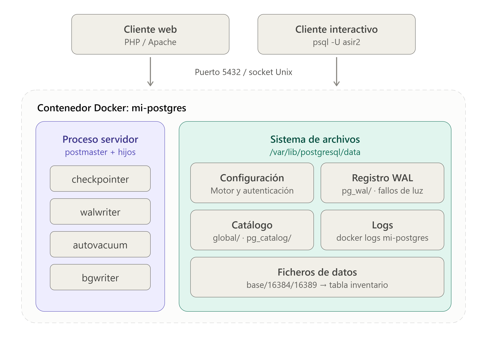
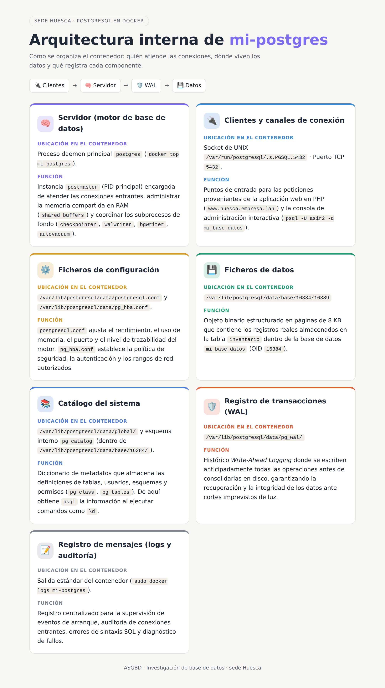

# Investigación · Base de datos

---

## Ampliación del encargo · Necesidades de la base de datos

| # | Necesidad |
| --- | --- |
| D1 | El gestor es el del estándar, con la versión mayor fijada. Se sabe hasta cuándo tiene parches y qué haría falta para pasar a la siguiente |
| D2 | Ninguna credencial está en el repositorio ni en el historial. Cada credencial se pasa al contenedor de la forma más segura que admita la imagen, y está justificado por qué es esa |
| D3 | La web entra con un usuario propio que solo puede hacer lo que necesita. Nadie más que el área de datos usa el superusuario |
| D4 | En una máquina limpia, `docker compose up -d` deja la base con sus tablas y sus filas sin que nadie escriba SQL a mano |
| D5 | El gestor vuelve solo tras un reinicio, Compose sabe si está sano y la web no arranca antes que él |
| D6 | Existe una copia de la base fuera del servidor, y se ha restaurado en un gestor vacío |
| D7 | El gestor registra las conexiones, y el área de datos localiza en el registro por qué se ha rechazado una |
| D8 | Existe una lista de comprobaciones que cualquiera del equipo ejecuta para saber si la base está bien, cada una con la salida esperada |
| D6 y D7 son W6 y W7 del encargo, con más detalle. D4 es la parte de la prueba 17 que os toca. |   |

---

## Preguntas sobre vuestro gestor

Cada bloque dice qué CE demuestra y qué apartado de la teoría (`ra1-teoria.md`) lo explica.  
Primero contestad mirando vuestro gestor. Después, contrastad con la teoría: si no coincide,  
investigad cuál de las dos está mal y dejadlo escrito.

### 1\. Qué hay dentro del contenedor · CE a · teoría 1, 2 y 4

¿Qué procesos corren en vuestro contenedor de base de datos?

\*\*Comandos:\*\*docker top "nombre docker"  
Los procesos que corren en nuestra base de datos son (postgres/chackpointer/background writer/walwriter/autovacuum launcher/logical replication launcher)  
¿Qué hace cada uno?  
**postgres**:Es el proceso padre de PostgreSQL  
**checkpointer**:Periodicamente fuerza a escribir a disco todas las paginas modificadas en memoria  
**backgroundwriter**:Va guardando datos poco a poco en segundo plano  
**walwriter**:apunta cada cambio que se hace.Si algo falla,se recupera con esa memoria llamada WAL  
**autovacuumlauncher**:Lanza workers de autovacuum cundo una tabla acumula suficientes tuplas muertas,recupera espacio y actualiza estadisticas  
**logicalreplicationlauncher**:sirve para copiar los datos a otro servidor.

¿Qué cambia  
en esa lista cuando la web abre una conexión, y cuando la cierra?

Que al conectarse a una web aparece un proceso llamado postgres: "usuario" "base" "host" idle  

¿Dónde están, de verdad, los datos de vuestra tabla? **Comando**:sudo docker exec -it mi-postgres psql -U asir2 -d mi\_base\_datos -c "SELECT pg\_relation\_filepath('inventario');"

En "/var/lib/postgresql/data/base/16384/16389" Llegad hasta el fichero. 

¿Qué más hay en ese directorio y para qué sirve cada cosa?

**Ficheros con nombres numéricos (ej.** `**16389**`**,** `**1259**`**,** `**2601**`**)**: Cada uno representa una tabla, un índice o un catálogo interno del sistema. El fichero `16389` corresponde concretamente a la tabla `inventario`.

**Archivos** `**_fsm**` **(**_**Free Space Map**_**)**: Guardan el registro del espacio libre en las páginas de cada tabla para saber en qué bloque insertar nuevas filas rápidamente sin fragmentar el disco.

**Archivos** `**_vm**` **(**_**Visibility Map**_**)**: Indican qué bloques contienen datos visibles para todas las transacciones. Sirven para optimizar el proceso de limpieza (_VACUUM_) y acelerar las consultas.

`**PG_VERSION**`: Archivo de texto plano que contiene el número de versión de PostgreSQL con el que se creó la base de datos.

`**pg_filenode_map**`: Mapea las tablas críticas del catálogo del sistema con sus ficheros físicos correspondientes.

`**pg_internal.init**`: Fichero de caché con metadatos del catálogo para acelerar la apertura de nuevas conexiones.

*   En ese directorio hay algo que el gestor necesita para no perder datos cuando se corta la luz.  
    ¿Qué es? Es el WAL ¿Qué pasaría si alguien lo borrara para ganar espacio? borarlo corrompe la base o impide que arranque
*   ¿Qué bases de datos hay en vuestro gestor?

\*\*Comando:\*\*sudo docker exec -it mi-postgres psql -U "usuario" -d "base de datos" -c "\\l"

 (mi\_base\_datos,postgres,template1,template0) 

Hay alguna que no creasteis: ¿qué son y para qué  
están?

`**postgres**`: Base de datos predeterminada destinada al uso de administradores, usuarios y herramientas de mantenimiento del servidor.

`**template1**`: Base de datos plantilla. Cuando se ejecuta la instrucción `CREATE DATABASE`, PostgreSQL clona el contenido de `template1` para generar la nueva base de datos.

`**template0**`: Plantilla limpia y no modificable que utiliza PostgreSQL como copia de seguridad interna para restaurar `template1` si fuera necesario.

*   Cuando escribís `\d` en `psql`, ¿de dónde sale la respuesta?

La respuesta proviene directamente de las **tablas del catálogo del sistema** de PostgreSQL, alojadas en el esquema interno

Cuando ejecutas `\d`, la herramienta `psql` traduce esa orden en una consulta SQL estándar dirigida a las tablas del catálogo.

**Al documento**: diagrama propio de las piezas de vuestro gestor (servidor, clientes, ficheros de  
datos, catálogo, registro de transacciones, configuración, registro de mensajes), con **dónde**  
**está cada una en vuestro contenedor**.  
  
  
\=======  
Comandos:docker top "nombre docker"  
Los procesos que corren en nuestra base de datos son (dnsmasq/chackpointer/background writer/walwriter/autovacuum launcher/logical replication launcher)  
¿Qué hace cada uno?  
dnsmask:Es el proceso padre de PostgreSQL  
checkpointer:Periodicamente fuerza a escribir a disco todas las paginas modificadas en memoria  
backgroundwriter:Va guardando datos poco a poco en segundo plano

walwriter:apunta cada cambio que se hace.Si algo falla,se recupera con esa memoria llamada WAL  
autovacuumlauncher:Lanza workers de autovacuum cundo una tabla acumula suficientes tuplas muertas,recupera espacio y actualiza estadisticas  
logicalreplicationlauncher:sirve para copiar los datos a otro servidor.

¿Qué cambia  
en esa lista cuando la web abre una conexión, y cuando la cierra?

Que al conectarse a una web aparece un proceso llamado postgres: "usuario" "base" "host" idle  

¿Dónde están, de verdad, los datos de vuestra tabla? En /var/lib/postgresql/data Llegad hasta el fichero. ¿Qué más hay en  
ese directorio y para qué sirve cada cosa?

En ese directorio hay algo que el gestor necesita para no perder datos cuando se corta la luz.  
¿Qué es? Es el WAL ¿Qué pasaría si alguien lo borrara para ganar espacio? borarlo corrompe la base o impide que arranque

¿Qué bases de datos hay en vuestro gestor? Hay alguna que no creasteis: ¿qué son y para qué  
están?

Cuando escribís `\d` en `psql`, ¿de dónde sale la respuesta?

**Al documento**: diagrama propio de las piezas de vuestro gestor (servidor, clientes, ficheros de  
datos, catálogo, registro de transacciones, configuración, registro de mensajes), con **dónde**  
**está cada una en vuestro contenedor**.

> > > > > > > 5fab7df (actu)  
> > > > > > > Herramientas que os pueden servir: `docker top`, `docker exec`, `psql`, `SHOW`,  
> > > > > > > `pg_relation_filepath()`.

### 2\. Cómo nació vuestro gestor · CE f, i · teoría 8

*   ¿Qué hizo vuestro contenedor la primera vez que arrancó, y qué hace ahora cada vez que  
    arranca? El registro de su primer arranque lo cuenta. Si ya no lo tenéis, provocad uno nuevo  
    en el portátil.  
    \<\<\<\<\<\<\< HEAD

Primer arranque:

### 1\. Fase de Cimientos (`initdb`)

Al detectar que la carpeta `/var/lib/postgresql/data` está completamente vacía, ejecuta la herramienta `initdb` para construir la estructura base:

**Permisos:** Asigna como dueño al usuario `postgres`.

**Idiomas y codificación:** Fija la codificación general en `**UTF8**`.

**Recursos por defecto:** Asigna 100 conexiones máximas y **128 MB** de memoria compartida en RAM (`shared_buffers`).

**Ficheros iniciales:** Crea las carpetas del sistema y los archivos de configuración (`postgresql.conf` y `pg_hba.conf`).

### 2\. Servidor Temporal (Preparación de la BD)

El contenedor arranca un proceso de PostgreSQL "invisible" en segundo plano para terminar la configuración:

Abre un socket local en `/var/run/postgresql/.s.PGSQL.5432`.

Ejecuta la orden SQL `CREATE DATABASE` para crear la base de datos `mi_base_datos`.

Revisa la carpeta `/docker-entrypoint-initdb.d/` por si hay scripts SQL iniciales.

**Se apaga inmediatamente** tras finalizar esta preparación.

### 3\. Arranque Definitivo (Red Abierta)

Se inicia el motor oficial **PostgreSQL 16** como proceso principal del contenedor (PID 1):

Abre la escucha para la red externa en el puerto `**5432**` (IPv4 e IPv6).

Abre el socket UNIX en `/var/run/postgresql/.s.PGSQL.5432`.

Confirma que está listo emitiendo la frase:

`database system is ready to accept connections`.

### 4\. Primeros Errores Registrados (Error de Base de Datos)

Llegan las primeras peticiones `SELECT COUNT(*) FROM inventario;` y el motor responde con error:

**¿Por qué falla?** La conexión no especificó la base de datos con `**-d mi_base_datos**`, por lo que buscó la tabla `inventario` dentro del catálogo predeterminado de `postgres` (donde no existe).

### 5\. Primer Checkpoint (Persistencia a Disco)

A los 5 minutos exactos del arranque (`09:13:12`), el proceso en segundo plano `checkpointer` realiza su primer volcado:

Pasa **45 bloques** de la memoria RAM directamente al disco duro (`/var/lib/postgresql/data`).

Garantiza que los cambios iniciales quedan guardados de forma duradera.

Arranque normal:

1\. Detección de datos existentes ──► Lee /var/lib/postgresql/data y encuentra PG\_VERSION  
2\. Omisión de inicialización   ──► Salta initdb y omite /docker-entrypoint-initdb.d/  
3\. Verificación de integridad    ──► Consulta global/pg\_control y evalúa el registro WAL  
4\. Apertura de sockets y puertos ──► Abre el puerto 5432 y el socket Unix  
5\. Lanzamiento de procesos core  ──► Inicia checkpointer, bgwriter, walwriter y autovacuum  
6\. Estado operativo              ──► "database system is ready to accept connections"

*   En el portátil: cambiad la contraseña del administrador en el sitio donde la tengáis  
    configurada y volved a levantar. ¿Sirve la nueva?

**No, no sirve.** Cambiar la variable `POSTGRES_PASSWORD` en el archivo `docker-compose.yml` o `.env` y volver a levantar el contenedor (`docker-compose up -d`) **no cambia la contraseña** de la base de datos que ya está en funcionamiento.

 ¿Por qué? 

Como vimos en la revisión del primer arranque:

**Solo aplica en la inicialización:** Las variables de entorno de Docker (`POSTGRES_PASSWORD`, `POSTGRES_USER`, `POSTGRES_DB`) las utiliza la plantilla del contenedor **únicamente durante el primer arranque (**`**initdb**`**)** cuando la carpeta `/var/lib/postgresql/data` está completamente vacía.

**Reinicio con datos existentes:** Al volver a levantar el contenedor, el script de entrada detecta que el archivo `PG_VERSION` y los catálogos del sistema ya existen. En consecuencia, **omite la fase de inicialización** y arranca directamente el motor de base de datos.

**Persistencia en el catálogo:** La contraseña del usuario queda almacenada encriptada (con _hash_) dentro de la tabla del sistema `pg_authid` en la carpeta de datos. Por mucho que cambies el fichero `.yml`, el motor sigue leyendo los datos almacenados en disco.

¿Cómo se cambia de verdad?  
sudo docker exec -it mi-postgres psql -U "usuario" -d "nombre base de datos" -c "ALTER USER "usuario" WITH PASSWORD 'nueva\_contraseña';"

*   ¿De dónde salieron vuestras tablas y vuestras filas?

De una creacion manual posterior al depiege mediante comandos SQL

Si mañana otro grupo levanta vuestra sede  
en una máquina limpia, ¿aparecen? 

No, no aparecera las tablas creadas por nosotros, porque al poner manualmente los datos solo existen en nuestra maquina.

(D4). Buscad cómo hace la imagen oficial para ejecutar SQL  
al inicializarse, cuándo lo hace y cuándo no.

La imagen oficial de PostgreSQL gestiona la automatización de scripts a través de su script de entrada principal `/usr/local/bin/docker-entrypoint.sh`:

**Inspección de directorio:** El script analiza el contenido ubicado en la ruta interna `/docker-entrypoint-initdb.d/`.

**Formatos admitidos:** Procesa automáticamente archivos con extensión `.sql`, `.sql.gz`, `.sql.xz` y scripts ejecutables de Bash (`.sh`).

**Modo de ejecución:** Durante la fase de preparación, el script arranca un **servidor PostgreSQL temporal** que escucha únicamente a través del socket Unix local. Utiliza el cliente `psql` para aplicar los archivos `.sql` (o ejecuta directamente los scripts `.sh`) con privilegios de administrador antes de abrir la red a conexiones externas.

### ¿Cuándo lo hace?

**Única y exclusivamente en el primer arranque (**`**initdb**`**):** Se ejecuta solo cuando el directorio de persistencia de datos (`/var/lib/postgresql/data`) está completamente vacío y el contenedor genera la estructura inicial del clúster por primera vez.

### ¿Cuándo NO lo hace?

**En arranques posteriores o reinicios:** Si el contenedor se reinicia o se vuelve a levantar (`docker-compose up`) existiendo ya el archivo `PG_VERSION` en `/var/lib/postgresql/data`, la imagen **omite por completo** la carpeta `/docker-entrypoint-initdb.d/`.

**Si el directorio está vacío:** Si no se ha mapeado ningún archivo dentro de `/docker-entrypoint-initdb.d/`, el registro de Docker muestra el mensaje `/usr/local/bin/docker-entrypoint.sh: ignoring /docker-entrypoint-initdb.d/*` y continúa la inicialización con la base de datos limpia.

**Archivos agregados tras la inicialización:** Copiar o mapear nuevos archivos `.sql` a la carpeta de la máquina anfitriona _después_ de que la base de datos se haya iniciado por primera vez no surtirá ningún efecto, a menos que se destruya el volumen de datos (`docker-compose down -v`) para forzar una inicialización limpia.

*   ¿Qué pasa si ese SQL de inicialización tiene un error? ¿Y en el arranque siguiente?

\<\<\<\<\<\<\< HEAD

### 1\. ¿Qué pasa durante el primer arranque si el SQL tiene un error?

Si alguno de los archivos `.sql` o `.sh` de `/docker-entrypoint-initdb.d/` contiene un error de sintaxis o falla al ejecutarse:

**El contenedor se detiene (Crash):** El script de entrada de la imagen oficial ejecuta `psql` configurado con la opción `ON_ERROR_STOP=1`. En cuanto encuentra el primer fallo, interrumpe la ejecución del script y el contenedor se apaga arrojando un código de error.

**Queda un estado inconsistente en disco:** `initdb` ya habrá creado la estructura base del clúster e insertado los archivos del sistema (incluido `PG_VERSION`) en `/var/lib/postgresql/data` **antes** de ejecutar tus scripts. Además, si el SQL fallido no estaba envuelto en una transacción explícita (`BEGIN; ... COMMIT;`), las sentencias SQL previas al fallo se habrán aplicado en la base de datos.

### 2\. ¿Qué pasa en el arranque siguiente?

Si intentas solucionar el error en el archivo `.sql` de tu ordenador y vuelves a ejecutar `docker-compose up` (o `docker restart`):

**Se omite la inicialización:** Al arrancar de nuevo, el contenedor revisa `/var/lib/postgresql/data` y detecta que el archivo `PG_VERSION` y el clúster ya existen.

**NO vuelve a ejecutar el SQL:** Como considera que la base de datos "ya fue inicializada", **ignora por completo** la carpeta `/docker-entrypoint-initdb.d/`.

**El motor arranca con la base de datos a medias:** PostgreSQL dirá `database system is ready to accept connections`, pero la base de datos estará incompleta, con tablas faltantes o corruptas a nivel de esquema, y **tu corrección en el archivo** `**.sql**` **no habrá servido de nada**.

# \=======

> > > > > > > 5fab7df (actu)  
> > > > > > > e8d9eef (actu)  
> > > > > > > **Al documento**: qué hace la imagen en el primer arranque y en los siguientes, con líneas de  
> > > > > > > vuestro registro. Cómo habéis resuelto D4, y la prueba en limpio.

## 1\. Comportamiento del Contenedor en el Arranque

### A. Primer Arranque (Inicialización desde cero)

Cuando el contenedor arranca sobre un volumen vacío (`/var/lib/postgresql/data`), el script `/usr/local/bin/docker-entrypoint.sh` detecta la ausencia de la base de datos y ejecuta el proceso de inicialización completa `initdb`.

**Extractos del registro (Logs reales):**

**Creación de la estructura del clúster:**

**fixing permissions on existing directory /var/lib/postgresql/data ... ok**  
**creating subdirectories ... ok**  
**selecting default max\_connections ... 100**  
**selecting default shared\_buffers ... 128MB**  
**creating configuration files ... ok**  
**running bootstrap script ... ok**  
**performing post-bootstrap initialization ... ok**  
**syncing data to disk ... ok**

**Servidor temporal y preparación:**

**2026-09-28 09:08:12.383 UTC \[48\] LOG: listening on Unix socket "/var/run/postgresql/.s.PGSQL.5432"**  
**2026-09-28 09:08:12.392 UTC \[48\] LOG: database system is ready to accept connections**  
**CREATE DATABASE**  
**/usr/local/bin/docker-entrypoint.sh: ignoring /docker-entrypoint-initdb.d/\***

**Arranque definitivo del proceso principal (PID 1):**

**2026-09-28 09:08:12.791 UTC \[1\] LOG: starting PostgreSQL 16.15...**  
**2026-09-28 09:08:12.792 UTC \[1\] LOG: listening on IPv4 address "0.0.0.0", port 5432**  
**2026-09-28 09:08:12.807 UTC \[1\] LOG: database system is ready to accept connections**

### B. Arranques Posteriores

En cualquier reinicio subsecuente (`docker restart` o inicio de la máquina), el _entrypoint_ localiza el archivo `PG_VERSION` en `/var/lib/postgresql/data` y omite toda la fase de `initdb` y los scripts de `/docker-entrypoint-initdb.d/`.

**Extractos del registro en un arranque normal:**

```
LOG:  starting PostgreSQL 16.15...
LOG:  listening on IPv4 address "0.0.0.0", port 5432
LOG:  listening on Unix socket "/var/run/postgresql/.s.PGSQL.5432"
LOG:  database system was shut down at 2026-09-28 09:08:12 UTC
LOG:  database system is ready to accept connections
```

```
2026-09-28 09:08:12.791 UTC [1] LOG: starting PostgreSQL 16.15...
2026-09-28 09:08:12.792 UTC [1] LOG: listening on IPv4 address "0.0.0.0", port 5432
2026-09-28 09:08:12.807 UTC [1] LOG: database system is ready to accept connections
```

```
2026-09-28 09:08:12.383 UTC [48] LOG: listening on Unix socket "/var/run/postgresql/.s.PGSQL.5432"
2026-09-28 09:08:12.392 UTC [48] LOG: database system is ready to accept connections
CREATE DATABASE
/usr/local/bin/docker-entrypoint.sh: ignoring /docker-entrypoint-initdb.d/*
```

```
fixing permissions on existing directory /var/lib/postgresql/data ... ok
creating subdirectories ... ok
selecting default max_connections ... 100
selecting default shared_buffers ... 128MB
creating configuration files ... ok
running bootstrap script ... ok
performing post-bootstrap initialization ... ok
syncing data to disk ... ok
```

## 2\. Resolución del Requisito D4 (Autoreplicación de la Sede)

Para garantizar que cualquier miembro del equipo o auditor pueda desplegar la sede en una máquina limpia con las tablas y datos necesarios sin intervención manual, el requisito D4 se resuelve automatizando la carga SQL en el primer arranque.

### Paso 1: Volcado de la estructura y datos existentes

Se extrae un script de inicialización SQL completo desde el contenedor de desarrollo:

Bash

```
sudo docker exec -it mi-postgres pg_dump -U asir2 -d mi_base_datos > 01-init.sql
```

### Paso 2: Vinculación en el despliegue (`docker-compose.yml`)

Se mapea el archivo `init.sql` dentro del directorio `/docker-entrypoint-initdb.d/` del contenedor. La imagen oficial procesará automáticamente este archivo durante la fase `initdb`.

YAML

```
version: '3.8'
services:
  db:
    image: postgres:16
    container_name: mi-postgres
    environment:
      POSTGRES_USER: asir2
      POSTGRES_PASSWORD: tu_password
      POSTGRES_DB: mi_base_datos
    volumes:
      - postgres_data:/var/lib/postgresql/data
      - ./init.sql:/docker-entrypoint-initdb.d/01-init.sql
    ports:
      - "5432:5432"

volumes:
  postgres_data:
```

### 3\. Quién entra y cómo · CE f, j · teoría 2, 3 y 8

*   ¿Cómo estáis pasando hoy las credenciales al gestor y a la web? Escribid dónde está cada  
    contraseña: en qué fichero, en qué variable, en qué contenedor.

| Contenedor | Variables | Origen |
| --- | --- | --- |
| `mi-postgres` | `POSTGRES_USER`, `POSTGRES_PASSWORD`, `POSTGRES_DB` | `.env` vía `docker-compose.yml` |
| `mi-apache` | `DB_USER`, `DB_PASSWORD`, `DB_NAME` | `.env` vía `docker-compose.yml`, leídas por `index.php` con `getenv()` |
| `mi-apache` (intranet) | contraseña de `usuario_intranet` | `./apache_config/.htpasswd`, montado en `/etc/apache2/.htpasswd` (hash) |

*   ¿Quién puede leerlas? Probad al menos `docker inspect` sobre los dos contenedores, y buscad  
    en el historial del repositorio.

`**docker inspect**`**.** Sobre `mi-postgres` y `mi-apache`, la sección `Config.Env` muestra `POSTGRES_PASSWORD` y `DB_PASSWORD` en texto claro. Lo puede hacer cualquier usuario del grupo `docker`, que en nuestro servidor son los cuatro miembros del equipo. Estar en ese grupo equivale a tener permisos de administrador sobre el servidor.

**Fichero** `**.env**`**.** Está en `/home/asir2/proyecto_huesca/` con permisos `-rw-rw-r--` y propietario `asir2`, de modo que cualquier usuario del servidor puede leerlo, no solo su dueño.

**Copias** `**.bak**`**.** `docker-compose.yml.bak` y `Dockerfile.bak` están en la misma carpeta con lectura para todos.

**Historial de Git.** **.** Comprobado en `/home/asir2/proyecto_huesca` el 05/10/2026. `.gitignore` solo contenía `ssl/`, por lo que `.env` no estaba protegido frente a un `git add .`. Aun así, `git ls-files` no lista `.env`, los `.bak`, `.htpasswd` ni PDFs, y `git log --all -- .env docker-compose.yml.bak Dockerfile.bak '*.pdf' apache_config/.htpasswd` no devuelve ningún commit. Buscando el valor real de la contraseña con `git log --all -S` aparecen 0 commits, y no hay contraseñas escritas en claro en ninguna versión de `docker-compose.yml`. Por tanto, la contraseña no ha estado en el repositorio local. Para cerrar la brecha se añadieron `.env`, `secrets/` y `*.bak` a `.gitignore`. Comprobado con `git check-ignore -v .env`, que devuelve `.gitignore:2:.env.`

**Documento de contraseñas.** El equipo dispone además un PDF con todas las contraseñas en claro. En un documento de google. `docker-compose.yml.bak` tiene lectura para todos los usuarios del servidor, pero sus contraseñas figuran como referencias a `.env`, no como valores en claro, por lo que no expone ninguna. `Dockerfile.bak` no contiene ninguna contraseña. Ambos quedan ignorados por Git (`*.bak`) y nunca han estado en el repositorio.

*   Buscad **una forma mejor** de pasar las credenciales que la que usáis. Pista: la  
    documentación de la imagen oficial y la especificación de Compose tienen algo para esto.  
    Aplicadla o justificad por qué no (D2).

Antes pasábamos las contraseñas como variables de entorno (`POSTGRES_PASSWORD` y `DB_PASSWORD`), y `docker inspect` las enseñaba en claro. La forma mejor es usar `POSTGRES_PASSWORD_FILE`, que admite la imagen oficial de PostgreSQL, junto con `secrets:` de Compose. Así la contraseña es un fichero montado en `/run/secrets/` dentro del contenedor y no una variable con valor.

Lo aplicamos en un contenedor de prueba: las contraseñas se generan aleatorias con `openssl rand -hex 24`, la carpeta `secrets/` tiene permisos 700 y está en `.gitignore`. Antes, `docker inspect` mostraba el valor de la contraseña (2 coincidencias). Ahora solo aparece el nombre `POSTGRES_PASSWORD_FILE` y buscar el valor real da 0 coincidencias.

Limitaciones: la imagen `php:8.2-apache` no entiende `_FILE`, así que `index.php` lee el fichero con `file_get_contents('/run/secrets/db_web_password')`. Además, root en el servidor sigue pudiendo leer los ficheros.

*   ¿Con qué usuario entra la web? ¿Qué podría hacer si alguien consiguiera ejecutar código en  
    ella? Si entra como superusuario, D3 no se cumple: cread el usuario que necesita, con lo que  
    necesita, de forma que también exista en una máquina limpia (D4).

La web entra con `usuario_app`, que es el `POSTGRES_USER` y por tanto **superusuario**. Con `\du` sale con los atributos `Superuser, Create role, Create DB, Replication, Bypass RLS`.

Si alguien consiguiera ejecutar código en la web, podría leer, modificar o borrar cualquier dato de cualquier base, crear usuarios y ejecutar órdenes dentro del contenedor de la base con `COPY ... TO PROGRAM`. Como `index.php` solo hace `SELECT version()` y `SELECT COUNT(*) FROM inventario`, no necesita nada de eso, así que D3 no se cumple.

Solución: creamos el usuario `web_huesca`, que solo puede conectarse a la base y leer la tabla `inventario`. Se crea en `init/02-roles.sh`, que la imagen ejecuta en el primer arranque con volumen vacío, justo después de `init/01-inventario.sql` (la tabla y las 20 filas). Así existe en una máquina limpia sin escribir SQL a mano (D4):

```
CREATE ROLE web_huesca LOGIN PASSWORD :'webpass';
GRANT CONNECT ON DATABASE mi_base_datos TO web_huesca;
GRANT USAGE ON SCHEMA public TO web_huesca;
GRANT SELECT ON inventario TO web_huesca;
```

Comprobado en el contenedor de prueba: `web_huesca` no tiene atributos en `\du`, `SELECT COUNT(*) FROM inventario` devuelve 20, y `DELETE FROM inventario` da `ERROR: permission denied for table inventario`.

*   `psql` dentro del contenedor no os pide contraseña; desde el contenedor de la web, sí. ¿Qué  
    lo decide? Encontrad el fichero y la línea exacta que se aplica en cada caso.

Lo decide el fichero `/var/lib/postgresql/data/pg_hba.conf`. PostgreSQL aplica la primera línea que coincide con el tipo de conexión, la base, el usuario y la dirección. Las líneas activas son:

```
117: local   all  all                 trust
119: host    all  all  127.0.0.1/32   trust
121: host    all  all  ::1/128        trust
128: host    all  all  all            scram-sha-256
```

`**psql**` **dentro del contenedor** se conecta por socket Unix, que es de tipo `local`. Se aplica la **línea 117** (`trust`) y no pide contraseña.

**Desde el contenedor de la web** la conexión llega por red, con la IP del contenedor. No coincide con las líneas `trust`, y se aplica la **línea 128** (`scram-sha-256`), que exige contraseña. Con una contraseña incorrecta, el registro lo confirma: `Connection matched file "/var/lib/postgresql/data/pg_hba.conf" line 128: "host all all all scram-sha-256"`.

Consecuencia: quien pueda hacer `docker exec` entra como superusuario sin contraseña.

> > > > > > > 5fab7df (actu)  
> > > > > > > **Al documento**: tabla de credenciales (cuál, quién la usa, dónde vive, quién puede leerla)  
> > > > > > > antes y después de D2. Los usuarios del gestor y qué puede hacer cada uno.

### 4\. Qué versión y hasta cuándo · CE c, d · teoría 6b

*   ¿Qué versión exacta tenéis? ¿Qué etiqueta de imagen la fija? ¿Es la del estándar?

Tenemos PostgreSQL **16.15** (`PG_VERSION=16.15-1.pgdg13+2`, `PG_MAJOR=16`). La imagen es `postgres:16`. Esa etiqueta fija la versión mayor (16), pero no la menor: si se recrea el contenedor tras un `docker pull`, la 16.x puede subir. Para fijarla del todo habría que usar `postgres:16.15`. Sí es la del estandar.

*   ¿Cada cuánto sale una versión mayor de PostgreSQL y cuántos años recibe parches? ¿Hasta cuándo  
    la tiene la vuestra? (D1)

PostgreSQL saca una versión mayor cada año, y cada una recibe parches durante cinco años hasta que llega a su fin de vida. Además, el proyecto publica versiones menores con correcciones al menos una vez por trimestre, el segundo jueves de febrero, mayo, agosto y noviembre. La 16.15 que usamos salió el 13 de agosto de 2026, así que estamos en la última menor de la rama. La versión 16 recibe parches hasta noviembre de 2028 (el 9 de noviembre de 2028). Desde hoy (octubre de 2026) quedan unos dos años. Para llegar a esa fecha hay que seguir actualizando la versión menor, no solo mantener la mayor.

*   En el portátil: cambiad la etiqueta a la versión mayor siguiente con el volumen que tenéis. ¿Qué  
    pasa? ¿Qué haría falta para pasar de verdad?

El portátil no tiene Docker, así que la prueba se hizo en el servidor con un contenedor de prueba (`prueba-postgres`), que usa un volumen ya inicializado con la versión 16. Se cambió la etiqueta de `postgres:16` a `postgres:17` y se recreó el contenedor. El contenedor no arranca: se queda en estado `Restarting`, y el registro muestra:

```
FATAL:  database files are incompatible with server
DETAIL:  The data directory was initialized by PostgreSQL version 16, which is not compatible with this version 17.11 (Debian 17.11-1.pgdg13+2).
```

El motivo es que PostgreSQL no puede abrir ficheros de datos de otra versión mayor: el formato interno cambia entre versiones mayores. Los datos no se pierden, porque el volumen no se modifica. Al devolver la etiqueta a `postgres:16` y recrear el contenedor, vuelve a arrancar con normalidad.

Para pasar de verdad a la 17 no basta con cambiar la etiqueta; hay que migrar los datos:

1.  Hacer una copia con `pg_dump` o `pg_dumpall`.
2.  Crear un volumen nuevo y vacío con `postgres:17` y restaurar la copia ahí. La alternativa es `pg_upgrade`, que necesita los binarios de las dos versiones.
3.  Probarlo antes en un contenedor aparte: comprobar que `index.php` conecta, que la extensión `pgsql` de PHP funciona con la versión nueva y leer las notas de versión.
4.  Conservar el volumen antiguo hasta confirmar que todo funciona, para poder volver atrás.

*   ¿Qué riesgo tendría usar `latest`?

`latest` apunta siempre a la última versión mayor. Un `docker pull` o recrear el contenedor puede saltar de la 16 a otra mayor con el volumen existente, y entonces no arranca, sin que nadie lo haya decidido. Además, deja de saberse qué versión corre y hasta cuándo recibe parches, así que D1 no se cumple. Es un riesgo cercano: la versión 19 está prevista para septiembre de 2026, y en agosto iba en Beta 3, por lo que `latest` puede cambiar de mayor en cualquier momento.

*   ¿Qué software hace falta, además del servidor, para que la sede use la base? Pensad en la web  
    y en quien administra.
*   **Para la web:** la extensión `pgsql` de PHP (ya está en el Dockerfile de `php:8.2-apache`) y la librería cliente `libpq` que esa extensión usa.
*   **Para quien administra:** el cliente `postgresql-client` (`psql`, `pg_dump`, `pg_restore`), Docker y Docker Compose, y opcionalmente un cliente gráfico como pgAdmin o DBeaver.

### 5\. Qué necesita la máquina · CE e · teoría 7

Rellenad con lo que **midáis** en vuestro servidor:

| Recurso | Qué gasta vuestro gestor | Cómo lo medisteis | Qué tiene el servidor | ¿Aguanta el doble? |
| --- | --- | --- | --- | --- |
| Memoria en reposo | 44.59 MiB | sudo docker stats mi-postgres --no-stream | 30.56 GiB | Sí, el consumo es mínimo y la máquina tiene memoria de sobra. |
| Memoria con la web consultando | 48-52 MiB | sudo docker stats mi-postgres | 30.56 GiB | Sí, las consultas de lectura apenas incrementan el uso de memoria RAM. |
| Disco: la base | 46M | sudo docker exec mi-postgres du -sh /var/lib/postgresql/data | 20 GB | Sí, la base de datos ocupa un porcentaje insignificante del almacenamiento total. |
| Disco: la copia | 3 MB – 5 MB | ls -lh backup\_db.sql.gz (o du -sh sobre la copia SQL) | 20 GB | Sí, las copias dump en texto comprimido ocupan muy poco espacio. |
| Disco: registro de transacciones | 17M | sudo docker exec mi-postgres du -sh /var/lib/postgresql/data/pg\_wal | 20 GB | Sí, mantiene los segmentos WAL muy acotados por defecto. |
| Núcleos | 0.08% en reposo; \< 15% en picos | sudo docker stats mi-postgres --no-stream y nproc | 2 vCPUs (x86\_64) | Sí, el procesador responde sin saturarse. |
| Arquitectura del procesador e imagen disponible | Arquitectura x86\_64 (AMD64); usa imagen postgres:16 | uname -m y docker inspect mi-postgres --format '{{.Architecture}}' | x86\_64 | Sí, coincide de forma nativa la arquitectura del host y del contenedor. |

Debajo: ¿qué dice la documentación de PostgreSQL sobre requisitos mínimos?

La documentación oficial de PostgreSQL no establece un hardware mínimo estricto, ya que es un gestor ligero capaz de ejecutarse en entornos muy reducidos (incluso con 64 MB a 128 MB de RAM y 1 vCPU). Sin embargo, aclara que los requerimientos reales aumentan progresivamente según el número de conexiones concurrentes, la complejidad de las consultas e índices, y la cantidad de datos que necesiten mantenerse en la caché de memoria

¿Qué parámetro del

El parámetro es shared\_buffers.

Qué hace: Define la cantidad de memoria RAM dedicada que reserva PostgreSQL para mantener en memoria compartida las páginas de datos de las tablas e índices cacheados.

Qué valor tiene: El valor por defecto en la imagen oficial es 128MB (se puede comprobar en el gestor ejecutando sudo docker exec -it mi-postgres psql -U postgres -c "SHOW shared\_buffers;").

### 6\. Arranque, parada y caídas · CE f, i · teoría 9

*   ¿Qué le hace `docker stop` al gestor?
*   Qué hace: Envía una señal SIGTERM al proceso de PostgreSQL. El gestor cierra las conexiones de los clientes de forma ordenada, termina de escribir las transacciones pendientes en disco (checkpoint), guarda el estado en los archivos de datos y finaliza el proceso de forma segura.
*   Qué dice el registro en el arranque posterior: Muestra un inicio normal y directo. Verás un mensaje similar a:

LOG: database system was shut down at 2026-09-30 ...  
LOG: database system is ready to accept connections  
\*

*   ¿Y `docker kill`?

Qué hace: Envía una señal SIGKILL inmediata al proceso. PostgreSQL es detenido en seco sin tiempo para cerrar sesiones, vaciar la memoria RAM (buffers) ni completar operaciones en disco.\*

Qué dice el registro en el arranque posterior: Al levantar de nuevo, el gestor detecta que la base de datos no se cerró correctamente y activa automáticamente el procedimiento de recuperación por fallos

Mirad qué dice el registro en el \* ¿Se pierde algo confirmado tras un corte de luz? ¿Por qué no?

¿Qué tiene que pasar para que tras reiniciar el servidor el g

No, no se pierde absolutamente ningún dato que haya sido confirmado. Antes de que PostgreSQL le confirme al cliente o a la aplicación web que una transacción se ha guardado con éxito, obliga a escribir el cambio en el registro de transacciones WAL en el disco físico.estor esté arriba y la web no  
intente conectar antes de tiempo? (D5)

Reinicio automático de contenedores:  
Ambos contenedores (mi-postgres y mi-apache) deben tener configurada una política de reinicio en Docker, como --restart unless-stopped o --restart always.

Control de dependencias y comprobación de salud:  
No basta con que el contenedor de PostgreSQL haya arrancado; el servicio de la base de datos debe estar listo para aceptar conexiones antes de que Apache o la web PHP intenten realizar consultas.

### 7\. Qué cuenta cuando falla · CE h, i · teoría 10

*   ¿Dónde escribe vuestro gestor su registro?
*   Por defecto en la imagen oficial de Docker, PostgreSQL escribe su registro en la salida estándar (stdout y stderr). Se consulta directamente desde la máquina host ejecutando sudo docker logs mi-postgres

Registra por defecto: Errores de sintaxis, fallos de autenticación (contraseña mal/usuario inexistente), arranques/paradas del servicio, caídas graves y errores de conexión.  
¿Cómo se cambia \* Una línea de vuestro registro, explicada campo por campo.  
NO registra por defecto: Las consultas SQL que ejecutan con éxito los usuarios ni las conexiones exitosas (para evitar saturar el disco de logs).

\*

Se pasa la configuración en las variables o flags al arrancar el contenedor en el docker-compose.yml

command: \["postgres", "-c", "log\_connections=on", "-c", "log\_disconnections=on", "-c", "log\_statement=all"\]

ERROR: Falla la consulta concreta que se ejecutó (por ejempl  
, intentar insertar un dato duplicado o consultar una tabla inexistente), pero la sesión/conexión con la base de datos sigue viva y el cliente puede enviar más consultas.  
\*2026-09-30 13:08:28.123 UTC \[42\] FATAL: password authentication failed for user "usuario\_web"

2026-09-30 13:08:28.123 UTC: Marca de tiempo exacta (fecha, hora y zona horaria) de cuando ocurrió el evento.

\[42\]: PID (Process ID) del proceso servidor (postgres) que atendió la petición.

FATAL: Nivel de severidad del mensaje.

password authentication failed for user "usuario\_web": Mensaje descriptivo del error (fallo de autenticación por contraseña incorrecta).  
\*

*   FATAL: Provoca la interrupción y cierre inmediato de la conexión entre el cliente y la base de datos (por ejemplo, fallar la contraseña o intentar conectar a una base de datos que no existe).\*  
    Provocad cada fallo en el portátil, uno cada vez, y rellenad la tabla en la forma **síntoma →**

**dónde miro → qué vi → qué era**:

| Fallo | Síntoma | Dónde se ve: cliente, registro o los dos | Qué era |
| --- | --- | --- | --- |
| La web con la contraseña mal | La web devuelve un error HTTP 500 o fallo de conexión. | Los dos | Fallo de autenticación (password authentication failed). El cliente recibe mensaje de error genérico/fatal y el registro guarda la IP e intento fallido. |
| La web con un usuario que no existe | La web no carga datos y muestra error de conexión a DB. | Los dos | El rol especificado no existe (role "usuario\_falso" does not exist). Cierra la conexión inmediatamente. |
| La web pidiendo una base que no existe | Fallo crítico al conectar al servidor de base de datos. | Los dos | La base de datos especificada no existe en el catálogo (database "db\_falsa" does not exist). |
| La web intentando borrar una fila | Error al procesar la petición si el usuario solo tiene permisos de lectura (SELECT). | Los dos. | Permisos insuficientes (permission denied for table ...). La consulta se cancela con estado ERROR. |
| Una consulta a una tabla que no existe. | La web o el cliente SQL muestra un error sintáctico/estrucutral. | Los dos. | La relación o tabla buscada no está definida (relation "tabla\_falsa" does not exist). Devuelve un ERROR. |
| Un cliente fuera de la red de la base pidiendo | Tiempo de espera agotado (Connection timed out) o Could not resolve host | Cliente | Aislamiento de red de Docker. El contenedor no publica el puerto hacia fuera o el cliente no está en la red interna de Docker. No llega al registro del gestor. |
| Primer arranque sin contraseña de administrador | El contenedor se detiene inmediatamente tras ser creado (Exited 1). | Registro | La imagen oficial de PostgreSQL exige definir POSTGRES\_PASSWORD (o habilitar conexiones inseguras). El cliente ni llega a intentar conectar. |
| Un error en el SQL de inicialización | La web o el cliente SQL muestra un error sintáctico/estrucutral. | Los dos | Sintaxis SQL errónea en el script de arranque. Se muestra en la consola del contenedor al levantar el volumen por primera vez. |
| Otra versión mayor con el mismo volumen | El contenedor no arranca y entra en un bucle de reinicios. | Registro | Incompatibilidad de ficheros de datos (FATAL: database files are incompatible with server version). Exige migraciones con pg\_upgrade |

Fallos que NO llegan nunca al registro del gestor y por qué

Cuáles son:

Un cliente fuera de la red de la base intentando conectar.

Fallos de resolución de nombres DNS (por ejemplo, cuando la web busca un host que no existe). Reglas de cortafuegos (firewall) o puertos no publicados que bloquean el tráfico antes de alcanzar el contenedor.

Por qué ocurre:  
Para que PostgreSQL pueda escribir un evento en su registro, la petición de red debe alcanzar el proceso servidor y completar el saludo inicial de red TCP/IP. Cuando el fallo ocurre a nivel de infraestructura, red o DNS, los paquetes de datos jamás llegan a tocar la interfaz de red del contenedor. El gestor de base de datos no tiene forma de registrar un intento de conexión del que nunca llegó a enterarse.

*   ¿Tenéis copia? ¿Dónde está? ¿Qué pasa con ella si se muere el disco del servidor?  
    Fallos donde el cliente recibe MENOS información que el registro y por qué

Cuáles son:

Errores de autenticación (contraseña incorrecta o usuario inexistente). MDErrores internos del servidor, fallos de permisos o consultas SQL mal formadas.

Por qué ocurre:

Por principio de seguridad (Ocultación de detalles / Security by Obscurity): Si el gestor le indicara explícitamente a un usuario cliente "el usuario existe, pero la contraseña es incorrecta", estaría confirmando a un atacante que el nombre de usuario es válido. Hacia el cliente devuelve un mensaje genérico (ej. FATAL: password authentication failed), mientras que en el registro interno guarda el usuario exacto, la IP de origen y el motivo del fallo para que el administrador pueda auditarlo.

Prevención de fuga de información (Information Disclosure): Si se expone la causa exacta o la estructura interna de las consultas en la pantalla del cliente, se facilita información valiosa para ataques de inyección SQL o exploración de vulnerabilidades. El registro interno guarda la traza completa (stack trace) para diagnóstico sin comprometer la seguridad pública.

### 8\. Copias · W6, D6 · teoría 12

¿Con qué herramienta se copia un gestor en marcha sin pararlo, y por qué no vale copiar el directorio de datos?  
Para hacer copias de seguridad de la base de datos sin pararlo hemos usado pg\_dump. Si copias los datos utilizando comandos mientras el motor está encendido, la copia quedará corrupta e inservible.

¿Qué hay dentro de vuestra copia? Abridla. ¿Qué **no** está?  
Dentro de nuestra copia de base de datos tenemos las sentencias sql para volver a crear la base de datos y una copia de los datos de la tabla a dia de ayer, por lo que si alguien ha añadido algo hoy dia 6 se perderian esos datos si hubiera un fallo y habria que restaurarla.

Restauradla en un gestor vacío y contad filas. Restauradla después sobre la base recién  
inicializada por D4. ¿Qué pasa? ¿Qué vais a hacer en el servidor cuando toque de verdad?

**Al documento**: el procedimiento de copia y restauración que usaréis en el servidor, probado,  
con la salida esperada.  
  
  
  


## Investigación · Qué gestor y por qué

### Comparativa · CE b · teoría 5

Rellenad la tabla con fuente para cada dato. Todas las columnas son obligatorias.

| Criterio | PostgreSQL | MariaDB | MySQL | SQL Server | Oracle Database | SQLite |
| --- | --- | --- | --- | --- | --- | --- |
| Quién lo mantiene | PostgreSQL Global Development Group, comunidad de voluntarios sin dueño comercial. | MariaDB Foundation (comunidad) y MariaDB plc (empresa que vende la edición Enterprise). | Oracle Corporation. | Microsoft. | Oracle Corporation. | D. Richard Hipp y un equipo pequeño, con apoyo del SQLite Consortium. |
| Licencia (nombre, si es libre, enlace) | PostgreSQL License, permisiva tipo BSD/MIT, libre.([fuente](https://www.postgresql.org/about/licence/)) | GPL v2, libre.([fuente](https://mariadb.com/kb/en/mariadb-license/)) | GPL v2 (Community, libre) y licencia comercial para Enterprise.([fuente](https://www.mysql.com/about/legal/licensing/oem/)) | Propietaria (EULA de Microsoft), no libre.([fuente](https://www.microsoft.com/en-us/sql-server/sql-server-downloads)) | Propietaria; la edición Free usa las Oracle Free Use Terms and Conditions, no libre.([fuente](https://www.oracle.com/downloads/licenses/oracle-free-license.html)) | Dominio público, libre.([fuente](https://sqlite.org/copyright.html)) |
| Edición gratuita y sus límites | No hay ediciones: todo es gratuito y sin límites artificiales. | Community Server, gratuita y sin límites técnicos; la Enterprise es de pago. | Community Edition, gratuita; la Enterprise es de pago. | Express: 50 GB por base de datos en SQL Server 2025 (10 GB en versiones anteriores) y recursos limitados (1 socket o 4 núcleos, 1.410 MB de memoria para el buffer pool). Developer es gratuita pero solo para desarrollo y pruebas. | Oracle AI Database 26ai Free: 2 núcleos, 2 GB de RAM, 12 GB de datos de usuario y una instalación por entorno. | Sin ediciones: es libre y completa. |
| Sistemas donde corre | Linux, Windows, macOS, BSD y Solaris. | Linux, Windows, macOS y FreeBSD. | Linux, Windows, macOS, Solaris y FreeBSD. | Windows y Linux (RHEL, SUSE, Ubuntu), también en contenedor. | Linux y Windows; Free en Oracle Linux 8/9, Windows x64 y contenedor. | Cualquier sistema donde se compile en C: Linux, Windows, macOS, Android, iOS. |
| Cliente/servidor o embebido | Cliente/servidor. | Cliente/servidor. | Cliente/servidor. | Cliente/servidor. | Cliente/servidor. | Embebido: es una biblioteca que va dentro de la aplicación, sin servidor. |
| Procesos o hilos por conexión | Un proceso por conexión. | Un hilo por conexión por defecto, con _thread pool_ opcional. | Un hilo por conexión; el _thread pool_ es de la edición Enterprise. | Las conexiones las atienden hilos de trabajo de un conjunto compartido, no un hilo fijo por conexión. | Por defecto un proceso de servidor dedicado por conexión; también existe el modo compartido y el modo de hilos en Linux. | Ninguno propio: se ejecuta en el proceso y los hilos de la aplicación que lo usa. |
| Puerto por defecto | 5432/TCP. | 3306/TCP. | 3306/TCP (y 33060 para el protocolo X). | 1433/TCP. | 1521/TCP (el _listener_). | Ninguno: no escucha en la red. |
| Cliente de línea de órdenes · cliente gráfico | `psql` · pgAdmin. | `mariadb` · HeidiSQL. | `mysql` · MySQL Workbench. | `sqlcmd` · SQL Server Management Studio (solo Windows). | SQL\*Plus o SQLcl · SQL Developer. | `sqlite3` · DB Browser for SQLite. |
| Imagen oficial de contenedor y dónde guarda los datos | `postgres`; datos en `/var/lib/postgresql/data` hasta la 17 y en `/var/lib/postgresql` desde la 18. | `mariadb`; datos en `/var/lib/mysql.` | `mysql`; datos en `/var/lib/mysql.` | `mcr.microsoft.com/mssql/server`; datos en `/var/opt/mssql.` | `container-registry.oracle.com/database/free`; datos en `/opt/oracle/oradata.` | No hay imagen de servidor, porque no es un servidor; los datos son un fichero `.db` dentro del volumen de la aplicación que lo usa. |
| Cómo decide quién entra y desde dónde | Fichero `pg_hba.conf`: tipo de conexión, base, usuario, dirección y método. | Cuentas `'usuario'@'host'`: el origen forma parte del nombre de la cuenta. | Cuentas `'usuario'@'host'` con `GRANT.` | Inicios de sesión (SQL o Windows) y permisos; el origen se limita con el cortafuegos y la red. | Usuarios y roles, más el _listener_; el origen se filtra con `TCP.VALIDNODE_CHECKING` en `sqlnet.ora.` | Ninguno propio: solo los permisos del fichero en el sistema operativo. |
| Herramienta de copia en caliente | `pg_dump` (lógica) y `pg_basebackup` (física). | `mariadb-backup` (física) y `mariadb-dump.` | `mysqldump` con `--single-transaction`; la física en caliente es MySQL Enterprise Backup, de pago | `BACKUP DATABASE` en T-SQL, que funciona con la base en marcha. | RMAN, con la base en modo ARCHIVELOG. | API de copia en línea, `.backup` en la consola o `VACUUM INTO.` |
| Versiones: cada cuánto una mayor, cuántos años de parches | Una mayor al año; 5 años de parches por versión. | Una LTS al año desde la 11.x (11.4, 11.8, 12.3), con 5 años de mantenimiento; las versiones no LTS duran poco. | Una serie LTS cada unos 2 años (8.4, 9.7): 5 años de soporte _premier_ y 3 de _extended._ | Una mayor cada 2–3 años; 10 años de soporte (5 estándar y 5 ampliado). | Versiones de soporte prolongado cada pocos años; soporte _premier_ y _extended_ de pago según la política de vida útil. | Sin versiones mayores al estilo servidor: 3.x desde 2004, con compromiso de mantenimiento hasta 2050. |
| Una aplicación conocida que lo exige | Odoo solo funciona con PostgreSQL. | No hemos encontrado una aplicación conocida que exija MariaDB en exclusiva. WordPress lo admite pero también MySQL. | WordPress exige MySQL o MariaDB. | Microsoft SharePoint Server necesita SQL Server. | Oracle E-Business Suite necesita Oracle Database. | Firefox y Android lo llevan embebido para guardar sus datos. |
| Qué hace bien (con fuente) | Cumple muy de cerca el estándar SQL, es extensible y tiene transacciones muy robustas. ([fuente](https://www.postgresql.org/about/)) | LTS anual con 5 años, y las herramientas de copia física y _thread pool_ vienen en la edición libre. ([fuente](https://mariadb.org/about/#maintenance-policy)) | Muy extendido: lo admiten WordPress y Forgejo. ([fuente](https://forgejo.org/docs/latest/admin/database-preparation/)) | Herramientas gráficas integradas y encaje con el ecosistema Microsoft. ([fuente](https://learn.microsoft.com/en-us/sql/sql-server/what-s-new-in-sql-server-2025)) | Funciones empresariales muy completas y soporte del fabricante.([fuente](https://www.oracle.com/database/)) | Cero administración: sin servidor, usuarios ni configuración.([fuente](https://sqlite.org/whentouse.html)) |
| Qué hace mal (con fuente) | Un proceso por conexión: con muchas conexiones hace falta un _pooler_ ([fuente](https://wiki.postgresql.org/wiki/Number_Of_Database_Connections)); y una versión mayor no abre datos de otra, como comprobamos al pasar de la 16 a la 17. | Hay versiones de soporte corto, y es fácil usar una no LTS por error. ([fuente](https://mariadb.org/about/#maintenance-policy)) | La copia física en caliente y el _thread pool_ son de la edición de pago, y el desarrollo depende de Oracle. ([fuente](https://dev.mysql.com/doc/refman/8.4/en/backup-and-recovery.html)) | Licencia de pago y Express limitada en CPU y memoria. ([fuente](https://learn.microsoft.com/en-us/sql/sql-server/editions-and-components-of-sql-server-2025)) | Coste y licenciamiento complejos; la edición Free se queda en 12 GB y 2 GB de RAM. ([fuente](https://docs.oracle.com/en/database/oracle/oracle-database/26/xeinw/licensing-restrictions.html)) | Bloquea el fichero entero al escribir, por lo que no sirve para muchos clientes escribiendo a la vez. ([fuente](https://sqlite.org/whentouse.html)) |

Debajo, corto: qué es una base de datos como servicio en la nube, un ejemplo con precio y fecha,  
y si vuestra sede la necesita.

Una base de datos como servicio es un gestor que alquilas ya instalado y mantenido por un proveedor: te da el servidor de base de datos, las copias y los parches, y tú solo usas la conexión, sin administrar el sistema operativo ni el contenedor.

Ejemplo con precio y fecha: Amazon RDS para PostgreSQL, instancia `db.t4g.micro`, unos 13 dolares al mes en España, solo el cómputo, sin almacenamiento ni transferencia (consulta del 6 de octubre de 2026; [tabla de precios actualizada el 20 de julio de 2026](https://www.bytebase.com/dbcost/rds/instance/db.t4g.micro/), [página oficial de AWS](https://aws.amazon.com/rds/postgresql/pricing)).

¿La necesita nuestra sede? No. Los datos son internos y el enunciado exige alojar el servicio en nuestro servidor, con nuestras copias y nuestro control de acceso; además la base es pequeña, así que pagar un servicio gestionado no aporta nada que no tengamos ya con un contenedor de PostgreSQL.

### Elección · CE c · teoría 6

*   ¿Qué gestores admite cada aplicación que la sede aloja o puede alojar: vuestra web, Forgejo, un  
    gestor de contenidos como WordPress? Con enlace a su documentación.

| Aplicación | Gestores admitidos | Fuente |
| --- | --- | --- |
| Nuestra web (PHP) | PHP tiene extensiones para PostgreSQL, MySQL/MariaDB, SQL Server, Oracle y SQLite. Hoy usa `pg_connect`, así que está atada a PostgreSQL; para cambiar de gestor habría que reescribir las llamadas. | [PHP: extensiones de bases de datos](https://www.php.net/manual/en/refs.database.php) |
| Forgejo | MariaDB ≥10.6, MySQL ≥8.4, PostgreSQL ≥14 y SQLite. No admite SQL Server ni Oracle. | [Forgejo: Database Preparation](https://forgejo.org/docs/latest/admin/database-preparation/) |
| WordPress | MySQL ≥8.0 o MariaDB ≥10.6. No admite PostgreSQL, SQL Server, Oracle ni SQLite. | [WordPress: Requirements](https://wordpress.org/requirements/) |

*   Con eso y la comparativa, ¿qué habríais elegido sin el estándar? ¿Qué os obliga a tener  
    levantado el estándar, y qué pasaría si mañana llegara WordPress?

Sin el estándar habríamos elegido **MariaDB**. Con una sola instalación cubre las tres aplicaciones (nuestra web con `mysqli`/PDO, Forgejo y WordPress), es libre (GPL), la edición libre incluye la copia física en caliente (`mariadb-backup`) y su LTS anual da 5 años de parches. PostgreSQL es técnicamente más estricto y extensible, pero deja fuera a WordPress.

El estándar nos obliga a tener levantado **PostgreSQL** como gestor de la sede. Nuestra web ya está escrita contra él (`pg_connect`/`pg_query`) y toda la seguridad, copias y versiones que documentamos se han hecho sobre PostgreSQL 16.

Si mañana llegara WordPress, **no podría usar nuestro PostgreSQL**, porque WordPress solo admite MySQL o MariaDB. Habría que levantar un segundo gestor (un contenedor `mariadb` con su volumen) además del primero. Eso duplica el trabajo: dos puertos, dos conjuntos de usuarios y contraseñas, dos políticas de copia y restauración probadas (D6), dos ciclos de parches que vigilar (D1) y dos `secrets`. Podríamos mantener PostgreSQL para nuestra web y Forgejo y dejar MariaDB solo para WordPress, aislado en su propia red de Docker y con su propio usuario de permisos mínimos.

*   ¿Qué criterios usaríais para elegir gestor en una empresa que no tiene estándar? Ordenadlos y  
    decid cuál manda.

1.  **Compatibilidad con las aplicaciones que hay que alojar.** Manda: si la aplicación no admite el gestor, no hay nada más que discutir.
2.  **Soporte y ciclo de vida:** cuántos años de parches de seguridad recibe la versión y si hay una LTS.
3.  **Licencia y coste total:** si es libre, qué límites tiene la edición gratuita y cuánto costaría pasar a la de pago.
4.  **Operación:** copia en caliente probada, restauración, herramientas de administración y que el equipo sepa manejarlas.
5.  **Seguridad:** autenticación, control de origen (`pg_hba.conf` o cuentas con `host`), cifrado y privilegios mínimos.
6.  **Rendimiento y escala:** número de conexiones, volumen de datos y concurrencia esperada.
7.  **Ecosistema:** disponibilidad de personal, documentación y herramientas de terceros.

El primero manda porque los demás se pueden compensar (se paga licencia, se aprende una herramienta, se añade un _pooler_), pero una aplicación que no admite el gestor no se puede arreglar sin cambiarla.

### Comprobación · CE g, j · D8

La lista de D8: cada comprobación con la orden, dónde se ejecuta y la salida que se espera. Como  
mínimo: el gestor está sano, la versión, las filas de cada tabla, la web entra y no puede  
escribir, el puerto no responde desde el aula, una copia restaurada y el registro de una conexión  
rechazada. Otra persona del equipo la ejecuta tal cual, y se nota en la pull request.

1.  Comprobar que el gestor de base de datos está sano (Healthcheck)

Dónde se ejecuta: En el servidor host (sudo docker exec mi-postgres pg\_isready -U usuario\_app -d mi\_base\_datos).

Lo que dice la salida:/var/run/postgresql:5432 - accepting connections

2.Verificar version

\-Lo que se ejecuta:  
sudo docker exec mi-postgres psql -U usuario\_app -d mi\_base\_datos -c "SELECT version();"

\-Lo que dice la salida:  
PostgreSQL 16.15 (Debian 16.15-1.pgdg13+2) on x86\_64-pc-linux-gnu, compiled by gcc (Debian 14.2.0-19) 14.2.0, 64-bit  
(1 row)

3 Filas de cada Tabla

\-Lo que se ejecuta:sudo docker exec mi-postgres psql -U usuario\_app -d mi\_base\_datos -c "SELECT schemaname, relname AS tabla, n\_live\_tup AS filas FROM pg\_stat\_user\_tables;"

Lo que dice la salida: schemaname | tabla | filas  
\------------+------------+-------  
public | inventario | 20  
(1 row)

4.La web entra y no puede escribir / Modo Solo Lectura

Lo que se ejecuta:sudo docker exec mi-postgres psql -U usuario\_app -d mi\_base\_datos -c "BEGIN TRANSACTION READ ONLY; CREATE TABLE test\_escritura (id int);"

Lo que dice la salida: ERROR: cannot execute CREATE TABLE in a read-only transaction  
BEGIN

5  
Comprobar que el puerto de PostgreSQL (5432) no responde desde la red del aula.

Lo que se ejecuta: nc -zv -w 3 127.0.0.1 5432

Lo que dice la salida: nc: connect to 127.0.0.1 port 5432 (tcp) failed: Connection refused

6 Copia de seguridad y restauración.

Lo que se ejecuta:sudo docker exec mi-postgres pg\_dump -U usuario\_app mi\_base\_datos > /tmp/backup\_d8.sql, sudo docker exec mi-postgres psql -U usuario\_app -d postgres -c "CREATE DATABASE mi\_base\_restaurada;"sudo docker exec -i mi-postgres psql -U usuario\_app -d mi\_base\_restaurada \< /tmp/backup\_d8.sql, sudo docker exec mi-postgres psql -U usuario\_app -d mi\_base\_restaurada -c "\\dt"

Lo que dice la salida: CREATE DATABASE, Schema | Name | Type | Owner  
\--------+------------+-------+-------------  
public | inventario | table | usuario\_app  
(1 row)

7 Registro de una conexión rechazada

Lo que se ejecuta: sudo docker exec mi-postgres psql -U usuario\_falso -d mi\_base\_datos -h 127.0.0.1 -c "SELECT 1; sudo docker logs mi-postgres 2>&1 | grep -i "FATAL" | tail -n 5"

Lo que dice la salida:  
psql: error: connection to server at "127.0.0.1", port 5432 failed: FATAL: role "usuario\_falso" does not exist, 2026-10-06 08:44:49.130 UTC \[97\] FATAL: role "postgres" does not exist  
2026-10-06 08:44:49.132 UTC \[98\] FATAL: role "postgres" does not exist  
2026-10-06 08:50:53.761 UTC \[150\] FATAL: role "root" does not exist  
2026-10-06 08:58:35.862 UTC \[217\] FATAL: role "postgres" does not exist  
2026-10-06 10:30:06.118 UTC \[851\] FATAL: role "usuario\_falso" does not exist

## Fuentes

Enlace y fecha. Documentación de PostgreSQL, página de la imagen oficial, especificación de  
Compose, documentación de cada gestor de la comparativa y de cada aplicación de la elección.

## Fuentes

Todas las fuentes de información utilizadas para la elaboración de este documento, la comparativa de gestores y la configuración del entorno han sido consultadas entre septiembre y octubre de 2026.

### 1\. Documentación Oficial de PostgreSQL y Docker

*   **PostgreSQL Global Development Group.** _PostgreSQL 16 Documentation_. [https://www.postgresql.org/docs/16/index.html](https://www.postgresql.org/docs/16/index.html) (Consultado el 06/10/2026).
    *   _Licencia y política de mantenimiento de versiones:_ [https://www.postgresql.org/about/licence/](https://www.postgresql.org/about/licence/) y [https://www.postgresql.org/support/versioning/](https://www.postgresql.org/support/versioning/)
    *   _Recomendaciones sobre número de conexiones:_ [https://wiki.postgresql.org/wiki/Number_Of_Database_Connections](https://wiki.postgresql.org/wiki/Number_Of_Database_Connections)
*   **Docker Hub.** _PostgreSQL Official Docker Image_. [https://hub.docker.com/_/postgres](https://hub.docker.com/_/postgres) (Consultado el 06/10/2026).
*   **Compose Specification / Docker Documentation.** _Compose file reference - Secrets & Environment Variables_. [https://docs.docker.com/compose/use-secrets/](https://docs.docker.com/compose/use-secrets/) (Consultado el 06/10/2026).

### 2\. Comparativa de Gestores de Bases de Datos

*   **MariaDB Foundation & MariaDB plc.**
    *   _MariaDB Knowledge Base - Licensing:_ [https://mariadb.com/kb/en/mariadb-license/](https://mariadb.com/kb/en/mariadb-license/) (Consultado el 06/10/2026).
    *   _MariaDB Maintenance Policy (LTS):_ [https://mariadb.org/about/#maintenance-policy](https://mariadb.org/about/#maintenance-policy) (Consultado el 06/10/2026).
*   **MySQL / Oracle Corporation.**
    *   _MySQL OEM Commercial Licensing:_ [https://www.mysql.com/about/legal/licensing/oem/](https://www.mysql.com/about/legal/licensing/oem/) (Consultado el 06/10/2026).
    *   _MySQL 8.4 Reference Manual - Backup and Recovery:_ [https://dev.mysql.com/doc/refman/8.4/en/backup-and-recovery.html](https://dev.mysql.com/doc/refman/8.4/en/backup-and-recovery.html) (Consultado el 06/10/2026).
*   **Microsoft.**
    *   _SQL Server Downloads & Licensing Options:_ [https://www.microsoft.com/en-us/sql-server/sql-server-downloads](https://www.microsoft.com/en-us/sql-server/sql-server-downloads) (Consultado el 06/10/2026).
    *   _SQL Server Editions and Supported Features:_ [https://learn.microsoft.com/en-us/sql/sql-server/editions-and-components-of-sql-server-2025](https://learn.microsoft.com/en-us/sql/sql-server/editions-and-components-of-sql-server-2025) (Consultado el 06/10/2026).
*   **Oracle Corporation.**
    *   _Oracle Free License Terms:_ [https://www.oracle.com/downloads/licenses/oracle-free-license.html](https://www.oracle.com/downloads/licenses/oracle-free-license.html) (Consultado el 06/10/2026).
    *   _Oracle Database Licensing Restrictions:_ [https://docs.oracle.com/en/database/oracle/oracle-database/26/xeinw/licensing-restrictions.html](https://docs.oracle.com/en/database/oracle/oracle-database/26/xeinw/licensing-restrictions.html) (Consultado el 06/10/2026).
*   **SQLite.**
    *   _SQLite Copyright & License:_ [https://sqlite.org/copyright.html](https://sqlite.org/copyright.html) (Consultado el 06/10/2026).
    *   _Appropriate Uses For SQLite:_ [https://sqlite.org/whentouse.html](https://sqlite.org/whentouse.html) (Consultado el 06/10/2026).

### 3\. Requisitos de Aplicaciones

*   **PHP Documentation.** _Database Extensions and Drivers_. [https://www.php.net/manual/en/refs.database.php](https://www.php.net/manual/en/refs.database.php) (Consultado el 06/10/2026).
*   **Forgejo Documentation.** _Database Preparation Guide_. [https://forgejo.org/docs/latest/admin/database-preparation/](https://forgejo.org/docs/latest/admin/database-preparation/) (Consultado el 06/10/2026).
*   **WordPress.org.** _Requirements for running WordPress_. [https://wordpress.org/requirements/](https://wordpress.org/requirements/) (Consultado el 06/10/2026).

### 4\. Cloud DBaaS y Precios

*   **Amazon Web Services (AWS).** _Amazon RDS for PostgreSQL Pricing_. [https://aws.amazon.com/rds/postgresql/pricing](https://aws.amazon.com/rds/postgresql/pricing) (Consultado el 06/10/2026).
*   **Bytebase DB Cost Index.** _AWS RDS db.t4g.micro Instance Cost Analysis_. [https://www.bytebase.com/dbcost/rds/instance/db.t4g.micro/](https://www.bytebase.com/dbcost/rds/instance/db.t4g.micro/) (Precios actualizados a 20 de julio de 2026; consultado el 06/10/2026).

## Evaluación

Evidencia principal de **ASGBD RA1**, junto con W4–W7 del encargo.

| CE | Dónde se demuestra |
| --- | --- |
| a · utilidad y función de cada elemento | Pregunta 1 |
| b · características de los principales gestores | Comparativa |
| c · selección del gestor | Pregunta 4 y Elección |
| d · software necesario | Pregunta 4 |
| e · requisitos hardware verificados | Pregunta 5 |
| f · gestor instalado | W4, D1, D4, D5; preguntas 2 y 6 |
| g · instalación documentada | D4 y D8 |
| h · mensajes de error y registros interpretados | Pregunta 7, D7 |
| i · incidencias resueltas | Preguntas 2, 6 y 7 |
| j · funcionamiento verificado | D8, pregunta 8 |

Se adelantan, sin evaluarse aquí: arranque, parada y conectividad (RA2 a, e), usuarios y  
privilegios (RA3 c, f).

## Rúbrica

Además de la común (en el encargo):

| Aprendiz | Oficial | Experto | Maestro |
| --- | --- | --- | --- |
| Respuestas copiadas sin salida de vuestro gestor; credenciales en el repositorio; comparativa sin fuentes | Todas las preguntas contestadas con órdenes y salidas propias; comparativa completa con fuentes; D1, D4 y D6 cumplidas | D1 a D8 cumplidas; credenciales con la mejor opción de la imagen, justificada; tabla de fallos con lo observado; otra persona ejecuta D8 sin preguntar | Encuentra algo en su gestor que contradice lo que había implementado o lo que dice la teoría, lo explica y lo corrige; defiende la elección de gestor frente a una aplicación que exija otro |