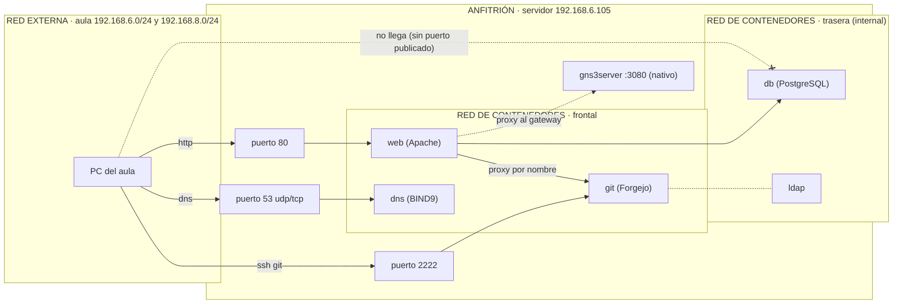

# Investigación · Contenedores

Encargo 1 · IAW · Sede Huesca

> Cómo leer este documento
> - Las tablas llevan lo que debe salir; se confirman al ejecutar y, si algo difiere, se corrige la tabla y se explica por qué.
> - El diseño de volúmenes y de red (apartados 2.4 y 2.5) es el de la sede; se comprueba con el apartado 5.

---

## Antes de empezar

**Instalación.** Motor de Docker y complemento Compose desde el repositorio oficial de Docker (no el paquete de la distribución). 

**Por qué estar en el grupo `docker` equivale a ser root.** El demonio `dockerd` corre como root y se maneja por el socket `/var/run/docker.sock`; quien puede escribir en ese socket puede pedirle a root que haga lo que quiera. Un usuario del grupo puede, por ejemplo, arrancar un contenedor con el sistema de ficheros del anfitrión montado (`-v /:/anfitrion`) y leer o modificar cualquier fichero del servidor, incluidos `/etc/shadow` y las claves SSH, o lanzar un contenedor privilegiado. Por eso, en nuestro servidor, el grupo `docker` solo lo forman quienes deben administrarlo.

---

## 1. La necesidad

Instalar servicios directamente sobre el sistema operativo crea un acoplamiento rígido entre las dependencias del software y el sistema base.

**Qué problema resuelve.**
- **Aislamiento de dependencias:** dos servicios que piden versiones distintas de la misma librería (PHP, Python, glibc) no chocan.
- **Portabilidad:** la imagen empaqueta el servicio, sus librerías y su configuración de base. Desaparece el "en mi máquina funciona".
- **Ciclo de vida desechable:** un contenedor se destruye y se recrea en segundos sin dejar residuos en el anfitrión.

**Qué gana quien administra.**
- Despliegues repetibles: lo que se probó es lo que corre.
- Límite de recursos por servicio (cgroups).
- Migración sencilla: se lleva el Compose, los secretos y los volúmenes.

**Qué se complica.**
- Hay que entender redes virtuales y almacenamiento persistente (si no, los datos se pierden con el contenedor).
- Los procesos ya no están a la vista: se depura con `docker logs`, `docker inspect` y `docker exec`.
- Una imagen mal diseñada, o un contenedor con privilegios de más, amplía la superficie de ataque.

**Por qué "lo instalo a mano y tomo notas" no es equivalente.** Las notas describen lo que se hizo un día, no el estado resultante, y no se enteran de los cambios posteriores. Ejemplo, tres semanas después: un `apt upgrade` actualiza `libssl` o el paquete del gestor de base de datos, y el servicio instalado a mano deja de arrancar por una incompatibilidad. Quien lo administra está de baja, y reinstalar desde las notas lleva horas de prueba y error adivinando dependencias que nadie anotó (versiones, módulos de Apache, permisos). Con Compose, la imagen guarda el entorno exacto, con etiqueta fijada, y se levanta igual en cualquier máquina. Lo único que cambia es lo que decidimos cambiar.

---

## 2. El servicio

### 2.1 Qué es un contenedor (paso 1)

```sh
docker run -d --name prueba alpine:3.20 sleep infinity
docker top prueba
ps aux | grep "sleep infinity" | grep -v grep
docker exec prueba ps aux
docker exec prueba ls /
docker exec prueba ip addr
uname -r && docker exec prueba uname -r
```


**Qué vimos.** El proceso `sleep infinity` aparece en la lista de procesos de nuestro portátil con un PID normal; desde dentro del contenedor tiene PID 1 y es el único proceso. Los ficheros (`ls /`) y la IP de dentro no son los nuestros. Pero `uname -r` devuelve la **misma versión de kernel** dentro y fuera.

**Conclusión.** Un contenedor **no es una máquina**: es un **proceso del anfitrión con la vista recortada**. Linux lo consigue con *namespaces* (qué ve: procesos, red, montajes, hostname, IPC) y *cgroups* (cuánto puede gastar: CPU, memoria, E/S).

| Comparte con el anfitrión | Es propio del contenedor |
| --- | --- |
| El **kernel** (mismo `uname -r`) | Árbol de procesos (PID 1 propio) |
| CPU, memoria y disco físicos (limitables con cgroups) | Sistema de ficheros raíz (capas de la imagen) |
| Los dispositivos y capacidades que se le den expresamente | Interfaz de red e IP propias |
| | Hostname y usuarios internos |

**Qué implica para la seguridad.** Al compartir kernel, un fallo del kernel o un contenedor con privilegios de más (`privileged: true`, el socket de Docker montado) puede comprometer el anfitrión. En una MV, el atacante tendría que saltar además el hipervisor.

### 2.2 Imágenes, capas y registros (paso 2)

```sh
docker image ls
docker image inspect alpine:3.20 --format '{{index .RepoDigests 0}}'
docker history alpine:3.20
docker build -t prueba-imagen:1.0 .
docker history prueba-imagen:1.0
docker run --rm prueba-imagen:1.0
```

Dockerfile usado:

```dockerfile
FROM alpine:3.20
RUN apk add --no-cache curl
COPY saluda.sh /usr/local/bin/saluda
CMD ["saluda"]
```


- **Imagen.** Plantilla de solo lectura: un sistema de ficheros más metadatos (qué ejecutar, variables, puertos). Se compone de **capas** apiladas; cada instrucción del Dockerfile (`FROM`, `RUN`, `COPY`) añade una. `docker history prueba-imagen:1.0` lo muestra: las capas de `alpine:3.20` debajo y las nuestras encima (la de `apk add curl` y la de `COPY`). Las capas se comparten entre imágenes y se guardan una sola vez.
- **Contenedor.** Una imagen en ejecución, con una capa fina de lectura/escritura encima (overlay2). Todo lo que se escribe dentro va a esa capa y **desaparece al borrar el contenedor** (paso 3).
- **Registro.** Servidor de imágenes (Docker Hub, `codeberg.org` para Forgejo). Una imagen se identifica por `nombre:etiqueta`, pero la etiqueta es un puntero **que se puede mover**; el **digest** (`sha256:...`, el `RepoDigests` de arriba) identifica un contenido exacto. De ahí que fijemos versiones (`postgres:16.15`, nunca `latest`).
- **Imagen propia.** El `Dockerfile` es la receta; `docker build` la ejecuta y reutiliza la caché de las capas que no cambian.

### 2.3 Vida y muerte de un contenedor (paso 3)

```sh
docker run -d --name ciclo alpine:3.20 sleep infinity
docker exec ciclo ip route add 1.2.3.4 via 172.17.0.1
```


**Por qué.** Ser root *dentro* del contenedor no es ser root del anfitrión: Docker arranca los procesos con un subconjunto reducido de **capacidades de Linux**, y configurar la red (`CAP_NET_ADMIN`) no está en él. Se concede solo la que hace falta con `--cap-add NET_ADMIN` (en Compose, `cap_add`), en vez de `privileged: true`, que las concede todas.

Resto del experimento: `rm -f` + `run --cap-add NET_ADMIN`, escribir `/tmp/prueba`, instalar `curl` a mano, añadir la ruta, `stop`/`start`, y por último `rm` + `run` de nuevo. 

| Qué | `stop`/`start` | `rm` + `run` | `down` + `up` | `down -v` + `up` |
| --- | --- | --- | --- | --- |
| El proceso principal | Vuelve a arrancar (mismo contenedor, proceso nuevo) | Contenedor y proceso nuevos | Nuevos | Nuevos |
| Un fichero escrito dentro | **Sobrevive** (la capa de escritura sigue) | Se pierde | Se pierde | Se pierde |
| Un paquete instalado a mano | **Sobrevive** | Se pierde | Se pierde | Se pierde |
| Una ruta de red puesta a mano | Se pierde (el espacio de red se recrea al arrancar) ‹verificar› | Se pierde | Se pierde | Se pierde |
| Lo que venía en la imagen | Está | Está | Está | Está |
| Lo que está en un volumen | Sobrevive | Sobrevive | **Sobrevive** | **Se pierde** |

**Regla.** Lo que tiene que durar se escribe en un **volumen** (datos) o en la **imagen/Compose** (configuración y paquetes). Arreglar algo con `docker exec` no vale porque modifica solo la capa de escritura de *ese* contenedor: sobrevive a un reinicio pero **no** a un `down`/`up`, a una recreación por cambio de imagen, ni se puede reproducir en otra máquina.

### 2.4 Datos que sobreviven (paso 4)

```sh
docker volume create datos
docker run --rm -v datos:/d alpine:3.20 sh -c 'echo persistente > /d/f.txt'
docker run --rm -v datos:/d alpine:3.20 cat /d/f.txt
docker volume inspect datos --format '{{.Mountpoint}}'
docker run --rm -v ~/lab-docker/contenido:/d:ro alpine:3.20 sh -c 'echo x > /d/otro.txt'
docker run --rm -v ~/lab-docker/contenido:/d    alpine:3.20 sh -c 'echo x > /d/otro.txt'
ls -l ~/lab-docker/contenido
```

 Vimos: el volumen vive en `/var/lib/docker/volumes/datos/_data`, lo gestiona Docker; con `:ro` el segundo `echo` falla con `Read-only file system`; sin `:ro`, el fichero que crea el contenedor pertenece a **root** en el anfitrión.

| | *Bind mount* (`./ruta:/destino`) | Volumen con nombre (`datos:/destino`) |
| --- | --- | --- |
| Dónde viven los datos | En la carpeta del anfitrión que indicamos | En `/var/lib/docker/volumes/<proyecto>_<nombre>/_data` |
| Quién lo crea | Nosotros (si la ruta no existe, Docker crea una **carpeta vacía de root**) | Docker, la primera vez que se usa |
| Con `down` | Siguen | Siguen |
| Con `down -v` | Siguen (Docker no los toca) | **Se borran** |
| Cómo se copian | `cp`, `rsync`, `git` directamente | Con un contenedor auxiliar y `tar` (paso 7), o `docker run --volumes-from` |
| Permisos | Los del anfitrión (suelen dar problemas de UID) | Los gestiona Docker; el contenedor inicializa su contenido |
| Se usa para | Configuración que está en Git, de solo lectura | Datos que genera el servicio |

**Diseño de volúmenes de la sede** (regla: configuración en Git → *bind mount* `:ro`; datos que genera el servicio → volumen con nombre):

| Servicio | Qué datos tiene | ¿Debe sobrevivir? | Tipo |
| --- | --- | --- | --- |
| `dns` (BIND9) | `named.conf*` y ficheros de zona (en Git) | Sí, pero ya vienen de Git | *Bind mount* `:ro` (`./dns/bind:/etc/bind:ro`). Si algún día hay actualizaciones dinámicas (`nsupdate`, TSIG), BIND necesita escribir los `.jnl`: entonces volumen para `/var/cache/bind` |
| `web` (Apache) | `web_publica`, `web_intranet`, `apache_config` (en Git) | Sí, vienen de Git | *Bind mount* `:ro`. Los certificados (`ssl/`) y `.htpasswd`, si no van a Git, también `:ro` |
| `db` (PostgreSQL) | Ficheros de la base: tablas, WAL | **Sí, lo más importante** | Volumen con nombre `postgres_data` → `/var/lib/postgresql/data`. Los SQL de arranque (`init/`) en Git, `:ro` |
| `git` (Forgejo) | Repositorios, base SQLite, claves SSH del servidor, adjuntos | **Sí** | Volumen con nombre `forgejo_data` → `/data` |
| `ldap` | Base del directorio y su configuración | Sí | Dos volúmenes con nombre (`ldap_data` y `ldap_config`) |
| `lam` | Configuración de LAM | Sí | Volumen con nombre |

Para Forgejo conviene el volumen con nombre y no una carpeta del anfitrión: con un *bind mount* a una carpeta vacía o equivocada, Forgejo arranca "de cero" y enseña el instalador, como nos pasó el 6 de octubre al apuntar a una carpeta vacía mientras los datos reales estaban en otra.

### 2.5 Quién ve a quién (paso 5)

```sh
docker network create demo
docker network create --internal demo-interna
docker run -d --name a --network demo alpine:3.20 sleep infinity
docker run -d --name b --network demo alpine:3.20 sleep infinity
docker run -d --name c --network demo-interna alpine:3.20 sleep infinity
docker exec a ping -c1 b
docker exec a ping -c1 8.8.8.8
docker exec c ping -c1 8.8.8.8
docker exec a cat /etc/resolv.conf
docker network inspect demo --format '{{json .IPAM.Config}} {{.Internal}}'
sudo iptables -t nat -S | grep -i masquerade | head
docker run -d --name webtest --network demo -p 8080:80 nginx:1.27-alpine
ss -lntp | grep 8080
```


- **Red de Docker.** Un puente virtual con su propia subred. Los contenedores conectados a la misma red se ven entre sí y se resuelven **por nombre** (el `127.0.0.11` de `resolv.conf` es el DNS interno de Docker). Un contenedor que no está en esa red no los ve.
- **`internal`.** Red sin salida: sus contenedores se hablan entre sí pero no alcanzan Internet ni la red exterior (`ping 8.8.8.8` desde `c` falla, desde `a` funciona). Tampoco se puede publicar el puerto de un contenedor que solo esté en una red interna.
- **Publicar un puerto** (`-p 8080:80`). Abre un puerto **en el anfitrión** (con una regla de iptables/nftables) que reenvía al contenedor. Es lo que hace visible el servicio desde otro equipo. Con `-p 8080:80` Docker escucha en `0.0.0.0` (todas las interfaces); con `-p 127.0.0.1:8080:80`, solo en el propio anfitrión.
- **Misma red frente a puerto publicado.** Dos contenedores en la misma red se alcanzan por nombre y puerto del contenedor, sin publicar nada; el puerto publicado es solo para los que están **fuera** de la red (el anfitrión y la red física).

**Diseño de red de la sede.**



| Servicio | Redes | Puertos publicados |
| --- | --- | --- |
| `web` | `frontal` y `trasera` | **80** (y 443 si se activa HTTPS) |
| `git` (Forgejo) | `frontal` | **2222** → 22 (SSH). El HTTP lo atiende Apache por proxy a `forgejo:3000`; no se publica el 3000 |
| `dns` (BIND9) | `frontal` | **53/udp y 53/tcp** en la IP del aula |
| `db` | solo `trasera` (`internal: true`) | **ninguno** |
| `ldap`, `lam` | `trasera` (LAM además en `frontal` si se publica su web) | los que haga falta, nunca el 389 |

**Cómo la base de datos es alcanzable por la web pero no desde fuera.** `db` está únicamente en `trasera`, red `internal`, y **no publica ningún puerto**. `web` está en `frontal` (para publicar el 80) y en `trasera` (para llegar a `db` por nombre). Desde el aula, el 5432 del servidor no tiene nada escuchando; desde el propio servidor tampoco, salvo para quien ejecute `docker exec`. Dos consecuencias a vigilar, ambas vividas:
- Un contenedor que **solo** está en una red `internal` no puede publicar puertos: el 22 de octubre `forgejo` no publicaba el 2222 por estar solo en `trasera`; se arregló añadiéndolo a `frontal`.
- Apache hace proxy a servicios en el anfitrión (`gns3server` en `172.22.0.1:3080`) y por nombre (`forgejo:3000`): `web` debe compartir red con `git`, y estar en una red con salida. Las conexiones manuales con `docker network connect` no sobreviven a un `down`/`up`; **la red tiene que estar en el Compose.**

```sh
docker rm -f a b c ciclo prueba webtest; docker network rm demo demo-interna
```

### 2.6 Compose (paso 6)

```yaml
name: lab
services:
  web:
    image: nginx:1.27-alpine
    container_name: lab-web
    ports: ["8080:80"]
    networks: [frontal]
    restart: unless-stopped
  herramienta:
    image: alpine:3.20
    container_name: lab-herramienta
    command: sleep infinity
    networks: [frontal]
networks:
  frontal:
```

```sh
docker compose config
docker compose up -d
docker compose ps
docker compose exec herramienta wget -qO- http://web | head -3
docker compose down
```


**Qué significa cada clave.**

| Clave | Qué hace |
| --- | --- |
| `name` | Nombre del proyecto; prefijo de redes, volúmenes y contenedores sin `container_name`. |
| `image` | Imagen (y etiqueta) a descargar o usar. |
| `build` | En vez de descargar, construir la imagen desde un `Dockerfile`. |
| `container_name` | Nombre fijo del contenedor (si no, `proyecto-servicio-1`). Impide escalar el servicio. |
| `command` | Sustituye al `CMD` de la imagen. |
| `environment` | Variables de entorno escritas en el propio fichero. |
| `env_file` | Variables de entorno leídas de un fichero. |
| `volumes` | Volúmenes con nombre o *bind mounts*, con `:ro` si es solo lectura. |
| `networks` | Redes a las que se conecta el servicio (y su declaración en el nivel superior, con `internal: true`, si procede). |
| `ports` | Puertos publicados en el anfitrión (`"anfitrión:contenedor"`). |
| `depends_on` | Orden de arranque; con `condition: service_healthy` espera a que el otro esté sano. |
| `restart` | Política de reinicio (`no`, `on-failure`, `unless-stopped`, `always`). |
| `healthcheck` | Orden que decide si el servicio está sano (`healthy`/`unhealthy`). |
| `cap_add` | Concede una capacidad de Linux concreta (p. ej. `NET_ADMIN`). |
| `privileged` | Concede **todas** las capacidades y acceso a los dispositivos del anfitrión. |
| `${VARIABLE}` | Sustitución desde el entorno o el fichero `.env` de la carpeta del proyecto. |

**Tres reglas y su porqué.**

1. **Nada de `privileged: true`.** Quita casi todo el aislamiento: un fallo en el servicio equivale a root en el anfitrión. Si hace falta un permiso concreto, se usa `cap_add` con esa capacidad (lo vimos con `NET_ADMIN` en el paso 3); si el problema son permisos de ficheros, se arreglan con `chown` o `user:`.
2. **Secretos fuera del fichero.** `.env` con las contraseñas va en `.gitignore`; `.env.example` (con valores de ejemplo) va a Git. Los secretos de la sede: contraseña del administrador de PostgreSQL, contraseña de la web a la base, contraseña del administrador de LDAP y de LAM, y `.htpasswd` de la intranet. Para los que lo admiten, es mejor `secrets:` con `*_FILE` (ver el documento de la base de datos), porque una variable en `environment` se ve con `docker inspect`.
3. **`restart: unless-stopped`.** Sin política (`no`, la de por defecto), tras reiniciar la máquina los contenedores **no** vuelven. Con `unless-stopped` el demonio los arranca solos, salvo los que paramos a mano con `docker stop`. Fuera de Compose hace falta que el propio servicio Docker arranque con el sistema (`systemctl enable docker`) y que haya salud: `healthcheck` y `depends_on: service_healthy` para el orden. Comprobado reiniciando el portátil: 
### 2.7 Qué hace `docker compose up -d`, por orden

1. **Lee y valida** `compose.yaml`: sintaxis, sustituye `${VARIABLES}` con `.env`, y calcula el grafo de dependencias (`depends_on`).
2. **Imágenes:** si no están en local, las descarga (`pull`) del registro, o las construye (`build`). Cada imagen son capas de solo lectura montadas con overlay2.
3. **Redes:** crea las redes que falten (puente con su subred, interfaces `veth` y reglas de iptables/nftables para publicar puertos y enmascarar la salida).
4. **Volúmenes:** crea los volúmenes con nombre que no existan; los *bind mounts* apuntan a rutas del anfitrión.
5. **Contenedores**, en el orden de `depends_on` (si una dependencia exige `service_healthy`, espera a que su `healthcheck` pase). Para cada uno, con `containerd`/`runc`: crea los *namespaces* (PID, red, montajes, IPC, hostname), asigna los *cgroups*, monta las capas con una capa de escritura nueva y arranca el proceso principal (PID 1, el `ENTRYPOINT`/`CMD`).
6. **Registros:** con `-d`, devuelve la terminal y conecta la salida estándar y de error del proceso al controlador de registros (`json-file` por defecto), que lee `docker logs`.

### 2.8 Levantar servicios de verdad: la pila (paso 7)

```yaml
name: pila
services:
  db:
    image: postgres:16
    environment:
      POSTGRES_PASSWORD: ${DB_CLAVE}
    volumes:
      - datos:/var/lib/postgresql/data
    networks: [trasera]
    healthcheck:
      test: ["CMD-SHELL", "pg_isready -U postgres"]
      interval: 5s
      retries: 10
    restart: unless-stopped
  web:
    image: nginx:1.27-alpine
    volumes:
      - ./sitio:/usr/share/nginx/html:ro
    ports: ["8080:80"]
    networks: [frontal, trasera]
    depends_on:
      db:
        condition: service_healthy
    restart: unless-stopped
volumes:
  datos:
networks:
  frontal:
  trasera:
    internal: true
```

**Servicio por servicio.**
- `db`: PostgreSQL con la contraseña tomada de `.env` (`${DB_CLAVE}`), sus datos en el volumen con nombre `datos` (sobrevive a `down`), solo en la red `trasera` y sin puertos publicados. El `healthcheck` con `pg_isready` marca cuándo acepta conexiones. Se reinicia solo.
- `web`: nginx que sirve `./sitio` como **solo lectura** (configuración/contenido que está en Git). Publica el 8080 al exterior, está en `frontal` (para publicar) y en `trasera` (para ver a `db`), y no arranca hasta que `db` esté `healthy`.
- `.env` (`DB_CLAVE=...`) en `.gitignore`; `.env.example` con la clave de ejemplo, en Git.

```sh
docker compose up -d
docker compose ps          # (healthy)
curl -s http://localhost:8080
```


**1. ¿La base de datos se alcanza desde fuera?**

```sh
# desde otro equipo
nc -zv -w 3 IP_DEL_PORTATIL 5432
# desde dentro de la red
docker run --rm --network pila_trasera postgres:16 pg_isready -h db
```

 Desde fuera, **no** (`Connection refused` o `timed out`): `db` no publica ningún puerto, así que el anfitrión no tiene nada escuchando en el 5432. Desde dentro de `pila_trasera`, **sí** (`db:5432 - accepting connections`): es la misma red, y se resuelve por nombre con el DNS de Docker. Ese contenedor auxiliar tampoco tiene Internet porque la red es `internal`.

**2. ¿Los datos sobreviven?**

```sh
docker compose exec db ls /var/lib/postgresql/data | head -3
docker compose down && docker compose up -d
docker compose exec db ls /var/lib/postgresql/data | head -3
docker compose down -v && docker compose up -d
docker compose logs db | grep -i initdb
```

 Tras `down` + `up` **siguen** los ficheros del gestor y no aparece `initdb`: los datos estaban en el volumen. Tras `down -v` + `up` **vuelve a aparecer `initdb`**: el volumen se borró y se creó una base nueva y vacía. **`docker compose down -v` no se teclea nunca en el servidor** (borra los datos de verdad).

**3. Copiar y restaurar un volumen.** Copia (con la base **parada**: copiar los ficheros de PostgreSQL con el gestor en marcha da una copia incoherente; en el servidor se usa además `pg_dump`):

```sh
docker compose stop db
docker run --rm -v pila_datos:/origen -v "$PWD":/copia alpine:3.20 tar czf /copia/datos.tgz -C /origen .
```

Restauración (órdenes que nos funcionaron ‹confirmar›):

```sh
docker compose down -v                   # se pierde el volumen
docker compose create                    # recrea volumen y contenedores, sin arrancar
docker run --rm -v pila_datos:/destino -v "$PWD":/copia alpine:3.20 tar xzf /copia/datos.tgz -C /destino
docker compose up -d
docker compose exec db ls /var/lib/postgresql/data | head -3
docker compose logs db | grep -i initdb  # no debe aparecer: no se ha reinicializado
```

(Se usa `docker compose create` en vez de `docker volume create` a mano para que el volumen lleve las etiquetas de Compose y no avise de que "no lo creó Compose".) 
### 2.9 Cuando algo no arranca (paso 8)

Se rompió la pila de tres maneras, una cada vez, y se diagnosticó solo con órdenes.

| Fallo provocado | Síntoma | Dónde miro | Qué vi | Qué era |
| --- | --- | --- | --- | --- |
| Borrar `DB_CLAVE` del `.env` | `docker compose up -d` avisa y `db` sale con error; `web` se queda esperando | `docker compose config -q`, `docker compose ps -a`, `docker compose logs --tail=50 db`, `docker inspect pila-db-1 --format '{{.State.Status}} {{.State.ExitCode}}'` | `The "DB_CLAVE" variable is not set. Defaulting to a blank string.`; en `db`: `Error: Database is uninitialized and superuser password is not specified.`; estado `exited 1`; `web` en `Created` | Variable vacía: la imagen exige contraseña en el primer arranque. **Ojo:** si el volumen ya estaba inicializado, `db` arranca igualmente y el fallo pasa desapercibido hasta crear una máquina limpia |
| Publicar en `web` un puerto ya ocupado | `docker compose up -d` falla al arrancar `web`; `db` sí está sano | `docker compose ps -a`, mensaje del propio `up`, `ss -lntp \| grep 8080` | `Bind for 0.0.0.0:8080 failed: port is already allocated` (o `address already in use`); `web` en `Created`; `ss` muestra el proceso que ocupa el puerto | Conflicto de puerto en el anfitrión. No es un fallo del contenedor: nunca llegó a arrancar |
| Nombre mal puesto de la imagen de `db` | `up` falla al descargar | `docker compose config -q` (válido: el nombre es correcto sintácticamente), `docker compose pull`, mensaje del `up` | `pull access denied for postgress, repository does not exist or may require 'docker login'` (o `manifest for postgres:99 not found`)  | La imagen o la etiqueta no existen en el registro. No hay contenedor que inspeccionar |

**Órdenes de comprobación para quien llegue nuevo:** ver apartado 5.

---

## 3. Alternativas de aislamiento

Siete formas de tener un entorno aislado sin otra máquina física.

| Criterio | Docker Engine | Podman | LXC / Incus (y LXD) | systemd-nspawn | Contenedores de Windows | MV con KVM | MV con VirtualBox / Hyper-V |
| --- | --- | --- | --- | --- | --- | --- | --- |
| **Qué es y quién lo mantiene** | Motor de contenedores de aplicaciones; Docker Inc. y proyecto Moby. | Motor de contenedores sin demonio; Red Hat y comunidad. | Contenedores de sistema completo: LXC (Linux Containers), Incus (comunidad, fork de LXD), LXD (Canonical). | Contenedor ligero de sistema que viene con systemd. | Contenedores de aplicaciones Windows; Microsoft. | Virtualización del kernel de Linux; con QEMU y libvirt. | VirtualBox (Oracle) e Hyper-V (Microsoft, función de Windows). |
| **Licencia** | Motor: Apache 2.0, libre. **Docker Desktop** tiene licencia propia y de pago para empresas grandes. ([fuente](https://docs.docker.com/subscription/desktop-license/)) | Apache 2.0, libre. | LXC: LGPL/GPL; Incus: Apache 2.0; **LXD: AGPLv3** desde 2023. | LGPL 2.1+ (parte de systemd). | Funciones del propio Windows; las imágenes base tienen su licencia de Microsoft. | GPL v2 (kernel), libre. | VirtualBox: GPLv3, pero el *Extension Pack* tiene licencia propia (gratuita solo en uso personal y educativo). Hyper-V: propietario. |
| **Qué aísla y qué comparte** | Procesos, ficheros y red con namespaces/cgroups. **Comparte el kernel.** | Igual que Docker. **Comparte el kernel.** | Un sistema completo (con `init`); **comparte el kernel**. Incus también crea MV. | Un sistema completo; **comparte el kernel**. Aislamiento más débil que Docker. | Dos modos: *process isolation* (**comparte el kernel de Windows**, que debe coincidir) y *Hyper-V isolation* (kernel propio, en una MV ligera). | **Kernel propio** por MV; hardware virtual completo. | **Kernel propio** por MV. |
| **Sistemas donde corre** | Linux nativo. En Windows y macOS, **dentro de una MV** (WSL 2 o Hyper-V). | Linux nativo. En Windows/macOS, dentro de una MV (`podman machine`). | Linux. | Linux con systemd. | Windows Server y Windows 10/11 Pro; solo imágenes **Windows**. | Linux con VT-x/AMD-V. | VirtualBox: Windows, Linux, macOS. Hyper-V: Windows. |
| **Necesita root** | Sí: `dockerd` corre como root (hay modo *rootless*). El grupo `docker` equivale a root. | **No**: nativamente *rootless*, sin demonio. | Normalmente sí (LXD/Incus: el grupo `lxd`/`incus-admin` equivale a root); admite contenedores sin privilegios. | Sí (`machinectl`/`systemd-nspawn` se ejecutan como root). | Administrador de Windows. | Sí (o grupo `libvirt`, equivalente). | Sí (módulos de kernel / Hyper-V requiere administrador). |
| **Varios servicios juntos** | `docker compose`. | `podman compose` / `podman-compose`, o pods y `podman kube play`. | Perfiles y scripts; Ansible, Juju o Terraform. | `machinectl` y ficheros `.nspawn`; no tiene equivalente a Compose. | `docker compose` (con Docker Engine para Windows). | libvirt/Terraform/Vagrant. | Vagrant; Hyper-V con PowerShell/Terraform. |
| **Arranque y consumo** | Medido: `time docker run --rm alpine:3.20 true` → ; sobrecarga de RAM del demonio  | Medir igual con `podman`  no hay demonio residente. | Arranca un `init` completo (más lento y pesado que un contenedor de aplicación) ‹fuente›. | Arranca un `init` completo ‹fuente›. | Más pesado que Linux: las imágenes base ocupan **GB** ‹fuente: documentación de Microsoft›. | La MV reserva la RAM asignada y arranca un SO completo (segundos a minutos). | Igual que KVM . |
| **Qué hace bien** | Estándar de facto, ecosistema y documentación enormes. ([fuente](https://docs.docker.com/get-started/overview/)) | Seguridad por defecto: *rootless* y sin demonio. ([fuente](https://podman.io/docs)) | Sustituye a una MV ligera con sistema completo. ([fuente](https://linuxcontainers.org/)) | Sin instalar nada extra en un Linux con systemd. ([fuente](https://www.freedesktop.org/software/systemd/man/latest/systemd-nspawn.html)) | Ejecuta software Windows en contenedor. ([fuente](https://learn.microsoft.com/en-us/virtualization/windowscontainers/about/)) | Aislamiento fuerte; cualquier SO invitado. ([fuente](https://linux-kvm.org/)) | Aislamiento fuerte; cualquier SO; interfaz gráfica. ([fuente](https://www.virtualbox.org/)) |
| **Qué hace mal** | Demonio con privilegios de root. ([fuente](https://docs.docker.com/engine/security/)) | Compatibilidad con Compose y redes complejas menos probada que Docker. ([fuente](https://docs.podman.io/)) | Pensado para sistemas, no para "un proceso por contenedor"; la licencia de LXD cambió. ([fuente](https://linuxcontainers.org/)) | Poca documentación y comunidad; sin orquestación. ([fuente](https://www.freedesktop.org/software/systemd/man/latest/systemd-nspawn.html)) | Solo cargas Windows; imágenes enormes. ([fuente](https://learn.microsoft.com/en-us/virtualization/windowscontainers/about/)) | Consumo alto de RAM, CPU y disco por servicio; más trabajo de administración. | Lo mismo; además, la licencia del *Extension Pack*. ([fuente](https://www.virtualbox.org/wiki/Licensing_FAQ)) |

**Kubernetes, en tres líneas.** Es un orquestador de contenedores de código abierto (Apache 2.0, proyecto de la CNCF) que reparte, escala y recupera contenedores sobre un **clúster** de varias máquinas. No es la respuesta para el servidor de una sede porque necesita un plano de control (API, base de datos `etcd`, planificador) y varios nodos para tener sentido, y el trabajo de administrarlo supera con mucho el de seis servicios en un solo servidor, que Compose resuelve con un fichero. ([fuente](https://kubernetes.io/docs/concepts/overview/))

---

## 4. Elección

**Sin que nadie nos impusiera nada.** Elegiríamos **Docker Engine con Compose**. Nuestros criterios, por orden: (1) que un servicio de un solo proceso por contenedor encaje con nuestros servicios (Apache, PostgreSQL, Forgejo, BIND9, OpenLDAP); (2) documentación e imágenes oficiales para todos ellos, que casi siempre se publican con instrucciones de Docker; (3) un único fichero que levante varios servicios y los ordene (`depends_on` con `healthcheck`); (4) que cualquiera del equipo pueda seguir los pasos sin experiencia previa. En seguridad, Podman *rootless* sería mejor; lo descartamos por (2) y (3), y a cambio mitigamos el riesgo del demonio con el grupo `docker` restringido, sin `privileged` y sin montar el socket de Docker.

**Qué nos da Compose que necesitamos.**
- **Que los servicios vuelvan solos tras un reinicio:** `restart: unless-stopped` en cada servicio, más `systemctl enable docker` fuera de Compose. Comprobado reiniciando (apartado 5).
- **Que alguien ajeno levante la sede en una máquina limpia leyendo solo la documentación:** el Compose, `.env.example`, la carpeta `init/` de la base de datos y las instrucciones de "Instalación desde cero" son suficientes; `docker compose up -d` crea redes, volúmenes y contenedores sin escribir SQL ni configurar a mano (prueba 17).

**Qué perderíamos con cada alternativa (una cosa concreta).**
- **Podman:** habría que comprobar que `depends_on` con `condition: service_healthy` y las redes `internal` funcionan igual en `podman compose`, y la mayoría de las guías de nuestros servicios dan las órdenes de Docker; asumiríamos el trabajo de traducirlas.
- **LXC/Incus:** perderíamos el modelo de "un proceso por contenedor": habría que administrar cada servicio como un sistema completo (actualizar con `apt`, gestionar `systemd`).
- **systemd-nspawn:** perderíamos cualquier equivalente a Compose: cada servicio, red y reinicio se configuraría a mano.
- **Contenedores de Windows:** nuestros servicios son Linux (Apache/PHP, PostgreSQL, BIND9, Forgejo); no hay imágenes Windows para ellos.
- **MV con KVM, VirtualBox o Hyper-V:** una MV por servicio, con su SO completo que parchear y la RAM reservada; tardaríamos minutos en levantar la sede en vez de segundos, y gastaríamos la RAM del servidor en sistemas operativos duplicados.

**Decisiones que son nuestras.**

| Decisión | Qué hacemos | Por qué |
| --- | --- | --- |
| Etiquetas fijadas | `postgres:16.15`, `nginx`/`php:8.2-apache` con versión, nunca `latest`; Forgejo con versión concreta. Revisar `forgejo:1.21` (es de finales de 2023: comprobar hasta cuándo recibe parches) y `ldapaccountmanager/lam:stable` (la etiqueta `stable` es móvil y puede cambiar al hacer `pull`) | Reproducibilidad y saber qué corre. Una etiqueta móvil rompe la regla |
| Un volumen por dato que sobreviva | `postgres_data`, `forgejo_data`, `ldap_data`, `ldap_config` (apartado 2.4) | Los datos no pueden depender de un contenedor |
| Qué puertos se publican | Solo `80` (web), `2222` (SSH de Forgejo) y `53` (DNS); **nunca** 5432, 389 ni 3000 | Principio de mínima exposición (W5) |
| Política de reinicio | `restart: unless-stopped` en todos | Vuelven solos (S3), pero respetan una parada voluntaria |
| Dónde viven los secretos | `.env` (en `.gitignore`) y, donde la imagen lo admite, `secrets:` con `*_FILE`; `.env.example` sin claves en Git | Nada de credenciales en el repositorio (prueba 18) |

---

## 5. Comprobación

Para quien acaba de llegar. Se ejecuta en el servidor, en la carpeta del proyecto (`/home/asir2/proyecto_huesca`).

| # | Qué comprueba | Orden | Salida esperada |
| --- | --- | --- | --- |
| 1 | El fichero es válido (sin levantar nada) | `docker compose config -q; echo $?` | Ninguna salida salvo `0`. Si falta una variable: `The "X" variable is not set...` |
| 2 | Todo está arriba, sano y desde cuándo | `docker compose ps` | Cada servicio `Up ... (healthy)` con su antigüedad en la columna de estado; ninguno en `Exited` o `Restarting` |
| 3 | La línea del error de un servicio que no arranca | `docker compose ps -a`, `docker compose logs --tail=50 SERVICIO` y `docker inspect CONTENEDOR --format '{{.State.Status}} {{.State.ExitCode}}'` | Estado y código de salida (`exited 1`, `exited 127`…) y, en el registro, la última línea con `ERROR`/`FATAL` o el mensaje de la imagen |
| 4 | Tras reiniciar, todo ha vuelto solo | `sudo reboot`; luego `uptime -s`, `systemctl is-enabled docker`, `docker compose ps` | `enabled`; todos `Up` con una antigüedad **posterior** al arranque (`uptime -s`) y `healthy` |
| 5 | Desde otro equipo, la base no responde y la web sí | `nc -zv -w 3 IP_SERVIDOR 5432` y `nc -zv -w 3 IP_SERVIDOR 80` | El 5432: `Connection refused` o `timed out`. El 80: `succeeded` |
| 6 | Qué publica el servidor | `ss -lntp \| grep -E ':(80\|2222\|53\|5432)'` | Escuchan 80, 2222 y 53; **no** el 5432 |
| 7 | La base no sale por ninguna red con salida | `docker network inspect NOMBRE_trasera --format '{{.Internal}}'` | `true` |
| 8 | Los datos sobreviven | `docker compose down && docker compose up -d` y la comprobación del recuento de filas | Mismos datos; en el registro del gestor **no** aparece `initdb` |

Ejecutada por: ‹nombre› · fecha: ‹fecha› · ¿todo coincide?: ‹sí/no›

### Fallos que anticipamos en el Compose de la sede y cómo los detectaremos

1. **Forgejo no publica el 2222 porque solo está en una red `internal`.** (Nos pasó el 22/10.) Detección: `docker port forgejo` sale vacío, `ss -lnt | grep 2222` no muestra nada y `docker network inspect trasera --format '{{.Internal}}'` da `true`. Prevención: Forgejo en `frontal`.
2. **Un *bind mount* a una ruta vacía o inexistente.** Docker crea una **carpeta vacía de root**, y servicios como Forgejo muestran el instalador o BIND9 sale con `Exited (127)` porque `root.hints` era una carpeta vacía en vez de un fichero (nos pasó con los dos). Detección: `docker compose config` (rutas resueltas), `ls -ld RUTA` en el anfitrión, y `docker compose logs --tail=50 SERVICIO`. Prevención: comprobar con `ls` que existen antes del `up`.
3. **Etiqueta móvil (`lam:stable`) que cambia tras un `pull`.** Detección: `docker image inspect IMAGEN --format '{{index .RepoDigests 0}}'` antes y después; si el digest cambia, la imagen cambió. Prevención: fijar versión.
4. **`depends_on: service_healthy` hacia un servicio sin `healthcheck`.** `docker compose up` falla con un error de dependencia no sana o se queda esperando. Detección: `docker compose config` y `docker inspect --format '{{json .State.Health}}' CONTENEDOR` (devuelve `null` si no hay `healthcheck`). Prevención: añadir `healthcheck` a todo servicio del que dependa otro.
5. **Contenedores conectados a mano con `docker network connect`.** Funcionan hasta el siguiente `down`/`up`. Detección: `docker inspect CONTENEDOR --format '{{json .NetworkSettings.Networks}}'` frente a lo que dice `docker compose config`. Prevención: la red, en el Compose.

---

## 6. Fuentes

Consultadas el ‹fecha de consulta›.

- **Docker Documentation** (arquitectura): https://docs.docker.com/get-started/overview/ (22/09/2026).
- **Docker.** Licencia de Docker Desktop: https://docs.docker.com/subscription/desktop-license/ ‹fecha› · Seguridad del motor: https://docs.docker.com/engine/security/ ‹fecha›.
- **Compose File Specification:** https://docs.docker.com/compose/compose-file/ (22/09/2026).
- **Podman:** https://podman.io/docs (22/09/2026) · https://docs.podman.io/ ‹fecha›.
- **Linux Containers (LXC / LXD / Incus):** https://linuxcontainers.org/ (22/09/2026).
- **systemd-nspawn:** https://www.freedesktop.org/software/systemd/man/latest/systemd-nspawn.html ‹fecha›.
- **Contenedores de Windows (Microsoft):** https://learn.microsoft.com/en-us/virtualization/windowscontainers/about/ ‹fecha›.
- **KVM:** https://linux-kvm.org/ ‹fecha› · **VirtualBox:** https://www.virtualbox.org/ y https://www.virtualbox.org/wiki/Licensing_FAQ ‹fecha›.
- **Kubernetes:** https://kubernetes.io/docs/concepts/overview/ ‹fecha›.
- **Red Hat Container Security Guide:** https://access.redhat.com/documentation/en-us/red_hat_enterprise_linux/ (22/09/2026).

---

## Preguntas de pizarra

**1. `docker compose down` y luego `up -d`: qué desaparece y qué no, servicio por servicio. Dónde están los datos de Forgejo.**

`down` elimina los **contenedores** (con su capa de escritura) y las **redes** que creó Compose. **No** toca las imágenes, ni los volúmenes con nombre, ni los *bind mounts* (sí los borraría `down -v` en los volúmenes con nombre). El `up -d` recrea contenedores y redes iguales.

| Servicio | Desaparece | Sigue |
| --- | --- | --- |
| `web` (Apache) | El contenedor y lo que se haya escrito dentro | La imagen y el contenido (viene de Git por *bind mount*) |
| `db` (PostgreSQL) | El contenedor | El volumen `postgres_data`: **los datos** |
| `git` (Forgejo) | El contenedor | El volumen `forgejo_data` (repos, base SQLite, claves SSH) |
| `dns` (BIND9) | El contenedor | La configuración (viene de Git por *bind mount*) |

En el instante entre `down` y `up`, los datos de Forgejo **no están en ningún contenedor** (no hay): están en el **volumen** `/var/lib/docker/volumes/<proyecto>_forgejo_data/_data` (o en la carpeta del anfitrión si fuera un *bind mount*), y el nuevo contenedor los monta al arrancar.

**2. Tres contenedores, dos redes y un puerto publicado.**

`web` (en `frontal` y `trasera`, publica el 80), `app` (solo `trasera`) y `db` (solo `trasera`, sin puertos):

| Desde | Alcanza |
| --- | --- |
| Otro contenedor de `frontal` | `web` (por nombre) |
| Otro contenedor de `trasera` | `web`, `app` y `db` (por nombre) |
| El anfitrión | `web`, en el puerto publicado (`localhost:80`). `db` no, salvo por `docker exec` |
| Otro equipo de la red | Solo `web`, en el puerto publicado |

La base de datos queda aislada en `trasera` (con `internal: true`): solo la ven los contenedores de esa red. No la alcanza el anfitrión por red ni ningún equipo de fuera.

**3. Un compañero propone `privileged: true` en el contenedor de la web.**

Le decimos que no. `privileged: true` concede al contenedor casi todas las capacidades del kernel, desactiva el filtro de AppArmor/seccomp y le da acceso a los dispositivos del anfitrión. Si el servidor web sufre una vulnerabilidad de ejecución remota de código, el atacante puede **escapar del contenedor** y controlar la máquina. Los problemas de permisos se arreglan por su causa: `chown` del volumen, el `user:` correcto del servicio, o, si falta un permiso concreto, `cap_add` con **esa** capacidad (lo vimos con `NET_ADMIN`).

**4. El servidor se reinicia de madrugada: qué tiene que pasar para que a las ocho todo funcione.**

- **En el anfitrión:** el servicio Docker arranca con el sistema (`systemctl enable docker` → `systemctl is-enabled docker` da `enabled`), y el servidor arranca solo tras un corte de luz (ajuste de la BIOS/UEFI "restaurar tras pérdida de corriente").
- **En el Compose:** `restart: unless-stopped` en todos los servicios, para que `dockerd` los levante solos (los que paramos a mano con `docker stop` no volverían).
- **Orden y salud:** `healthcheck` en la base de datos y `depends_on: condition: service_healthy` en los servicios que la usan, para que la web no arranque antes de que la base acepte conexiones.
- **Datos y redes en el Compose:** volúmenes con nombre para lo que debe durar y redes declaradas (sin `docker network connect` a mano, que no sobrevive).
- **Comprobación:** apartado 5, punto 4.

---

## Aplicación a la sede

| Del encargo | Qué responde esta investigación |
| --- | --- |
| S4 · servicios en contenedores con Compose | El Compose de la sede y el porqué de cada servicio (apartados 2.6 a 2.8) |
| S3 · tras un reinicio todo vuelve solo | `restart: unless-stopped` y `systemctl enable docker`; comprobado en el apartado 5, punto 4 |
| F1, W6 · los datos sobreviven al contenedor | Diseño de volúmenes (2.4) y copia restaurada del volumen (2.8) |
| W5 · la base de datos no se alcanza desde el aula | Diseño de red (2.5), comprobado con el apartado 5, puntos 5 a 7 |
| Prueba 17 · otro grupo levanta la sede | Compose, `.env.example` y `init/`; sección "Instalación desde cero" |
| Prueba 18 · sin credenciales en el repositorio | `.env` en `.gitignore`, `.env.example` en Git |
